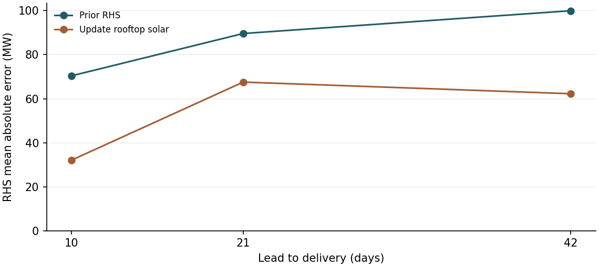
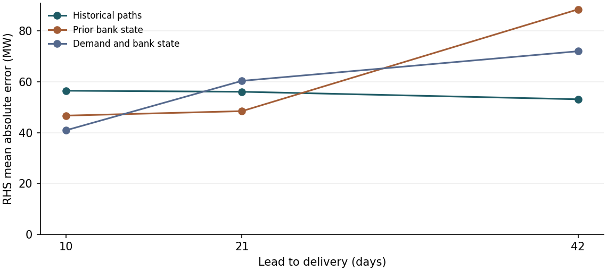

# Forecasting NEM dispatch constraints beyond seven days

## What to inject first

Use the dispatch formula at delivery. Give it complete operating scenarios built from information available at issue. AEMO's long-range adequacy reports supply regional energy, demand and availability assumptions. Historical electrical measurements supply plausible combinations of plant injections, line flows and device positions. The two sources have different resolution and uncertainty. [AEMO PASA](https://www.aemo.com.au/energy-systems/electricity/national-electricity-market-nem/nem-forecasting-and-planning/forecasting-and-reliability/projected-assessment-of-system-adequacy)

- **Rooftop solar can be worth forecasting explicitly.** On 12 complete half-hours per lead, updating the prior SA operating state with a solar-elevation-adjusted forecast reduced full-equation error from 100.0 to 62.3 MW at 42 days. Its value depended on the active branch.
- **Spend network-data effort where it changes the answer.** For the NSW–Queensland MAXGEN equation, selecting historical paths by the earlier capacitor/reactor configuration improved 21-day RHS error from 56.1 to 48.5 MW. At 42 days that choice increased error to 88.5 MW. Four morning half-hours per lead support this comparison. Use the spread of plausible paths at longer leads.
- **Retain independent forecasts for the reported directional limits.** At 21 days, the direct seasonal benchmark beat the demand-conditioned equation scenarios in all four directions. Binding alerts also require a forecast of weighted dispatch on the left-hand side. The issued-demand screen found 2 of 2 routine QNI binding half-hours with 43 false alerts and missed 17 of 17 VNI positives at the 25% cutoff.

The tests use 10, 21 and 42 days as representative leads for 8–14, 15–28 and 29–56 days. Scores apply to the tested leads and February 2026 samples. Every market time is an interval end in fixed UTC+10. [Candidate equation screen](screen.csv) · [Routing register](routing.csv)

## Directional limits and binding

Mean absolute error in MW for the reported tight half-hour limit at 21 days, four routine dates. Import uses the project's signed directional convention. Each forecast route is evaluated on the same delivery rows within a direction.

| link   | target   |   clock equation |   issued demand |   seasonal direct |
|:-------|:---------|-----------------:|----------------:|------------------:|
| qni    | export   |            660.7 |           692.9 |             210.8 |
| qni    | import   |            182.7 |           175.1 |             158.2 |
| vni    | export   |            407.8 |           457.3 |             210.6 |
| vni    | import   |            280.5 |           343.8 |             194.1 |

### QNI and VNI dispatch and limit experiment

All times are fixed NEM time. The forecast origin is midnight 10, 21 or 42 calendar days before each delivery day. Four routine Wednesdays (4, 11, 18 and 25 February 2026) contribute 192 half-hours per connector and lead. A separate stress day per connector maximised the representative equation’s five-minute economic bind count among disjoint February dates: 8 February for QNI and 17 February for VNI. Dates selected on outcomes describe stress behaviour, not event prevalence. Four earlier November delivery days (23, 24, 26, 28) set error bands. Their November archive was created 8 December, before the first February test origin. Calibration and evaluation reuse correlated half-hours.

The QNI thermal case N>>NIL_85_86_S v1, effective 22 September 2025, includes Waratah protection headroom, registered plant power, ratings and status gates. Its link coefficient is −0.986. The VNI voltage case V^^N_NIL_1 v1, effective 31 October 2024, includes Portland load, reactive power, pump power and discrete equipment counts. Its coefficient is +1. Both are ≤ dispatch equations. Earlier QNI studies also established a separately replayable stability expression, N::Q_NIL_KC. We test it numerically with a distinct formula and archive target. The two main equations have usable exact-version records throughout the tested windows. Invocation is assumed for these snapshots. This selection does not test detection of other newly invoked equations.

**Direct route.** The seasonal baseline forecasts each reported signed directional limit as its median in pre-October 2025 history (from January 2024), at the same clock and weekend class within ±35 calendar days of its annual delivery date. The comparator uses the minimum of six native directional limits in each historical half-hour. Original pre-origin DispatchIS persistence carries the last sampled interval labelled five minutes before midnight, checking both creation and nested-file timestamp. Original reports were recovered for every routine and stress origin. Eleven earlier archive dates returned 404. For original-report persistence the 21- and 42-day calibration bands remain unavailable and the 10-day band uses one calibration day. The monthly archive persistence rule uses only the last completed archive whose original header predates origin and is a stale-feed fallback. Historical client receipt was not recorded.

**Equation route.** Seven complete training days (23–29 September 2025) supplied matched same-clock five-minute dispatch states. September’s archive was created 8 October, before the earliest forecast. Clock scenarios give all seven days equal weight. Issued-demand scenarios select the three nearest NSW and adjacent-region half-hour demands, scaled by their training standard deviations, using one original MT PASA weekly-energy vintage converted to half-hour demand by the feed study. Each retained analogue carries one coherent RHS, LHS, signed flow and competing-equation envelope. This estimates joint operating states of the two complex equations. It does not independently forecast all their meter readings, switching configurations or other units’ bids.

For link coefficient a, the candidate signed flow bound is F + (RHS − LHS)/a. Each native analogue intersects this bound with its reconstructed competing-equation envelope in the appropriate direction. The opposite direction uses that envelope alone. We take the minimum of the six export values and the minimum of the six negated signed lower bounds, then average paths. An additional empirical bridge applies the median training-period difference between each envelope and the corresponding reported directional limit. Its errors appear as adjusted export and adjusted import in the scorecard. The scenario calculation holds the analogue dispatch pattern fixed. Reported limits are dispatch-solution outputs and can differ substantially from a conditional physical envelope.

For QNI’s stability equation we also explicitly calculate 1383 − 0.001(i+d)² − 0.0239N + 0.0524Q − 0.6394d on each five-minute path. Here i is an analogue of signed initial Directlink MW and d is Terranora MW (verified monitor with the 10,000 MW offset removed). N and Q are regional-demand proxies. The issued route injects the forecast NSW and Queensland half-hour demands. The clock route uses matched historical regional demand. No future pumps are observed or added. Score differences include eligible-load definition errors and regional forecast errors.

### Reported limit and RHS error

Mean absolute error in MW. Reported directional limits use tight half-hour targets. RHS uses a six-interval mean; minimum signed headroom and native RHS/LHS paths are available separately. A blank cell denotes a quantity outside the route’s output.

| link   | method                       |   lead |   export |   import |   rhs |    kc |
|:-------|:-----------------------------|-------:|---------:|---------:|------:|------:|
| qni    | carry last published archive |     10 |    248.3 |    314.4 | 241   |  21.1 |
| qni    | carry last published archive |     21 |    237.4 |    311.9 | 245.8 |  22.2 |
| qni    | carry last published archive |     42 |    239.6 |    316   | 284.4 |  24   |
| qni    | clock equation               |     10 |    660.7 |    182.7 |  68.5 |  35.1 |
| qni    | clock equation               |     21 |    660.7 |    182.7 |  68.5 |  35.1 |
| qni    | clock equation               |     42 |    660.7 |    182.7 |  68.5 |  35.1 |
| qni    | issued demand                |     10 |    692.9 |    175.1 |  71.9 |  30.8 |
| qni    | issued demand                |     21 |    692.9 |    175.1 |  71.9 |  30.8 |
| qni    | issued demand                |     42 |    692.9 |    175.1 |  71.9 |  30.8 |
| qni    | last original DispatchIS     |     10 |    246.6 |    257.3 | 236.9 |  22.1 |
| qni    | last original DispatchIS     |     21 |    269.1 |    240.7 | 239.9 |  22.5 |
| qni    | last original DispatchIS     |     42 |    254.2 |    267   | 263.3 |  22   |
| qni    | seasonal direct              |     10 |    210.8 |    158.2 | nan   | nan   |
| qni    | seasonal direct              |     21 |    210.8 |    158.2 | nan   | nan   |
| qni    | seasonal direct              |     42 |    210.8 |    158.2 | nan   | nan   |
| vni    | carry last published archive |     10 |    600.9 |    274.2 |  49.3 | nan   |
| vni    | carry last published archive |     21 |    592   |    254.8 |  44.1 | nan   |
| vni    | carry last published archive |     42 |    631   |    254.4 |  50.5 | nan   |
| vni    | clock equation               |     10 |    407.8 |    280.5 |  52.4 | nan   |
| vni    | clock equation               |     21 |    407.8 |    280.5 |  52.4 | nan   |
| vni    | clock equation               |     42 |    407.8 |    280.5 |  52.4 | nan   |
| vni    | issued demand                |     10 |    457.3 |    343.8 |  71   | nan   |
| vni    | issued demand                |     21 |    457.3 |    343.8 |  71   | nan   |
| vni    | issued demand                |     42 |    457.3 |    343.8 |  71   | nan   |
| vni    | last original DispatchIS     |     10 |    580.4 |    416.7 |  64.4 | nan   |
| vni    | last original DispatchIS     |     21 |    647.5 |    513.6 |  82.6 | nan   |
| vni    | last original DispatchIS     |     42 |    578.9 |    344   |  60.7 | nan   |
| vni    | seasonal direct              |     10 |    210.6 |    194.1 | nan   | nan   |
| vni    | seasonal direct              |     21 |    210.6 |    194.1 | nan   | nan   |
| vni    | seasonal direct              |     42 |    210.6 |    194.1 | nan   | nan   |

### Probability screen and forecast bands

An analogue path casts a positive half-hour vote if its representative equation bound economically in at least one native interval, using absolute nonintervention marginal value above 0.00001. This is an empirical scenario frequency estimating future economic binding. It is distinct from a calculation of joint forecast physical headroom. Seven clock paths or three demand-matched paths yield coarse probability steps. Carry-forward probabilities are zero or one. A 25% cutoff is shown to expose the tradeoff. The evidence files also contain 10% and 50% cutoffs.

| link   | partition   | method                       |   n |   event_days |   positives |   tp |   fp |   fn |
|:-------|:------------|:-----------------------------|----:|-------------:|------------:|-----:|-----:|-----:|
| qni    | routine     | carry last published archive | 192 |            1 |           2 |    0 |    0 |    2 |
| qni    | stress      | carry last published archive |  48 |            1 |          18 |    0 |    0 |   18 |
| qni    | routine     | clock equation               | 192 |            1 |           2 |    2 |   54 |    0 |
| qni    | stress      | clock equation               |  48 |            1 |          18 |   14 |    0 |    4 |
| qni    | routine     | issued demand                | 192 |            1 |           2 |    2 |   43 |    0 |
| qni    | stress      | issued demand                |  48 |            1 |          18 |   13 |    0 |    5 |
| qni    | routine     | last original DispatchIS     | 192 |            1 |           2 |    0 |    0 |    2 |
| qni    | stress      | last original DispatchIS     |  48 |            1 |          18 |    0 |    0 |   18 |
| vni    | routine     | carry last published archive | 192 |            1 |          17 |    0 |    0 |   17 |
| vni    | stress      | carry last published archive |  48 |            1 |          12 |    0 |    0 |   12 |
| vni    | routine     | clock equation               | 192 |            1 |          17 |    0 |    0 |   17 |
| vni    | stress      | clock equation               |  48 |            1 |          12 |    0 |    0 |   12 |
| vni    | routine     | issued demand                | 192 |            1 |          17 |    0 |    5 |   17 |
| vni    | stress      | issued demand                |  48 |            1 |          12 |    0 |    1 |   12 |
| vni    | routine     | last original DispatchIS     | 192 |            1 |          17 |    0 |    0 |   17 |
| vni    | stress      | last original DispatchIS     |  48 |            1 |          12 |    0 |    0 |   12 |

The bands use the higher 90th percentile of absolute forecast errors from four calibration days, per method, target, connector and lead. Width is full MW width. A stable level is not sufficient for production calibration.

| link   | target   |   lead |   calibration_n |   width |   coverage |
|:-------|:---------|-------:|----------------:|--------:|-----------:|
| qni    | headroom |     21 |             192 |  2373.2 |        1   |
| qni    | export   |     21 |             192 |  6851.5 |        1   |
| qni    | import   |     21 |             192 |  1235.1 |        0.9 |
| vni    | headroom |     21 |             192 |  1830.7 |        0.9 |
| vni    | export   |     21 |             192 |  2339.3 |        1   |
| vni    | import   |     21 |             192 |  1598.5 |        0.9 |

### Network recommendation

At 21 days the direct seasonal reference beat both dated-origin persistence and the analogue envelope in all four routine directions. Issued demand reduced the explicit QNI stability error from 35.10 to 30.81 MW relative to the clock analogue, although original DispatchIS persistence scored 22.5 MW. The issued-demand event screen caught both routine QNI positives with 43 false calls, and missed all 17 routine VNI positives with five false calls. Routine events occurred on one of four days per link. The QNI and VNI headroom bands covered 97.9% and 90.6% of outcomes, but their full widths were 2,373 and 1,831 MW. Use the direct historical forecast and a dated origin reading as benchmarks for all four directions. Keep analogue-based dispatch outputs as conditional scenarios, particularly on directions where an empirical shift is needed to align an envelope with AEMO’s reported limit. For a high-value direct equation, investigate the inputs that move its bound jointly with dispatch before investing in a market-wide solver. The scope here includes no private offers, future observed dispatch or fitted out-of-sample interconnector targets as predictors. One month of delivery dates and two outcome-selected stress days cannot establish seasonal skill or a production alert threshold.

[Interval forecasts](network/predictions.csv) · [All errors, widths and coverage](network/scores.csv) · [Alert tradeoffs](network/alerts.csv) · [Native RHS/LHS forecasts](network/native_predictions.parquet) · [Dispatch archive lineage](network/archive_sources.json) · [Original origin reports](network/anchor_sources.json)

## Rooftop solar and MAXG

For this SA equation, keep the regional entered PV estimate and the SAPN-controlled MW as separate inputs. On the ordinary PV-sensitive branch, an additional 100 MW in the entered solar estimate lowers the RHS by approximately 37.05 MW **while the same branch remains selected**. Each additional MW of controlled PV lowers it by 0.36 MW on that branch. An illustrative 5 MW RHS error budget therefore allows about 13.5 MW of entered PV error with every other input fixed. The observed long-lead regional forecast errors are much larger. Run low, central and high PV paths through the maximum and the flags; a fixed coefficient alone loses the transition to the insensitive branch. [Native replay and branch tests](solar/case_replays.csv)

### When SA rooftop generation changes the dispatch RHS

The South Australian MAXG equation V::S_NIL_MAXG_1 (dispatch version 1, effective 8 December 2025) subtracts the larger of a statewide maximum-generation term and a gated metropolitan term from its remaining line-flow, load and trader contributions. With fewer than two Black Range capacitors in service, the expression selects the 10,000 MW bypass. The gated term is (1.2 × metropolitan maximum + 0.36 × total distributed PV) multiplied by the daytime and metro-generation status flags. The statewide maximum includes individual or grouped trader injections, analogue values and Murraylink initial MW. This is a South Australian worked example. It supplies no evidence of direct rooftop exposure for a QNI or VNI equation.

On the ordinary PV branch the shared expression is entered regional solar MW × (1 + 65/2,228) + SAPN-controlled PV MW. The effective formulation supplies those two constants. The override uses the positive product of the period flag and the HDRESS analogue when that analogue is below 10,000. If that product is nonpositive the ordinary branch applies. Keep the entered estimate, separately measured controlled PV, override and period flag distinct. When regional demand already reflects PV, change only the PV deviation from the embedded assumption in any net-load scenario. Preserve the explicit solar term in the MAXG expression.

Independent calculation matched all 72 official five-minute nonintervention RHS results within 0.00000050 MW. These are three two-hour windows on 1, 15 and 19 February 2026, originally selected for another study. In 48 midday intervals the metropolitan term controlled the result. A 1 MW increase in entered PV lowered the RHS by 0.37050 MW, while 1 MW more controlled PV lowered it by 0.36 MW. A joint increase of 100 and 10 MW respectively lowered the RHS by 40.65 MW. In the other 24 intervals the statewide branch controlled and these perturbations had zero effect. For a 5 MW error allowance on the sensitive branch, the entered solar forecast alone must be within 13.5 MW, holding the other terms fixed. No historical sample activated the override. Forcing a 500 MW override on midday cases increased the calculated RHS by 453.8 MW on average. That is a branch scenario.

### What can be forecast at the three leads

All 16 sampled origin-matched public rooftop forecasts ended seven days and four hours after the origin. None covered a 10-, 21- or 42-day target. We estimated regional PV from original SA measurement reports created and timestamped in the archive before each midnight forecast origin. The first method repeats the latest available observation for that delivery clock. The second takes the previous 14 observations' median. The third adjusts the historical readings for the seasonal change in solar elevation before taking their median. It uses flat horizontal geometry at Adelaide, approximate mid-interval sun position and a median fallback near the horizon. Cloud fields, panel orientation and installed-capacity changes remain unmodelled.

The routine set uses all 48 half-hours on each of four preassigned Sundays (1, 8, 15 and 22 February). The table reports mean absolute error in MW across the 96 interval endings from 07:00 to 18:30 fixed NEM time at each lead. Sunrise, evening and night comparisons, bias and tail errors are also retained. The target is AEMO's contemporaneously published regional PV estimate. A site-level allocation is unnecessary for this regional input. Controlled rooftop generation is a separate population and would need independent calibration.

| method                          |   10 days |   21 days |   42 days |
|:--------------------------------|----------:|----------:|----------:|
| 14-day same clock median        |     297.8 |     349.6 |     412.1 |
| geometry-adjusted 14-day median |     253.8 |     271.3 |     305.9 |
| last published clock            |     196.7 |     274.2 |     332.2 |

A retrospective stress day, 28 February, had the lowest daily regional PV total of the month. The elevation-adjusted method's 42-day error rose to 904.7 MW across its 24 daylight-clock intervals. Selection used the realised stress event only for evaluation. Seven native-clock historical errors produced symmetric bands separately for each method and lead. Each calibration prediction used the same horizon, only information available at its own origin, and calibration outcomes present before the evaluated forecast. Missing seven qualifying residuals suppresses the band. Routine coverage for the elevation-adjusted method was 10 days 75% (96/96 slots eligible); 21 days 76% (96/96 slots eligible); 42 days 0% (24/96 slots eligible). A small number of adjacent calibration days does not establish a reliable interval for another weather regime.

### Conditional input error and complete-equation forecasts

The regional public estimate and the dispatch-entered solar value are distinct. Substituting even the *target-time* regional half-hour measurement for the entered five-minute value introduced 9.33 MW average absolute RHS error on the 48 sensitive intervals, keeping every other input observed. The independent regional value differed from entered solar by 25.19 MW on those intervals. The public data alone do not identify how much is timing, interval aggregation or source definition. For forecast PV injected into otherwise observed cases, elevation-adjusted native RHS error was 20.58, 17.99 and 10.02 MW at 10, 21 and 42 days over all 72 cases. These are conditional contributions, not full RHS forecast errors. Each predicted half-hour PV is held across its six intervals and passes through the complete nonlinear formula.

For a full forward benchmark, select the same delivery-clock five-minute case two calendar days before forecast issue. Its trading-day release cycle and original member timestamp both precede the cutoff. Carry that joint historical equipment, unit, transfer, override and load state through the dispatch expression and replace only the regional PV input with the respective lead-time projection. The carry baseline repeats that prior case's published RHS. The issue-time calculation assumes this equation remains invoked. It does not predict economic binding. The table scores half-hour means only when all six native predictions and labels exist, on 12 complete half-hours per method and lead across the three target windows. The saved file also contains each native predicted and actual branch.

| method                                    |   10 days |   21 days |   42 days |
|:------------------------------------------|----------:|----------:|----------:|
| 14-day same clock median                  |      31.4 |      78.5 |      84.1 |
| geometry plus controlled electrical share |      31.0 |      67.1 |      62.8 |
| geometry-adjusted 14-day median           |      32.1 |      67.5 |      62.3 |
| last published clock                      |      58.5 |      75.7 |      90.1 |
| prior published clock RHS                 |      70.4 |      89.6 |     100.0 |

The controlled-electrical-share variant also changes SAPN-controlled PV in proportion to its share of regional entered PV in the pre-origin same-clock case. It holds the earlier value when that denominator is 50 MW or less. Against holding controlled PV fixed, the joint update changed MAE by about −1.1, −0.4 and +0.5 MW at 10, 21 and 42 days. All projected branches matched the delivery branch in these windows, and none of the 72 delivery intervals had a nonzero economic marginal value for this equation. Operating transitions and SA binding alerts therefore remain untested.

Use both the joint prior-state baseline and PV-adjusted scenarios. Region-wide solar accuracy and RHS usefulness can rank estimators differently because the branch gates, transfer, metro generation and bypass can dominate the error. Switch the simulated plant and topology path jointly with the renewable path when better dated schedules exist. The QNI/VNI study should use its own scoped terms and cannot inherit these coefficients.

[AEMO dispatch formulation operations](https://aemo.com.au/-/media/files/stakeholder_consultation/consultations/nem-consultations/2023/constraints-implementation-guidelines/final-constraint-implementation-guidelines-v3.pdf) · [Original regional PV measurements](https://www.nemweb.com.au/Reports/ARCHIVE/ROOFTOP_PV/ACTUAL/) · [Issued rooftop forecasts](https://www.nemweb.com.au/Reports/ARCHIVE/ROOFTOP_PV/FORECAST/) · [Public NEMDE file publication cycle](https://www.aemo.com.au/-/media/files/electricity/nem/it-systems-and-change/nemde-queue/nemde_queue_users_guide.pdf) · [Five-minute inputs and replay](solar/case_replays.csv) · [Regional scores and band eligibility](solar/pv_metrics.csv) · [Forecast horizon audit](solar/issued_coverage.csv) · [Full five-minute forecasts](solar/full_forecast.csv) · [Full half-hour scores](solar/full_scores.csv) · [Source hashes](solar/source_hashes.json)

## Forecasting the dispatch A and S terms together

The full NSW–Queensland MAXGEN equation includes signed Terranora and Muswellbrook load, an embedded Far North NSW load program, multiple capacitor and reactor groups, and the largest of eleven plant injections. Replaying its 2 December 2025 version against 90 native case outputs puts the largest discrepancy below 0.000001 MW. Other equation versions were excluded from that check. The scenario model evaluates this program for each native historical state before averaging six values. It preserves correlations between load, generation and switch positions. [Independent replay](points/qni_replay.csv) · [Native case extractor and formula](points/run.py)

Mean absolute error in MW of the half-hour average RHS. Each column holds four complete half-hours ending 10:30 on 4, 11, 18 and 25 February. “Clock” uses all eligible historical paths. “Last sampled state” carries the most recent eligible weekly case path. Nearest-demand routes use the three closest earlier mornings. Bank matching uses a six-device Tamworth state vector. The peak-based demand comparator scales a historical profile to the issued adequacy peak. Weekly energy uses the issued energy total. The analogue matches forecast regional demand to the historical case's initial regional demand, so differences between demand definitions also enter its error.

| method                        |   10 |   21 |   42 |
|:------------------------------|-----:|-----:|-----:|
| clock                         | 56.5 | 56.1 | 53.1 |
| clock demand analogue         | 76.3 | 76.3 | 68.3 |
| demand plus bank analogue     | 40.9 | 60.4 | 72.0 |
| issued demand analogue        | 95.3 | 96.7 | 96.7 |
| issued weekly energy analogue | 94.1 | 94.1 | 86.1 |
| last sampled state            | 70.6 | 75.0 | 63.7 |
| prior bank configuration      | 46.7 | 48.5 | 88.5 |

The first Tamworth capacitor contributes 120 × 0.2091 = **25.092 MW** when on, with other terms fixed. The two sampled Tamworth reactor inputs each contribute −10.455 MW when on. A plan that changes a device may also change the line loading and other dispatch inputs. Use those single-device numbers for sensitivity. Draw the feeder, generator and switch path together for a complete RHS scenario. Historical paths and their min/max range describe observed alternatives; their range carries no prescribed probability. [Whole-path predictions and realised values](points/coherent_predictions.csv) · [Scenario members](points/scenario_paths.csv)

### Breakers and apparent power at a named terminal

At the Ararat end of the Ararat–Stawell 66 kV line, the measured quantity is a state-estimated MVA value. We grouped historical readings by the simultaneous reported state of Ararat breaker F and Stawell breaker B. At each native interval, the forward predictor uses the most recent eligible case's state pair, then takes the historical median loading for that configuration and clock. A separate diagnostic supplies the realised state pair to isolate the potential value of knowing it. The two breaker IDs are operating-state indicators. A circuit diagram and dated switching instruction are needed to infer a unique physical state from an outage booking.

| method                          |   10 |   21 |   42 |
|:--------------------------------|-----:|-----:|-----:|
| clock median                    |  3.6 |  3.7 |  3.7 |
| known delivery state diagnostic |  3.6 |  3.7 |  3.7 |
| last flow                       |  7.9 | 10.2 | 11.0 |
| previous state                  |  3.6 |  3.7 |  3.7 |

The previous state pair differed from delivery on 0, 0 and 0 of 24 routine native intervals at 10, 21 and 42 days respectively. Unknown future states stay as separate configurations, each with the support count and conditional terminal loading in the download. [Conditional loading scenarios](points/breaker_scenarios.csv) · [Scores and denominators](points/breaker_scores.csv)

The quiet Ararat–Stawell sample understates the difficulty of forecasting a switching device that actually moves. For the Portland wind farm CNS 66 kV breaker, carrying the earlier sampled state missed **12/24, 14/24 and 16/24** routine native readings at the three leads. The corresponding stress-window counts were 4/12, 0/12 and 6/12. Six observations from one half-hour are correlated. For a material Portland status term, keep the two feasible operating branches explicit until a dated switching instruction or a validated plant-state model distinguishes them. [Device observations and predictions](points/predictions.csv)

### Other difficult measurements

Mean absolute errors at 21 days on the same routine mornings. Each row uses its stated engineering unit. These three marginal input benchmarks use persistence, a same-clock historical median or the three earlier days closest to a four-signal historical state vector. They test whether an input deserves a separate feed. The full NSW MAXGEN experiment above uses coherent native paths.

| point                       |   Earlier reading |   Clock median |   Three state analogues |
|:----------------------------|------------------:|---------------:|------------------------:|
| Armidale transformer MW     |              26.6 |           18.3 |                    24.9 |
| Armidale–Tamworth MVA       |             202.7 |          102.4 |                   153.5 |
| Armidale transformer MVAr   |               5.8 |           12.1 |                     7.2 |
| Bus voltage kV              |               0.7 |            0.3 |                     0.5 |
| Red Cliffs–Wemen rating MVA |              58.2 |           71.4 |                    28.0 |
| Tarong battery signed MW    |              52.5 |           97.6 |                    71.0 |
| Shoalhaven pump MW          |              63.7 |           59.9 |                    91.0 |
| Basslink prior target MW    |              84.1 |           69.5 |                    37.1 |
| Bango full RHS MW           |               5.7 |           10.5 |                    23.3 |

For unit commitment and pumping, sample entire operating combinations. For storage, publish separate signed power paths until a dated energy and availability forecast can constrain them. A flat inertia or switch observation during a small evaluation offers no test of transition behaviour. Dynamic ratings and apparent power have different error mechanisms even though both are measured in MVA. Collect a terminal-specific rating before investing in a more detailed MW model. [All input scores, biases and earlier calibration widths](points/scores.csv)

## Public demand, availability and outages

### Issued regional demand and offered capacity

The public MT PASA regional availability product supplies regional planning demand and offered scheduled generation capacity for target delivery days. Its DEMAND50 field describes a most probable peak as-generated demand excluding non-scheduled generation and scheduled load. Its weekly ENERGYREQDEMAND50 describes operational as-generated consumption excluding scheduled load in GWh. Both have different temporal and physical definitions from a five-minute equation-specific regional demand input. [AEMO MT PASA process, Appendix F](https://wa.aemo.com.au/-/media/files/electricity/nem/planning_and_forecasting/pasa/mt-pasa-process-description-v62.pdf?la=en) · [AEMO report timing and public visibility](https://markets-portal-help.docs.public.aemo.com.au/Content/MTPASA/MTPASAreports.htm)

The pilot selected one coherent original report for NSW, Queensland and Victoria at midnight on the delivery date minus 10, 21 or 42 days, in fixed NEM time. The report creation and original ZIP member modification had to precede that origin by more than 24 hours, allowing for the next-day public release. Publication is inferred from the documented release and preserved source times. Client receipt is unavailable. The retained extracts identify the member, checksum, generation, source fields, offer date and delivery day. [Vintage extracts](feeds/pasa_issued.csv) · [Original MT PASA archives](https://www.nemweb.com.au/Reports/ARCHIVE/MTPASA_RegionAvailability/)

The clock benchmark averages observed regional demand at each delivery time on five matching weekdays one year earlier (364 days earlier plus or minus zero, seven and fourteen days). For the daily-peak method, the recorded fraction of each training day's maximum scales the issued daily peak. For the weekly-energy method, the clock profile is divided by the corresponding average hourly MW over five matched historical weeks and multiplied by the issued GWh converted to weekly mean MW. Each historical week and its profile come from before origin. The conversion respects the 04:00 NEM trading-day boundary. Both are research approximations to public dispatch TOTALDEMAND. An updated regional forecast from a user must still be matched to the equation's load definition.

MAE in MW on 192 complete half-hours per region at each lead, covering 4, 11, 18 and 25 February 2026. The three horizons gave the same demand values for all 576 region/half-hour combinations. Equal scores therefore reflect unchanged planning assumptions on these test dates.

| region   |   Historical clock |   Issued peak × shape |   Weekly GWh × shape |
|:---------|-------------------:|----------------------:|---------------------:|
| NSW1     |              925.6 |                2276.2 |                923.9 |
| QLD1     |              477.6 |                1430.9 |                521.5 |
| VIC1     |              698.0 |                2093.5 |                709.6 |

The weekly-energy route was close to the simple historical shape. Scaling to the MT PASA peak substantially overstated intraday demand. Use the weekly conversion and clock as joint baselines when only public data are available, and keep peak-based output for a planning sensitivity. The public regional offered capacity changed by as much as 1129 MW between the 42- and 10-day vintages. It constrains a regional supply scenario; an individual unit's on/off state or MW requires further evidence. [Regional half-hour predictions](feeds/regional_forecasts.csv) · [Separate November calibration and February stress results](feeds/regional_scores.csv)

### Scheduled outage sets at long leads

The original public network schedule specifies planned outage and linked set windows. A standing set is counted once per half-hour if any of the six native five-minute intervals is active. The direct test uses the delivery window in the schedule issued before origin. The matched baseline carries the set schedule at the same time of day on the origin date. Labels come from the archived nonintervention invocation register, including start and end interval timestamps. A supplementary previous-weekday comparator uses retrospectively reconstructed labels and is listed separately in the evidence. [AEMO network outage schedule](https://www.aemo.com.au/energy-systems/electricity/national-electricity-market-nem/data-nem/network-data/network-outage-schedule)

The common universe was frozen on 15 December 2025, before the earliest February forecast. It uses outage-linked sets seen in four earlier monthly NOS snapshots and standing equations with a nonzero QNI or VNI interconnector term. It contains 40 QNI sets and 33 VNI sets. An alternative, origin-listed universe is included in the evidence to identify coverage changes. Neither denominator covers outages with no observed set mapping. Standing membership uses effective/revision times as public-availability proxies, and different valid versions inside the forecast horizon can change actual scope. Each eligible NOS report was generated at least 30 minutes before origin. The absence of original workstation receipt times limits historical verification.

| Link   |   Lead (days) | Source                |   Hits |   False alerts |   Misses | Precision   | Recall   |
|:-------|--------------:|:----------------------|-------:|---------------:|---------:|:------------|:---------|
| QNI    |            10 | Delivery schedule     |     17 |              0 |       56 | 100.0%      | 23.3%    |
| QNI    |            10 | Carry origin schedule |      0 |              0 |       73 | n/a         | 0.0%     |
| QNI    |            21 | Delivery schedule     |     17 |              0 |       56 | 100.0%      | 23.3%    |
| QNI    |            21 | Carry origin schedule |      0 |            112 |       73 | 0.0%        | 0.0%     |
| QNI    |            42 | Delivery schedule     |      0 |              0 |       73 | n/a         | 0.0%     |
| QNI    |            42 | Carry origin schedule |      0 |              0 |       73 | n/a         | 0.0%     |
| VNI    |            10 | Delivery schedule     |      0 |              0 |        0 | n/a         | n/a      |
| VNI    |            10 | Carry origin schedule |      0 |              0 |        0 | n/a         | n/a      |
| VNI    |            21 | Delivery schedule     |      0 |              0 |        0 | n/a         | n/a      |
| VNI    |            21 | Carry origin schedule |      0 |              0 |        0 | n/a         | n/a      |
| VNI    |            42 | Delivery schedule     |      0 |              0 |        0 | n/a         | n/a      |
| VNI    |            42 | Carry origin schedule |      0 |              0 |        0 | n/a         | n/a      |

The fixed VNI cohort had zero active positives in the routine sample, so its recall is unmeasurable. Updating the universe to the sets actually listed in each origin's vintage changes coverage. Among those origin-listed sets, the 10-day QNI schedule returned 80 hits, two false alerts and 135 misses. The 10-day VNI schedule returned 120 hits, 36 false alerts and 58 misses. Longer-horizon origin-listed scores have different denominators. These results favour explicit scenarios for both missing links and changes to known work.

Hits, false alerts and misses count set/half-hour combinations. Repeated half-hours within a single outage are correlated. The four routine Wednesdays and two selected stress dates provide a check of the issued schedule, not a season-wide estimate of accuracy. The target is invocation, which can differ from physical breaker state or the onset of an economic bind. Use the scheduled configuration alongside delayed or cancelled-work cases. [Outage scorecard](feeds/outage_scores.csv) · [Forecasts, target labels and original member IDs](feeds/outage_rows.csv) · [Set universes](feeds/set_universes.csv) · [Source hashes](feeds/source_hashes.json)

## Calculator handoff

| Input                                 | 8–56 day injection                                                                                                                      | When to report scenarios                                                                     |
|:--------------------------------------|:----------------------------------------------------------------------------------------------------------------------------------------|:---------------------------------------------------------------------------------------------|
| Regional demand                       | Shape weekly energy to delivery half-hours with a historical local profile; benchmark against the historical profile alone              | Peak and energy are different constraints on the load shape                                  |
| Distributed PV                        | Time-of-day solar-geometry profile for long leads; compare with the latest same-clock measurement                                       | Cloud variability and local controlled generation; keep separate estimate for each MAXG leaf |
| Local electrical load                 | Use named boundary and instrument an empirical share or whole historical path                                                           | Net exporters and large industrial loads change the local relationship                       |
| Scheduled load and pumping            | Sample joint unit and load paths; include hydro operating and idle states                                                               | Future pumping commitments can change the meaning of regional demand                         |
| Storage                               | Historical signed profile and idle/charge/discharge paths; constrain by available MWh where issue-time SOC exists                       | Public history here tests MW and does not validate a future SOC model                        |
| Plant output and commitment           | Use physically observed combinations of dispatch and unit status; retain the maximum over units in each scenario                        | An averaged unit-by-unit dispatch can understate the largest contingency                     |
| Signed line flow and terminal loading | Condition same-clock native paths on issued regional demand and earlier feasible configurations                                         | Topology or reactive loading unresolved; MW at the opposite end is insufficient              |
| Breaker and shunt operation           | Use original outage schedule when mapped to the device; otherwise use prior feasible configurations and separately evaluate each branch | Region-level schedule and set activation do not identify a breaker uniquely                  |
| Thermal rating                        | Verify standing rating then compare historical rating paths for dynamic equipment                                                       | Outages and dynamic conditions can invalidate a shoulder-season or nameplate fallback        |
| Voltage and reactive demand           | Use matching clock and operating configuration and retain native units                                                                  | Limited historical range or unobserved reactive controls                                     |
| Protection timer                      | Propagate state only for its valid duration; evaluate each feasible timer branch                                                        | Several weeks ahead the triggering incident or switching sequence is unknown                 |
| Offers and interconnector mode        | Use jointly observed directions and capacities; compare full availability and outage cases                                              | Zero transfer alone cannot identify zero availability                                        |
| Previous targets                      | Roll forward within each scenario or draw the full prior-period operating path; compare same-clock history                              | Observed delivery-period targets would leak the future                                       |
| Entered settings and overrides        | Carry only a dated setting valid at delivery; perturb each leaf and evaluate full conditional expression                                | Unannounced operator actions require a range or conditional sensitivity                      |
| Invocation and LHS                    | Forecast eligible set and a coherent LHS; compare several alert thresholds                                                              | A forecast RHS can be accurate while another constraint sets the directional limit           |

For a custom regional scenario, bind each delivery to one origin and retain the source run IDs. Change a net demand forecast only by the difference from the PV assumption already embedded in it. Evaluate the effective dispatch formula inside every feasible path. Record invocation, RHS, LHS and signed headroom, then take the tight directional limit across six complete native intervals. When no prospective device mapping or operator setting exists, disclose which assumption changes the decision and the two resulting limits. [Download the input register](routing.csv)

## Limits of the experiment and reproducibility

The screen cross-references 165 connector/direction/equation records from the September 2025 historical influence analysis with the typed dependency inventory of 4 February 2026. The inventory is a retrospective crosswalk and some equations or versions have no match. Long-range historical receipt by the user's system is unobserved. The studies enforce availability using dated public source records or a conservative delay, documented for each experiment. They test public stand-ins for the user's own forecasts. Evidence on one season or a few independent event dates cannot support a production alert cutoff.

The terminal pilot sampled Wednesday mornings from August 2025 to February 2026 and added 19 and 22 February as stress dates identified in earlier work. It omits 5 November because two native files had only over-constrained-dispatch rerun labels. The training library rolls forward using only case days at least two calendar days old whose archive timestamps precede origin. Its latest-state benchmark can consequently be older than an operational telemetry feed. December errors available before the earliest test origin calibrate the illustrative point-input bands. A separate command and source log are retained for each study. Files containing original forecast values, case member names and hashes are included in the evidence download.
