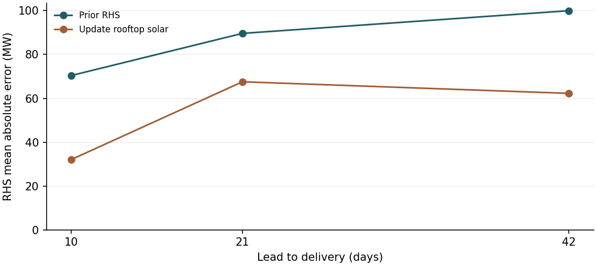
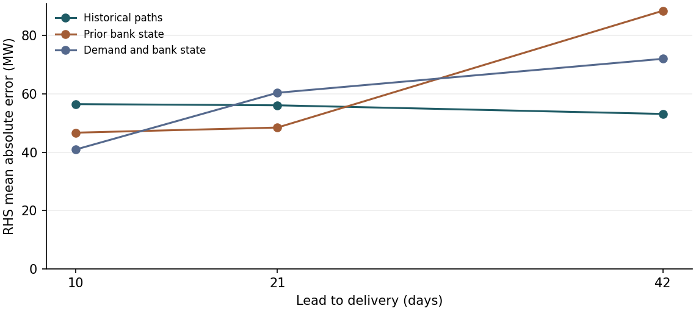

# From rooftop generation to interconnector headroom

## Dispatch constraints at 10, 21 and 42 days in the Australian National Electricity Market

An extra megawatt of rooftop generation can tighten a dispatch limit even as it reduces grid demand. In the South Australian equation examined here, the effect depends on which of two generation contingencies governs the calculation. Forecasting the solar input therefore has value only in conjunction with a forecast of the network state. The same distinction matters for interconnectors, where a second equation can take over as the limiting constraint. [South Australian dispatch replay](../rhs_8_56/solar/case_replays.csv) · [Interconnector method and evidence](../rhs_8_56/network/report.md)

- Across 72 South Australian five-minute intervals in February 2026, an additional 1 MW of entered rooftop generation lowered the right-hand side (RHS) by 0.371 MW in 48 intervals. In the other 24, the sensitivity was zero. [Solar replay](../rhs_8_56/solar/case_replays.csv)
- Updating the solar input in an earlier operating state reduced 42-day mean absolute RHS error from 100.0 to 62.3 MW across 12 South Australian half-hours. All 12 came from three dates. [Full-equation forecast scores](../rhs_8_56/solar/full_scores.csv)
- For one NSW–Queensland generation-contingency equation, matching historical capacitor and reactor positions cut 21-day RHS error from 56.1 to 48.5 MW. At 42 days, the same selection increased error from 53.1 to 88.5 MW. [Operating-state comparisons](../rhs_8_56/points/coherent_scores.csv)
- On four routine February Wednesdays, the seasonal benchmark gave the lowest 21-day error for all four reported directions on the Queensland–NSW and Victoria–NSW interconnectors. A demand-conditioned binding alert missed all 17 positive Victoria–NSW half-hours at its tested 25% threshold. [Directional scores](../rhs_8_56/network/scores.csv) · [Alert counts](../rhs_8_56/network/alerts.csv)

## The quantity being forecast

A dispatch constraint compares two quantities. The RHS specifies the permitted threshold under the equation version and operating state in force. The left-hand side (LHS) sums the relevant dispatch quantities with their signed coefficients. For an active upper-bound equation, the difference between RHS and LHS gives headroom. This study identifies economic binding from the dispatch marginal value and evaluates invocation separately. [AEMO constraint implementation guidelines](https://aemo.com.au/-/media/files/stakeholder_consultation/consultations/nem-consultations/2023/constraints-implementation-guidelines/final-constraint-implementation-guidelines-v3.pdf) · [Network experiment](../rhs_8_56/network/report.md)

A connector introduces a further step. If current flow is F and its coefficient in the equation is a, the candidate flow bound is F + (RHS − LHS)/a, holding other dispatch quantities fixed. The sign of a determines which direction the equation restricts. Other equations and dispatch conditions can impose a tighter bound. The outcome tested here is AEMO’s reported directional limit in the dispatch solution. Its interpretation as a maximum physical transfer capability would require a separate security assessment. [Directional-limit construction](../rhs_8_56/network/report.md)

## South Australia: the solar term changes with the governing contingency

The South Australian MAXG equation subtracts the larger of a statewide generation term and a metropolitan term from the remaining contributions. The metropolitan term depends on generation, distributed solar and operating flags. There is also a capacitor-dependent bypass. On the ordinary solar branch, the equation scales the regional entered solar estimate by 1 + 65/2,228 and adds separately measured SAPN-controlled solar. An override can replace the ordinary input. These are distinct quantities for the calculator to receive. [Equation definition, branches and source register](../rhs_8_56/solar/report.md)

When the metropolitan term governed, multiplying its solar coefficient of 0.36 by that regional scaling factor, then applying the outer subtraction, gave a final sensitivity of −0.3705 MW per additional MW of entered solar. Increasing the regional estimate by 100 MW and controlled solar by 10 MW lowered the limit by 40.65 MW in the tested midday cases. The same perturbation left the statewide-limited cases unchanged. A 5 MW error budget on the sensitive branch would allow about 13.5 MW of regional solar error with the other inputs fixed. None of the sampled cases exercised the override. [Five-minute perturbation and replay evidence](../rhs_8_56/solar/case_replays.csv)

The archived public solar forecasts examined ended seven days and four hours after issue. For the longer leads, the experiment used earlier same-clock solar readings and adjusted their median for the change in solar elevation. It then inserted that forecast into a complete, previously published network state. Holding the other inputs at their earlier values makes their subsequent movement part of the forecast error. [Issued horizon audit](../rhs_8_56/solar/issued_coverage.csv) · [Forecast construction](../rhs_8_56/solar/report.md)

| Full South Australian equation forecast | 10 days | 21 days | 42 days |
|---|---:|---:|---:|
| Carry the earlier same-clock RHS | 70.4 | 89.6 | 100.0 |
| Replace entered solar with its 14-day same-clock median | 31.4 | 78.5 | 84.1 |
| Adjust that median for solar elevation | 32.1 | 67.5 | 62.3 |
| Also update controlled solar using its earlier electrical share | 31.0 | 67.1 | 62.8 |

Mean absolute error in MW of the half-hour average RHS. Each column covers 12 complete half-hours from 1, 15 and 19 February 2026. Updating controlled solar delivered little additional accuracy here. None of the 72 native intervals had an economic bind, so the results establish sensitivity and RHS error only. [Matched scores](../rhs_8_56/solar/full_scores.csv)

Cloud cover sets a practical limit on this approach. On 28 February, the month’s lowest-output day, the 42-day solar-elevation estimate missed regional daytime output by about 905 MW on average. Only two of 24 daylight half-hours fell inside its earlier error band. For a forward calculation, run low, central and high solar paths through the full expression. If regional demand already incorporates solar, adjust demand by the change from its embedded assumption while preserving the explicit solar term in the equation. [Daylight and stress scores](../rhs_8_56/solar/pv_metrics.csv)

## NSW and Victoria: a line reading inherits the switching state

An analogue term measures a particular quantity at a named terminal. Active power carries direction in MW. Apparent power in MVA also depends on reactive loading. A state term identifies a device position. Combining an open-breaker reading with the line flow from an unrelated closed configuration can produce an internally inconsistent forecast even when each individual input looks plausible. The NSW pilot addressed this by drawing complete historical five-minute operating states and evaluating the equation before averaging the six results. [Historical operating paths](../rhs_8_56/points/scenario_paths.csv)

The NSW–Queensland generation-contingency equation combines Terranora and Muswellbrook load, a Far North NSW load calculation, switched reactive equipment and the largest of eleven plant injections. Its December 2025 version reproduced 90 native RHS values within 0.000001 MW. At Tamworth, one capacitor contributes 25.092 MW to the limit when switched on, with all other inputs fixed. Each of two reactors contributes −10.455 MW. The effect of an actual switching operation can differ because the flows and other injections move with it. [Independent replay](../rhs_8_56/points/qni_replay.csv) · [Term calculation](../rhs_8_56/points/run.py)

| Historical paths used for the NSW–Queensland generation contingency | 10 days | 21 days | 42 days |
|---|---:|---:|---:|
| All eligible paths at the delivery clock | 56.5 | 56.1 | 53.1 |
| Latest sampled path | 70.6 | 75.0 | 63.7 |
| Three paths closest to the earlier Tamworth bank configuration | 46.7 | 48.5 | 88.5 |
| Three paths closest to demand inferred from issued weekly energy | 94.1 | 94.1 | 86.1 |

Mean absolute RHS error in MW for four half-hours ending at 10:30 NEM time on 4, 11, 18 and 25 February 2026. At 42 days, the older bank configuration narrowed the set of historical paths in a way that worsened the forecast. Regional demand alone also gave a weak ordering of relevant network states. The sample is too small to establish a universal lead at which bank information loses value. [Path selection scores](../rhs_8_56/points/coherent_scores.csv)

The value of forecasting a breaker depends on whether it moves. At Ararat and Stawell, both sampled breaker indicators stayed unchanged in the routine windows. At the Portland wind farm, carrying the earlier CNS breaker position missed 12, 14 and 16 of 24 routine native readings at 10, 21 and 42 days. Where the breaker materially changes the equation, retain the feasible positions as separate cases until a dated instruction or a tested operating model distinguishes them. Six readings from one half-hour share much of the same operating history. [Breaker and point predictions](../rhs_8_56/points/predictions.csv)

## What an issued demand forecast and outage schedule can resolve

AEMO’s medium-term adequacy product supplies a most-probable regional daily peak and a weekly energy requirement. The peak and energy fields have different demand definitions and neither supplies the half-hour load directly. On the four routine dates, scaling a historical NSW profile to the daily peak produced about 2,276 MW mean absolute error. Scaling to weekly energy gave 924 MW, close to the historical clock benchmark’s 926 MW. The weekly-energy method was slightly worse than the clock benchmark in Queensland and Victoria. Treat the peak as a high-load scenario and test weekly energy as the central public input. [AEMO medium-term PASA process, Appendix F](https://wa.aemo.com.au/-/media/files/electricity/nem/planning_and_forecasting/pasa/mt-pasa-process-description-v62.pdf?la=en) · [Regional scores](../rhs_8_56/feeds/regional_scores.csv)

An outage booking supplies evidence about planned work. Translating it into a constraint set requires the applicable mapping, and translating it into a breaker position requires more information again. Across a fixed group of Queensland–NSW sets, the issued schedule identified 17 of 73 active set-half-hours at both 10 and 21 days, with zero false alerts. At 42 days it missed all 73. The fixed Victoria–NSW group had no positive observations. Restricting the test to sets listed in the relevant 10-day vintage produced 120 hits, 36 false alerts and 58 misses on Victoria–NSW. Those counts refer to a different population. [Issued schedules and matched invocation scores](../rhs_8_56/feeds/report.md)

## What reaches the reported interconnector limit

The network experiment compared a direct seasonal forecast of each reported limit with an equation-based forecast. The latter drew coherent historical values of RHS, LHS, flow and the bounds imposed by competing equations. It then used issued regional demand to choose comparable operating states. Each reported half-hour limit is the tightest of six complete five-minute directional limits. Signed values, including forced-flow conditions, are retained. [Network methodology and matched predictions](../rhs_8_56/network/report.md)

| Reported direction | Seasonal forecast | Demand-conditioned equation forecast |
|---|---:|---:|
| Queensland–NSW export | 210.8 | 692.9 |
| Queensland–NSW import | 158.2 | 175.1 |
| Victoria–NSW export | 210.6 | 457.3 |
| Victoria–NSW import | 194.1 | 343.8 |

Mean absolute error in MW at 21 days, using the study’s connector export and import conventions. Each direction has 192 half-hours from four February Wednesdays. For a separately evaluated Queensland–NSW stability equation, adding issued demand improved RHS error from 35.1 to 30.8 MW against the clock scenario. The last published RHS scored 22.5 MW. Better information about one term can improve an equation without improving the reported transfer limit. [Directional and equation scores](../rhs_8_56/network/scores.csv)

Binding was harder to classify. At a 25% alert threshold, the 21-day demand-conditioned forecast caught both routine Queensland–NSW positive half-hours with 43 false alerts. On Victoria–NSW it missed all 17 positives and generated five false alerts. The positives occurred on one routine day per link. The corresponding headroom bands covered 97.9% and 90.6% of routine outcomes, but their full widths were 2,373 and 1,831 MW. Those widths leave a wide range of commercially different outcomes consistent with the forecast. [Alert tradeoffs](../rhs_8_56/network/alerts.csv) · [Coverage and band widths](../rhs_8_56/network/scores.csv)

## Implications for the calculator

| Input | Treatment at issue |
|---|---|
| Rooftop generation and embedded load | Separate the regional entered estimate, controlled PV and override. Apply one coherent solar path to net demand and the explicit solar term. Evaluate the maximum and branch flags at five-minute resolution. |
| Line flows, breakers and shunts | Match terminal, sign and unit. Use a dated switching schedule where the device mapping is established. Otherwise carry complete, feasible combinations of flow and position. |
| Dynamic ratings, voltage and reactive power | Distinguish the applicable equipment rating from measured terminal loading. Carry alternative ratings where timing or weather is uncertain and keep kV, MW and MVAr in their native roles. |
| Generators, pumps, batteries and inertia | Sample joint commitment and signed injection paths. Apply energy bounds where state of charge is available. Calculate the maximum generator contingency within each path. |
| Prior targets, timers, offers and operator settings | Keep available capacity separate from transfer. Propagate the preceding simulated target within each path. Evaluate discrete timer and override states where the future instruction is unknown. |

The most useful output per half-hour is a conditional RHS and the change in that RHS when the material assumption moves. Report the LHS and headroom alongside it when there is a defensible dispatch forecast. For Queensland–NSW and Victoria–NSW, retain the independent seasonal limit as the decision benchmark until a forward equation model improves on it across independent event days. [Complete input routing register](../rhs_8_56/routing.csv) · [Engineering-unit forecast scores](../rhs_8_56/points/scores.csv)

## Sources and evidence

- **AEMO dispatch and formulation.** Effective equation versions and independent five-minute case checks. [Constraint implementation guidelines](https://aemo.com.au/-/media/files/stakeholder_consultation/consultations/nem-consultations/2023/constraints-implementation-guidelines/final-constraint-implementation-guidelines-v3.pdf) · [Study evidence and archive hashes](../rhs_8_56/manifest.json)
- **AEMO forecasts and schedules.** The comparisons used original public vintages and publication-time proxies. Historical receipt by the user’s system was unavailable. [Regional vintage extracts](../rhs_8_56/feeds/pasa_issued.csv) · [Issued solar forecast coverage](../rhs_8_56/solar/issued_coverage.csv) · [Outage-set definitions](../rhs_8_56/feeds/set_universes.csv)
- **Scope of inference.** All times use fixed NEM time (UTC+10). Leads of 10, 21 and 42 days represent the wider 8–56-day planning window. The routine connector sample used 4, 11, 18 and 25 February 2026. The separate connector stress days, 8 February for Queensland–NSW and 17 February for Victoria–NSW, were chosen for observed binding. Regional solar and equation replay used the distinct cohorts described above. Seasonal accuracy, performance with the user’s demand vintages and a production binding threshold remain unmeasured. [Original study and downloadable evidence](../rhs_8_56/index.html)
