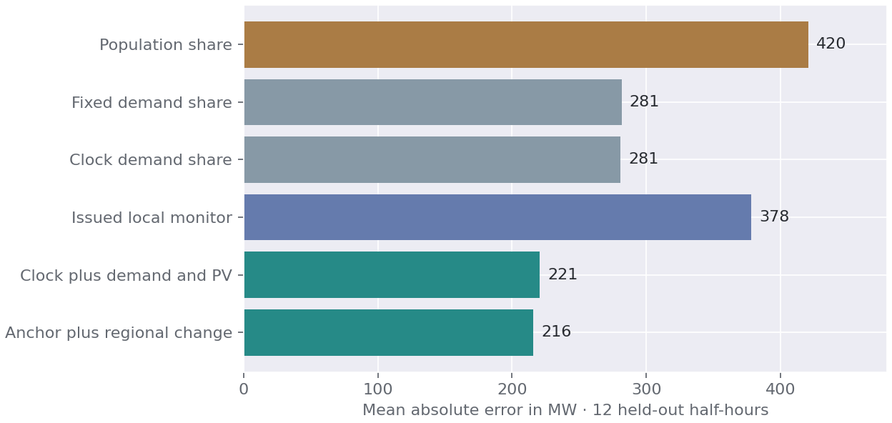

## What you can forecast from regional data

Use your regional forecast in a constraint equation when you can name the electrical quantity it changes. Start with the regional forecast you want to test, a recent public state available at issue, and the matching AEMO forecast run. The last two give you a baseline and, for some local loads, a direct forecast. A single regional MW value admits many combinations of flows, generation and switch positions. Each combination can produce a different RHS.

If regional demand is literally your **only future series**, a practical first model is the local share for that time of day multiplied by forecast regional demand. If a recent local measurement is available, also try **last local MW + historical share × change in regional demand**. If you also have issued rooftop PV, estimate the local response to demand and PV deviations from their delivery-clock averages. All three procedures can be fit against public historical electrical observations. Their relative accuracy varied by location and horizon.

For a custom scenario with a matching AEMO run, use the published RHS as a reference. Apply the difference between two evaluations of the *same* scoped equation, first with AEMO drivers and then your changed drivers. Leave unchanged inputs on the same vintage and record every quantity held fixed. On the sampled QNI dispatch expression, adding 100 MW of NSW demand and moving Terranora by its historical share shifted the RHS by **−2.61 to −2.53 MW**. This measures the assumed response. A change in generator commitment, topology or dispatch could move it again. [Scenario calculations](flows/injection_scenarios.csv)

To decide whether an approximation is good enough, work backwards from headroom. For example, Bango's rating coefficient is 1.197. If the RHS error budget for that term is 5 MW, its rating estimate must be within about **4.2 MVA** when the other terms are fixed. The 21 MVA gap between the applied rating and the equation fallback would already exceed that budget fivefold. Five MW is an illustrative tolerance. Set the actual tolerance from the decision the forecast supports, then measure how often the joint forecast stays inside it. [Bango inputs and sensitivities](thermal/input_metrics.csv)

## Which local demand estimate to use

We decoded five public constraint monitors. Their published RHS has a 10,000 MW offset in the checked predispatch definition. Subtracting it recovers the local value. The 12 held-out half-hours below cover mornings and late afternoons on 23, 25 and 28 February 2026. Each score is mean absolute error against six native observations per half-hour. Values are MW. “Clock share” needs only the regional forecast and history. “Anchor” also needs the most recent published local and regional state. “Demand + PV” also needs an issued regional rooftop-PV forecast. [Monitor definitions](local/definitions.csv) · [All scores, bias and uncertainty](local/scores.csv)

{{LOAD_TABLE}}

For broad Sydney, the population method assigned 66.97% of NSW-region demand to the Sydney, Newcastle–Maitland and Wollongong Significant Urban Areas, using NSW plus ACT population as the denominator. Day-ahead error was **420 MW** here and **412 MW** in a separate three-morning sample. The electrical clock share scored **281 MW** here and an earlier clock/day-type share **333 MW** in the morning-only sample. The issued local monitor scored **378 MW** here and **295 MW** in the earlier sample. Population missed both the load mix and intraday shape. Use it only to initialise a scenario where historical electrical labels are unavailable. [Earlier matched sample](context/earlier_scores.csv) · [ABS population release](https://www.abs.gov.au/statistics/people/population/regional-population/2023-24)

**Western Sydney requires a boundary decision.** The checked AEMO point covers Sydney, Wollongong and Newcastle. The public Sydney West 132 kV bulk supply point is a different target. Transgrid publishes historical site data and its planning material identifies other supply paths into Western Sydney. For a nominated BSP, fit the local model to that BSP's own trace after resolving signs, interval alignment and an unexplained June–July 2025 magnitude change. For a wider load pocket, obtain a dated list of boundary meters and sum coincident signed imports, exports and any adjustments required by the equation. Validate the reconstructed series against the named point. We have no error estimate for that wider target. [Source audit](context/sydney_sources.csv) · [Transgrid data portal](https://tapr.transgrid.com.au/) · [Western Sydney supply diagram](https://www.transgrid.com.au/media/wwpo0dlu/transgrid-pacr_macarthur.pdf)

We also ran the regional-share method directly against the Sydney West BSP workbook. Fitting the seven February 2026 training dates and testing twelve later half-hours, the day-ahead **clock-specific electrical share** had **2.95–3.10** mean absolute error in the workbook's signed units. A fixed share scored **3.34–3.59**, and a historical clock mean **3.72–4.00**. The range comes from testing both possible half-hour label alignments, assuming the workbook clock uses NEM time. The retrieved workbook was updated in September 2026, so this is retrospective evidence of fit to one site. It does not establish an available February feed or identify the wider area consumed by a constraint. [Sydney West predictions](local/sydney_west_predictions.csv) · [Site source and hash](local/sydney_west_source.json)

**Terranora needs a signed estimate.** The earlier sample included seven negative half-hours out of twelve. A positive population share cannot represent reverse net load. The issued monitor had **13.1 MW** day-ahead error on the later sample and **8.9 MW** on the earlier one. For short leads, the last local observation plus the change in regional demand scored **6.1 MW** on the later dates. [Held-out local predictions](local/predictions.csv)

## Generators, rooftop solar and batteries

Use unit MW where a term calls for a unit's initial injection. A region-level wind or solar forecast still needs a plant-level allocation. We fitted each plant's historical share of regional cleared wind or solar MW, then multiplied the share by the issued regional series. The anchor variant changes only the plant's starting MW by its share of the regional change. At short leads, recent plant MW was competitive. At previous-afternoon leads the share model improved on persistence at three plants in this sample. None of those comparisons verifies an operator-entered availability or wind-farm setting. [Inputs and vintages](local/forecast_inputs.csv) · [Unit-level scores](local/scores.csv)

{{GEN_TABLE}}

Regional rooftop PV was worth obtaining as a separate forecast. Its issued NSW mean had **116.5 MW** short-horizon and **217.8 MW** previous-afternoon error against AEMO's regional measurement estimate. A historical delivery-clock mean had **443.1 MW** error at both horizons. When applying PV locally, train against measured *net* local demand. Adding a second explicit PV subtraction to an already net series would count PV twice. [Forecast inputs](local/forecast_inputs.csv) · [Measurement provenance](context/rooftop_actual.json)

For batteries, a statewide price forecast alone performed poorly on the active unit. TARBESS1's previous-afternoon errors were **52.6 MW** for its historical clock profile, **105.7 MW** for idle and **108.9 MW** for a price-bin dispatch rule. ORABESS1 stayed close to idle in the same windows. Fit each unit separately. Where energy and offer data are available at issue, limit the charge/discharge paths by MW capability, efficiency and available MWh at each step. Otherwise carry charging, idle and discharging paths as alternatives. This pilot tested clock, persistence, idle and price bins. An energy-constrained scheduling model still needs a forward evaluation. [Battery predictions](local/predictions.csv)

## What to put into the calculator

The initial inventory found 2,206 distinct typed external inputs across 1,125 invoked equations in one dispatch case. Of 1,008 dynamic equations, 744 had a candidate historical source for every leaf. That inventory establishes historical coverage at one instant. The experiments below cover representative inputs and two network equations, with a further protection-timer example. Use the matrix as a routing guide for new equations. [Equation-by-input inventory](context/dependencies.csv) · [Recommendations spreadsheet](recommendations.csv)

{{MATRIX}}

In AEMO's input codes, **A** covers analogue measurements, **E** covers entered values, **T** identifies trader inputs, **I** identifies interconnector inputs, **S** covers statuses and **R** covers regional inputs. For Basslink, **M** and **N** are directional offer inputs and **W** is the switch. An entered value could be an equipment rating, a local-demand estimate or an operator setting. Route by the typed ID, quantity, scope and units together. In the audited snapshot, 880 equations used A, 620 used E, 566 used T, 522 used I, 507 used S, 114 used R, 69 used M, 63 used N and 138 used W. An equation can appear in several counts. [Typed dependency rows](context/dependencies.csv)

## When to use the result

With **regional demand and public history only**, start by supporting local loads, signed flow profiles and unchanged-state scenarios. If one additional live feed is practical, collect the original P5MIN or predispatch run, including its monitored RHS, flows and LHS. Add scheduled outages and the specific unit or equipment feeds needed by the equations that move your target. Detailed engineering models for every term are expensive and can underperform persistence even when their physics looks plausible. The Bango and dynamic-rating comparisons show where that happened.

1. **Choose the actual target.** Record equation, effective date, version, DS/PD scope, inequality, invocation and delivery end in fixed UTC+10. Resolve shared equations, prior-period references, defaults and switches before requesting forecasts. A dispatch recipe can use different inputs from its predispatch counterpart. For Bango the audited dispatch recipe had six external leaves and the predispatch recipe had 78, including 71 traders. [Bango input list by scope](context/bango_inputs.csv)
2. **Start with the cheapest useful case.** Carry the latest available RHS and compare it with the matched published RHS. Run the regional-only profile if it must operate without an origin reading. Add a source when it reduces *out-of-sample RHS or risk error* enough for the intended decision. A large error on one input may have a small RHS coefficient, or it may cancel another term on one day and reinforce it on the next.
3. **Prioritise measurements by their effect.** Replace one term at a time on historical cases to diagnose sensitivity, then replay whole coherent forecast paths to score the deployable model. For nonlinear equations, rerun the complete expression. For correlated terms, such as a farm's output and its export-line loading, vary them together. Hard switch logic requires attainable branches. A weighted average of branch RHS values may be physically impossible.
4. **Report proximity separately from economic binding.** For an active ≤ equation define headroom as RHS − LHS. Reverse the sign for ≥ and assess the absolute residual for equality. Publish invocation, RHS, LHS, headroom and its error range from jointly forecast paths. Economic binding is a separate outcome assessed here using dispatch marginal value. If activity or a decisive switch is unknown, show the results conditional on each state. An accurate RHS alone cannot settle the alert.
5. **Qualify each route for the intended lead.** Use chronological selection, then independent calibration and event-day tests. Score native-interval errors, bias, tails, interval coverage/width, hits, misses and false calls by lead, season and topology. For example, a ±407 MW band fitted on eight earlier Sydney half-hours for the issued day-ahead monitor covered only 6/12 later values. A wide band may be honest and still be unusable for a tight dispatch margin. Specify your acceptable MW error or false-alert cost before selecting a route. [Local uncertainty and coverage](local/scores.csv) · [Binding evidence](flows/binding_scores.csv)

## Data and scope

The pilots use the public AEMO regional runs as a stand-in for your regional forecast. A comparison with your own vintages remains unmeasured. The local, plant and battery pilot fitted 9–15 February, calibrated on 17–18 February, and evaluated on 23, 25 and 28 February 2026. Short leads were approximately 33–59 minutes and previous-afternoon leads 18.5–26 hours. Its origin reading used the dispatch and SCADA pair labelled at the five-minute floor of forecast creation, with both publication proxies checked. A newer interval label can sometimes already be published. The thermal and state experiments also tested those fresher readings. The network pilots used earlier held-out dates and mostly morning delivery periods. Their individual sample sizes and scoring clocks appear alongside their tables. The two sets of results should be read separately.

Public archive run headers and nested archive timestamps bound when the selected files existed. They do not establish receipt by your workstation. Keep publication and receipt timestamps in live use, retain complete regional vintages, and reject inputs received after the forecast origin. A same-month dispatch extract is used only for historical targets or cross-checks. The latest-rooftop-estimate comparator uses historical revision time as a proxy for availability. Treat it as a diagnostic. No performance claim extends to a different season, multi-day or multi-week leads, unseen topology, or the full inventory. [AEMO predispatch products](https://www.aemo.com.au/energy-systems/electricity/national-electricity-market-nem/data-nem/market-management-system-mms-data/pre-dispatch) · [Local source hashes](local/sources.json)
