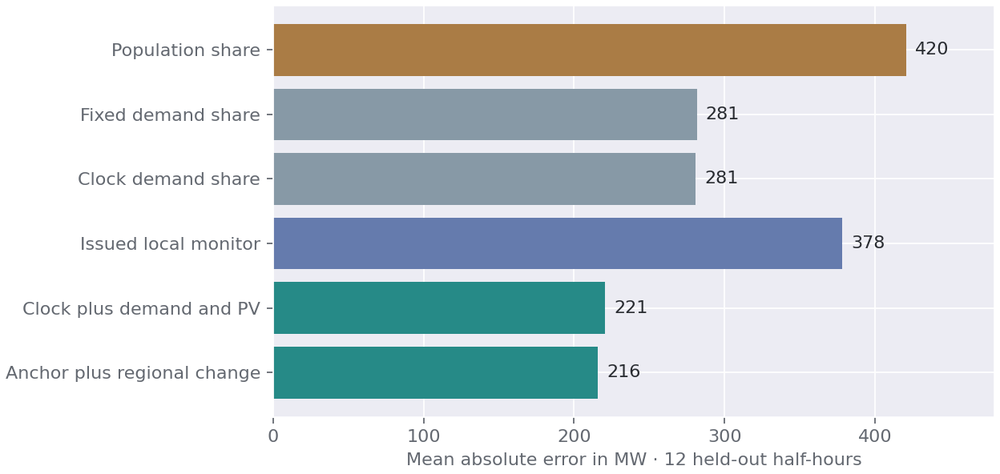
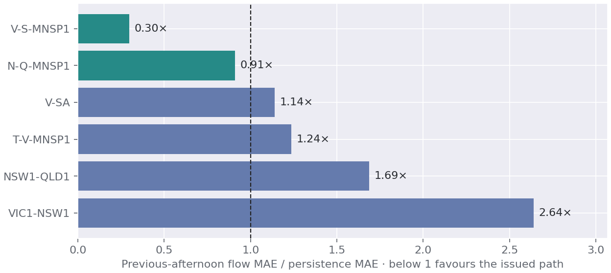

# Forecasting NEM constraint right-hand sides

## What you can forecast from regional data

Use your regional forecast in a constraint equation when you can name the electrical quantity it changes. Start with the regional forecast you want to test, a recent public state available at issue, and the matching AEMO forecast run. The last two give you a baseline and, for some local loads, a direct forecast. A single regional MW value admits many combinations of flows, generation and switch positions. Each combination can produce a different RHS.

If regional demand is literally your **only future series**, a practical first model is the local share for that time of day multiplied by forecast regional demand. If a recent local measurement is available, also try **last local MW + historical share × change in regional demand**. If you also have issued rooftop PV, estimate the local response to demand and PV deviations from their delivery-clock averages. All three procedures can be fit against public historical electrical observations. Their relative accuracy varied by location and horizon.

For a custom scenario with a matching AEMO run, use the published RHS as a reference. Apply the difference between two evaluations of the *same* scoped equation, first with AEMO drivers and then your changed drivers. Leave unchanged inputs on the same vintage and record every quantity held fixed. On the sampled QNI dispatch expression, adding 100 MW of NSW demand and moving Terranora by its historical share shifted the RHS by **−2.61 to −2.53 MW**. This measures the assumed response. A change in generator commitment, topology or dispatch could move it again. [Scenario calculations](flows/injection_scenarios.csv)

To decide whether an approximation is good enough, work backwards from headroom. For example, Bango's rating coefficient is 1.197. If the RHS error budget for that term is 5 MW, its rating estimate must be within about **4.2 MVA** when the other terms are fixed. The 21 MVA gap between the applied rating and the equation fallback would already exceed that budget fivefold. Five MW is an illustrative tolerance. Set the actual tolerance from the decision the forecast supports, then measure how often the joint forecast stays inside it. [Bango inputs and sensitivities](thermal/input_metrics.csv)

## Which local demand estimate to use

We decoded five public constraint monitors. Their published RHS has a 10,000 MW offset in the checked predispatch definition. Subtracting it recovers the local value. The 12 held-out half-hours below cover mornings and late afternoons on 23, 25 and 28 February 2026. Each score is mean absolute error against six native observations per half-hour. Values are MW. “Clock share” needs only the regional forecast and history. “Anchor” also needs the most recent published local and regional state. “Demand + PV” also needs an issued regional rooftop-PV forecast. [Monitor definitions](local/definitions.csv) · [All scores, bias and uncertainty](local/scores.csv)

| Input            | Forecast origin    |   Clock share |   Anchor |   Demand + PV |   Issued monitor |
|:-----------------|:-------------------|--------------:|---------:|--------------:|-----------------:|
| Sydney area      | Short              |         168.5 |    170.5 |         167.5 |            193.2 |
| Sydney area      | Previous afternoon |         280.7 |    215.7 |         220.6 |            377.8 |
| Terranora        | Short              |          17.8 |      6.1 |          16.6 |              6.2 |
| Terranora        | Previous afternoon |          17.8 |     20.0 |          16.9 |             13.1 |
| Canberra         | Short              |          57.9 |     20.9 |          43.7 |             24.2 |
| Canberra         | Previous afternoon |          58.2 |     74.7 |          43.9 |             29.8 |
| Central West NSW | Short              |          41.8 |     20.8 |          17.9 |             32.9 |
| Central West NSW | Previous afternoon |          32.4 |     39.3 |          17.9 |             21.0 |
| Southwest NSW    | Short              |          53.8 |     15.0 |          40.1 |             28.1 |
| Southwest NSW    | Previous afternoon |          53.6 |     77.5 |          40.4 |             28.8 |

For broad Sydney, the population method assigned 66.97% of NSW-region demand to the Sydney, Newcastle–Maitland and Wollongong Significant Urban Areas, using NSW plus ACT population as the denominator. Day-ahead error was **420 MW** here and **412 MW** in a separate three-morning sample. The electrical clock share scored **281 MW** here and an earlier clock/day-type share **333 MW** in the morning-only sample. The issued local monitor scored **378 MW** here and **295 MW** in the earlier sample. Population missed both the load mix and intraday shape. Use it only to initialise a scenario where historical electrical labels are unavailable. [Earlier matched sample](context/earlier_scores.csv) · [ABS population release](https://www.abs.gov.au/statistics/people/population/regional-population/2023-24)

**Western Sydney requires a boundary decision.** The checked AEMO point covers Sydney, Wollongong and Newcastle. The public Sydney West 132 kV bulk supply point is a different target. Transgrid publishes historical site data and its planning material identifies other supply paths into Western Sydney. For a nominated BSP, fit the local model to that BSP's own trace after resolving signs, interval alignment and an unexplained June–July 2025 magnitude change. For a wider load pocket, obtain a dated list of boundary meters and sum coincident signed imports, exports and any adjustments required by the equation. Validate the reconstructed series against the named point. We have no error estimate for that wider target. [Source audit](context/sydney_sources.csv) · [Transgrid data portal](https://tapr.transgrid.com.au/) · [Western Sydney supply diagram](https://www.transgrid.com.au/media/wwpo0dlu/transgrid-pacr_macarthur.pdf)

We also ran the regional-share method directly against the Sydney West BSP workbook. Fitting the seven February 2026 training dates and testing twelve later half-hours, the day-ahead **clock-specific electrical share** had **2.95–3.10** mean absolute error in the workbook's signed units. A fixed share scored **3.34–3.59**, and a historical clock mean **3.72–4.00**. The range comes from testing both possible half-hour label alignments, assuming the workbook clock uses NEM time. The retrieved workbook was updated in September 2026, so this is retrospective evidence of fit to one site. It does not establish an available February feed or identify the wider area consumed by a constraint. [Sydney West predictions](local/sydney_west_predictions.csv) · [Site source and hash](local/sydney_west_source.json)

**Terranora needs a signed estimate.** The earlier sample included seven negative half-hours out of twelve. A positive population share cannot represent reverse net load. The issued monitor had **13.1 MW** day-ahead error on the later sample and **8.9 MW** on the earlier one. For short leads, the last local observation plus the change in regional demand scored **6.1 MW** on the later dates. [Held-out local predictions](local/predictions.csv)

## Generators, rooftop solar and batteries

Use unit MW where a term calls for a unit's initial injection. A region-level wind or solar forecast still needs a plant-level allocation. We fitted each plant's historical share of regional cleared wind or solar MW, then multiplied the share by the issued regional series. The anchor variant changes only the plant's starting MW by its share of the regional change. At short leads, recent plant MW was competitive. At previous-afternoon leads the share model improved on persistence at three plants in this sample. None of those comparisons verifies an operator-entered availability or wind-farm setting. [Inputs and vintages](local/forecast_inputs.csv) · [Unit-level scores](local/scores.csv)

| Input    | Forecast origin    |   Carry latest |   Regional share |   Anchor + change |
|:---------|:-------------------|---------------:|-----------------:|------------------:|
| BANGOWF1 | Short              |           17.2 |             37.3 |              16.4 |
| BANGOWF1 | Previous afternoon |           52.7 |             33.7 |              40.9 |
| CAPTL_WF | Short              |            8.2 |             24.1 |               9.3 |
| CAPTL_WF | Previous afternoon |           38.6 |             25.5 |              31.1 |
| CULLRGWF | Short              |            2.4 |              3.7 |               3.2 |
| CULLRGWF | Previous afternoon |            7.4 |              4.6 |               5.6 |
| GOONSF1  | Short              |            9.0 |             13.5 |               9.0 |
| GOONSF1  | Previous afternoon |           26.7 |             13.7 |              26.1 |

The independent dispatch-solution check found 1,252 matching unit-interval records among 1,878 SCADA records. Maximum absolute difference on matched observations was 0.0000 MW. BANGOWF1, GOONSF1 and both batteries matched on every sampled record. CAPTL_WF and CULLRGWF had public SCADA but no matching DUID in the sampled dispatch solution. The plant forecast errors above are against public SCADA. [Unit identity cross-check](local/unit_crosscheck.csv)

Regional rooftop PV was worth obtaining as a separate forecast. Its issued NSW mean had **116.5 MW** short-horizon and **217.8 MW** previous-afternoon error against AEMO's regional measurement estimate. A historical delivery-clock mean had **443.1 MW** error at both horizons. When applying PV locally, train against measured *net* local demand. Adding a second explicit PV subtraction to an already net series would count PV twice. [Forecast inputs](local/forecast_inputs.csv) · [Measurement provenance](context/rooftop_actual.json)

For batteries, a statewide price forecast alone performed poorly on the active unit. TARBESS1's previous-afternoon errors were **52.6 MW** for its historical clock profile, **105.7 MW** for idle and **108.9 MW** for a price-bin dispatch rule. ORABESS1 stayed close to idle in the same windows. Fit each unit separately. Where energy and offer data are available at issue, limit the charge/discharge paths by MW capability, efficiency and available MWh at each step. Otherwise carry charging, idle and discharging paths as alternatives. This pilot tested clock, persistence, idle and price bins. An energy-constrained scheduling model still needs a forward evaluation. [Battery predictions](local/predictions.csv)

## What to put into the calculator

The initial inventory found 2,206 distinct typed external inputs across 1,125 invoked equations in one dispatch case. Of 1,008 dynamic equations, 744 had a candidate historical source for every leaf. That inventory establishes historical coverage at one instant. The experiments below cover representative inputs and two network equations, with a further protection-timer example. Use the matrix as a routing guide for new equations. [Equation-by-input inventory](context/dependencies.csv) · [Recommendations spreadsheet](recommendations.csv)

| Input family                         | First public source or benchmark                                                              | Fallback to test                                                                                                          |
|:-------------------------------------|:----------------------------------------------------------------------------------------------|:--------------------------------------------------------------------------------------------------------------------------|
| Constants and shared equations       | Resolve dated coefficients and recursively expand the applicable RHS                          | Use the exact definition                                                                                                  |
| Local load                           | Decode the matching issued monitor and verify its definition                                  | Fit local/region shares by delivery clock or regress on regional demand and rooftop PV using historical electrical labels |
| Regional demand                      | Reconcile regional demand and eligible scheduled loads against historical case inputs         | Forecast eligible pumps separately or specify off and running schedules                                                   |
| Initial interconnector flow          | Latest public metered flow or preceding target from the same forecast vintage                 | Use a signed clock/day-type baseline by link and scenario-test flow changes                                               |
| Wind and solar trader MW             | Latest signed SCADA or previously issued plant path where accessible                          | Use plant share of issued regional cleared generation or anchor plus regional change                                      |
| Scheduled plant and pumping          | Last observed unit state with public dated availability and outage schedule where available   | Use unit clock/start/stop scenarios with ramp and capacity bounds                                                         |
| Storage                              | Latest unit MW and available state of charge with issue-time availability                     | Clock by unit plus idle/charge/discharge scenarios within power and energy limits                                         |
| Rooftop solar                        | Use issued AEMO regional rooftop PV mean                                                      | Fit a local PV response or use installed-PV shares as an untested scenario                                                |
| Thermal rating                       | Match the public standing rating and class to the equipment and confirm whether it is dynamic | Compare last rating and seasonal/clock rating and apply a weather scenario                                                |
| Branch loading                       | Earlier terminal measurements or electrically matched state estimate                          | Fit a local relationship to regional dispatch and flows with topology fixed                                               |
| Voltage and reactive power           | Earlier point or published monitor with the same definition                                   | Use local clock/regime baselines and high/low reactive and voltage scenarios                                              |
| Inertia and system strength          | Use the last published aggregate or sum eligible committed units with documented constants    | Scenario-test likely unit combinations and synchronous condensers                                                         |
| Statuses and protection timers       | Apply known switch logic with the latest public state and announced changes                   | Run discrete topology and timer scenarios                                                                                 |
| Entered settings and overrides       | Use dated public entered forecast or a verified matching monitor                              | Carry last valid entry within its effective window and stress plausible alternatives                                      |
| Basslink directional offers and mode | Use previously public directional offers and an issued flow direction as a switch proxy       | Model outages and operating direction as joint scenarios                                                                  |
| Previous-period references           | Seed from earlier public result and recursively roll a consistent forecast path               | Carry or clock benchmark and stress the first forecast step                                                               |
| Invocation and economic binding      | Use issue-time set or outage information and matched public constraint solution               | Run active and inactive scenarios plus a joint LHS/RHS range                                                              |

In AEMO's input codes, **A** covers analogue measurements, **E** covers entered values, **T** identifies trader inputs, **I** identifies interconnector inputs, **S** covers statuses and **R** covers regional inputs. For Basslink, **M** and **N** are directional offer inputs and **W** is the switch. An entered value could be an equipment rating, a local-demand estimate or an operator setting. Route by the typed ID, quantity, scope and units together. In the audited snapshot, 880 equations used A, 620 used E, 566 used T, 522 used I, 507 used S, 114 used R, 69 used M, 63 used N and 138 used W. An equation can appear in several counts. [Typed dependency rows](context/dependencies.csv)

## Signed flows and the QNI network equation

### Signed interconnector flow

Inject the signed initial metered MW for the physical link specified in the expression. The comparison covers all six original links. Each cell is five-minute MAE in MW on the same 72 dispatch intervals. The short column uses P5MIN issued about 34–60 minutes before interval end. The day-ahead column uses predispatch issued the previous afternoon, roughly 18–20 hours ahead. The clock benchmark averages earlier observations in the matching half-hour and weekday/weekend group. Short and day-ahead forecasts have different origin readings.

| Signed link   |   Short carry |   Short clock |   Short issued |   Day carry |   Day clock |   Day prior target |   Day ramp |
|:--------------|--------------:|--------------:|---------------:|------------:|------------:|-------------------:|-----------:|
| N-Q-MNSP1     |          13.9 |          41.9 |           23.7 |        63.8 |        41.9 |               57.2 |       58.0 |
| NSW1-QLD1     |         149.4 |         642.1 |          202.9 |       245.5 |       642.1 |              413.0 |      414.1 |
| T-V-MNSP1     |          35.9 |          86.8 |           34.7 |        48.3 |        86.8 |               61.2 |       59.7 |
| V-S-MNSP1     |          14.4 |          17.2 |           22.7 |        25.1 |        17.2 |                7.9 |        7.4 |
| V-SA          |          70.6 |         222.4 |          189.4 |       198.9 |       222.4 |              228.4 |      226.9 |
| VIC1-NSW1     |         118.5 |         101.1 |          244.6 |       146.4 |       101.1 |              380.8 |      386.4 |

For the issued path, use the **previous delivery period's MWFLOW target from the same forecast run** to estimate initial flow at the next period's start. The day-ahead ramp linearly interpolates from that previous target toward the current half-hour target at each five-minute start. On the 12 exact half-hour starts, preceding PD target Directlink MAE was 56.64 MW versus 63.57 MW for carrying the origin reading. Within-block interpolation is a scenario. Both issued methods use forecast targets, not realized downstream flows. Public labels are the DISPATCHIS METEREDMWFLOW field with matching sign and nonintervention run.

Recommended starting points are link- and horizon-specific. Directlink persistence beat the short issued target here. Murraylink benefited from the day-ahead path; VNI's earlier clock profile beat both the issued path and persistence in both lead bands. These three evaluation mornings do not establish a general route. For the Directlink input of the nonlinear NSW–Queensland equation, substituting only the signed flow and holding realized Terranora load constant changed the RHS by 1.12 MW MAE for short persistence vs 1.75 for the short issued path. Treat this attribution as a retrospective sensitivity diagnostic.

### Regional demand semantics and full NSW–Queensland RHS

The equations below estimate the dispatch RHS for N::Q_NIL_KC v1 effective 1 May 2023. Define N and Q as the equation-specific NSW and Queensland regional demand, d as Terranora load, and i as signed initial Directlink flow. The numerical program is `1383 − 0.001(i+d)² − 0.0239N + 0.0524Q − 0.6394d`. Every deployable estimate used only observations from before the forecast issue or data from the coherent forecast run. Scoring uses **native five-minute** dispatch RHS, including for hourly/half-hourly alternatives. PREDISPATCH values are held across their represented six deliveries unless a flow ramp is specified. Headline values can differ from earlier half-hour-average comparisons.

| method                                                                      |   Short MAE |   Day-ahead MAE |
|:----------------------------------------------------------------------------|------------:|----------------:|
| RHS persistence                                                             |       12.21 |           15.79 |
| clock RHS profile                                                           |       27.54 |           27.54 |
| issued AEMO RHS                                                             |       27.92 |           36.48 |
| Issued flow and local load + total demand plus three prior pump readings    |       11.44 |           36.50 |
| Issued flow and local load + total demand only                              |       27.92 |           36.50 |
| Issued flow and local load + total demand plus all issued dispatchable load |       19.06 |           12.06 |
| regional forecast change from observed RHS                                  |       10.95 |           51.23 |
| regional forecast with clock flow and fixed load share                      |       34.67 |           53.90 |

The regional-only approach uses matched historical signed flow and the fixed seven-morning Terranora-to-NSW ratio. The anchored change method starts from the latest observed RHS and changes the regional totals and implied Terranora load while holding observed flow. The adjusted aggregate forecast uses the preceding issued dispatchable-load target (interpolated for PD), which includes loads outside the equation's eligible class. It gave a smaller day-ahead error here, although its physical definition is poor. The three-pump approach uses previously published MW for SHPUMP in NSW and PUMP1/PUMP2 in Queensland from Dispatch SCADA, held through delivery, added to the corresponding regional TOTALDEMAND.

In a **separate target-time diagnostic** using contemporaneous observations for all other terms, RHS MAE was 22.18 MW using public TOTALDEMAND, 23.19 after adding all dispatchable-load targets, and 2.12 after adding just the three measured pumps. For the 19 February exact-case audit the latter reproduced the regional R components to within 0.0049 MW. Its RHS residual reached 9.08 MW on 22 February. Other eligible loads, snapshot timing or formulation inputs require further investigation. Future pump operation must itself be forecast. Short horizon persistence of those readings reduced RHS error. At the previous-afternoon horizon it provided almost no improvement. Use dated trader classifications and pump or scheduled-load operating scenarios; retain aggregate-load addition only as an empirical challenger with error monitoring.

For a user's demand scenario, the export tests +100 MW of NSW regional demand relative to the issued base, with the earlier training-share response for Terranora, unchanged QLD demand and the matched issued signed flow. Applying the full dispatch formula difference to the published forecast RHS moved the RHS by -2.61 to -2.53 MW over the test rows. This is a conditional sensitivity on the dispatch formula, not a measured prediction or an exact emulation of the PD-scope program.

### Binding and uncertainty on the NSW–Queensland equation

Every evaluated case had the equation active in both the public forecast and the physical nonintervention dispatch. Seven of 72 actual intervals had nonzero absolute marginal value above 0.00001, in three episodes, all on 19 February. P5MIN's issued marginal values captured seven and produced 11 false alerts. The day-ahead forecast called none and missed all seven. Repeating its half-hour classification at five-minute resolution tests what a flat warning would do within the block. Detection of future invocation or unreported equations is outside these counts.

For a forward physical screen we used the forecast run's **issued LHS**, never the delivery's realized LHS as a predictor. For each method and lead we measured the absolute error of predicted signed RHS-minus-LHS headroom on two earlier calibration mornings (48 observations), then used its empirical 90th percentile (higher order statistic) as a symmetric band. The published RHS/LHS pair's short band was ±260.3 MW and covered 54/72 held-out headrooms. It marked 47 clear, 25 uncertain and 0 definitively at risk. All seven economic binds were uncertain. The day-ahead band ±697.6 MW covered 39/72; all seven economic binds were classified clear. These counts argue against a point-RHS binding alert. Run invocation and topology scenarios, preserve LHS uncertainty and collect more independent event days before choosing alert thresholds.

Training was frozen on mornings 9–15 February, calibration on 16–17 February and evaluation on 19, 20 and 22 February. The original forecast headers and nested-file modification times precede the delivery. The conservative carried-forward source's header and archive time precede forecast issue. Historical workstation receipt time is unavailable. [AEMO predispatch](https://www.aemo.com.au/energy-systems/electricity/national-electricity-market-nem/data-nem/market-management-system-mms-data/pre-dispatch) · [Public DispatchIS](https://www.nemweb.com.au/Reports/ARCHIVE/DispatchIS_Reports/) · [Public unit SCADA](https://www.nemweb.com.au/Reports/ARCHIVE/Dispatch_SCADA/)

## Thermal limits and Bango

### Bango thermal limit, terminal loading and renewable units

The six inputs to the dispatch equation for Bango were all present after dispatch. The four unit injections, terminal loading and rating reproduced all 240 published NEMDE values to within 0.00000050 MW. Forward injection was more difficult. Half an hour ahead, a recent public Bango RHS and four public unit observations gave a better starting point than a model using NSW forecasts alone. The previous afternoon, the AEMO published RHS gave the smallest error.

The tested dispatch expression for `N>999_9GL_NIL`, version 1 effective 2 December 2025, was `1.197 × (rating − terminal MVA − 10) + BANGOWF1 + 0.266 × GOONSF1 + 0.375 × JEMALNG1 + 0.266 × PARSF1`. The constant margin is 10. The four trader inputs are initial MW. The predispatch expression has 81 term rows and includes three subregions and numerous plant terms. We forecast the future *dispatch* expression at both horizons and separately compared the official issued outcome from each product. Rebuilding the official predispatch expression would require its own input inventory. [AEMO effective-dated equation table](https://www.nemweb.com.au/Data_Archive/Wholesale_Electricity/MMSDM/2025/MMSDM_2025_12/MMSDM_Historical_Data_SQLLoader/DATA/PUBLIC_ARCHIVE%23GENERICCONSTRAINTRHS%23FILE01%23202512010000.zip)

Seven earlier windows, 9–15 February 2026 from 10:05 to 12:00 fixed NEM time, supplied 168 observations. We held out 19, 20 and 22 February, the same hours, with 72 native intervals or 12 complete half-hours. Every case invoked the same equation with a usable terminal SCADA point. Regional inputs came from one issued P5MIN run per target half-hour, or the 16:30-labelled PREDISPATCHIS run from the previous day, produced around 16:02. Actual five-minute leads were 33–59 minutes and 18 hours 3 minutes–19 hours 58 minutes. AEMO run headers and original archive-member timestamps preceded the targets. The analyst's historical client receipts are unavailable.

| Forecast of Bango dispatch RHS | P5MIN half-hour MAE, MW | Previous-afternoon half-hour MAE, MW |
|---|---:|---:|
| Carry forward latest published Bango dispatch RHS | 4.00 | 36.79 |
| Move latest state by issued regional changes | 3.68 | 22.41 |
| Allocate issued NSW wind and solar by historical plant shares, model line loading | 10.85 | 14.26 |
| Historical average for matching half-hour | 11.03 | 11.03 |
| AEMO issued constraint RHS | 7.20 | 6.95 |

The short-horizon improvement from adding regional changes was 0.33 MW across 12 half-hours. A five-minute evaluation gave 4.34 MW versus 4.50 MW for persistence. Retain both and recheck across seasons and outages before choosing the additional model. When the local observations are missing, the regional generation share calculation offers a reproducible scenario. For the previous-afternoon point forecast, use the issued equation RHS when available.

| Input and unit | Recent state, short MAE | Regional generation shares, short MAE | Regional generation shares, previous-afternoon MAE | Matching clock, previous-afternoon MAE |
|---|---:|---:|---:|---:|
| Bango terminal apparent power, MVA | 6.09 | 20.51 | 25.04 | 37.00 |
| BANGOWF1 wind initial MW | 4.39 | 13.90 | 19.89 | 36.37 |
| GOONSF1 solar initial MW | 4.13 | 13.65 | 12.75 | 11.10 |
| JEMALNG1 solar initial MW | 3.68 | 10.43 | 10.87 | 14.19 |
| PARSF1 solar initial MW | 3.10 | 10.18 | 9.51 | 8.26 |

Plant shares equal the sum of the plant's training initial MW divided by the corresponding sum of NSW cleared wind or solar MW in the preceding interval. At forecast time, multiply by issued cleared output for the same technology. For the short-horizon change calculation, add the forecast change in regional output times that share to the most recent plant observation, flooring generation at zero. The previous half-hour product cannot resolve a five-minute initial condition. Use its covering half-hour throughout and label that approximation. A plant availability forecast would still need an estimate of curtailment and dispatch. Public unit-level intermittent forecasts are published next day, while regional forecasts have broader real-time access. [AEMO intermittent generation forecast access](https://markets-portal-help.docs.public.aemo.com.au/Content/IntermittentGen/Forecasts.htm)

Terminal MVA was modelled against local generation and NSW demand using the training dates. At the origin, if a public RHS and four plant SCADA values are available for the same dispatch interval, invert the equation for terminal MVA using the applicable rating. Retaining all five origin values simply returns the published RHS algebraically. In the change model, update the inferred MVA by the difference between modelled future and origin loading. Future reactive power, voltage and topology can all move apparent loading independently of regional demand. With *realised* future plant and regional inputs, the terminal regression's diagnostic MAE was still 10.73 MVA. With issued or estimated inputs it reached 20.51 MVA at short lead. Each MVA error in this term changes the RHS by 1.197 MW in the opposite direction. Joint errors can cancel as the same generators also enter the equation with positive signs.

Seven five-minute intervals had nonzero dispatch marginal values, all on 22 February. A forward alert was defined as predicted `RHS − LHS ≤ 0.1 MW`. Using the weighted predicted plant injections as a proxy for the solved dispatch LHS, persistence detected four of seven with two false alerts. Adding regional changes detected two with one false alert. The official P5MIN RHS and its own forecast LHS together alerted on none. All previous-afternoon methods missed all seven. A small half-hour RHS error therefore did not establish dependable five-minute binding alerts. The original public timestamps mattered here because a dispatch solution can be published before the end of its labelled interval. We used the latest common DispatchIS and DispatchSCADA interval whose two file headers and archive-member timestamps preceded forecast production.

### Equipment ratings that can and cannot be fixed in advance

For `NRATCN_BANYS9GL`, the public rating identifier resolves to BANGOWF line 9GL, normal rating, dynamic flag 0. Its effective-dated NSW summer-day alternate `N_SUM_D` is 125 MVA, valid from 28 October 2025. The archived public network file was produced 13 February at 10:00:03 NEM time and its member stamped 10:03:12, before the first test origin. The alternate matched all 240 observations. Injecting the equation's 146 MVA default would raise this RHS by 25.137 MW on every tested interval. Recheck the application, terminal, rating level, effective dates and overrides at each issue. [Archived public network standing data](https://www.nemweb.com.au/Reports/ARCHIVE/Network/PUBLIC_NETWORK_20260213.zip) · [AEMO seasonal and temperature application rules](https://www.aemo.com.au/energy-systems/electricity/national-electricity-market-nem/data-nem/network-data/transmission-equipment-ratings/alternative-value-application-ratings)

For a genuinely dynamic example, the Red Cliffs–Wemen 220 kV line rating `VRAT15_RCWE` has dynamic flag 1 and rating level `LDSH`. It tied with the opposite terminal for the largest training-only range divided by median among rating-like case inputs with 168 complete training records, minimum above 20 and maximum below 2,000. We chose the Red Cliffs direction as a high-variability stress case. Training ranged from 298.35 to 666.06 MVA. Held-out measurements ranged from 324.14 to 448.13 MVA. This point is separate from the Bango equation. [AEMO equipment rating flags and use of fallbacks](https://visualisations.aemo.com.au/aemo/nemweb/MMSDataModelReport/Electricity/MMS%20Data%20Model%20Report_files/MMS_463.htm)

| Dynamic Red Cliffs rating estimate | MAE, MVA across 12 held-out half-hours |
|---|---:|
| Median rating across 28 training half-hours, 384.25 MVA | 32.45 |
| Public 25°C static fallback, 374 MVA | 35.87 |
| Historical matching half-hour | 44.43 |
| Apply forecast air temperature to public static curve, round up to next 5°C | 52.42 |
| Fit rating to forecast temperature and wind speed on earlier dates | 66.10 |

The weather estimates used individual ECMWF IFS runs identified by UTC initialisation, a single approximate corridor location at 34.45° S, 142.42° E, and hourly 2 m temperature and 10 m wind speed. Each run began at 12:00 UTC two calendar days before delivery, over 18 hours before the corresponding predispatch issue. Hourly forecasts were interpolated to the target intervals. Historical receipt of that weather run was not independently recorded. The upward 5°C rounding is our conservative scenario. The fitted coefficients can vary substantially with only seven mornings. The public 5–45°C alternate table spans 134–519 MVA. It includes all 72 test values, but some observed training ratings exceeded 519 MVA. This is evidence for retaining a fallback scenario separately from a weather-driven dynamic rating, and for comparing each site with a historical median before adopting a weather model. The physical candidate for a larger study uses corridor-specific temperature, wind speed and direction, solar heating, circuit exposure, rating duration and known overrides. [Open-Meteo single-run archive](https://open-meteo.com/en/docs/single-runs-api) · [AEMO alternate applications](https://www.aemo.com.au/energy-systems/electricity/national-electricity-market-nem/data-nem/network-data/transmission-equipment-ratings/alternative-value-application-ratings)

### Thermal evidence and reproduction

Within the `thermal` directory, `case_observations.csv` records equation inputs, sensor timestamps, marginal values and XML hashes. `regional_dispatch.csv`, `issued.csv`, `origin.csv` and `forecast_sources.json` retain original reports, member identifiers, source times and hashes. `forecast_predictions.csv`, `input_metrics.csv`, `rhs_metrics.csv` and `binding.csv` contain predictions and errors. `rating_panel.csv`, `rating_identifiers.csv`, `alternate_ratings.csv`, `rating_standing_source.json`, `weather_runs.csv`, `dynamic_rating_predictions.csv` and `dynamic_rating_metrics.csv` document the separate varying-rating test. The weather response includes API processing time, so the source log also records a stable hash of the hourly payload. For local scoring from these evidence extracts run `python thermal.py score` and `python ratings.py` from this directory. To refresh, run `python thermal.py cases`, `python thermal.py forecasts regions`, `python thermal.py rating-panel`, `python thermal.py score`, then `python ratings.py capture`. The scripts import the existing repository archive reader from `local_exports/rhs_forward_feb26/study.py`.

## Switches, electrical conditions and outages

### Digital state, equipment outages and special electrical inputs

Carrying the previous day's binary state forward was correct on 95.7% of all point-intervals at the short lead. For the 59 points that actually varied across the three target mornings, accuracy fell to 63.7%. A good aggregate score can conceal material operating-state errors. An explicit pair of state scenarios makes their effect on the equation visible.

The test uses dispatch intervals ending 10:30, 11:00, 11:30 and 12:00 fixed NEM time on 19, 20 and 22 February 2026. Each label is one five-minute interval. Training uses the same four clock times on 9–15 February. Each target has a P5MIN vintage 58.2–59.3 minutes before delivery and a previous-afternoon PREDISPATCHIS vintage 18.46–19.96 hours before delivery. The long-lead predictions for each date use one fixed vintage. There are 12 short-lead origins and three long-lead origins. Results describe three correlated mornings.

Case SCADA labels require Can_Use_Value=True. The 4 February S-type inventory supplies 641 points with usable 0/1 observations. The short-lead prior-case baseline uses yesterday's morning. At the previous-afternoon cutoff that morning's case awaited the end of its trading day, so the long-lead baseline uses two mornings before delivery. Clock references use seven earlier observations per clock time. Case eligibility follows AEMO's documented 04:00 publication cycle. The forecast-product cutoff is the later of source creation and archive member modification. Both timestamps on the latest dispatch and SCADA reports used precede the cutoff. For NOS the last report generated at least two minutes earlier is eligible. Historical recipient timestamps are unavailable. [AEMO NEMDE Queue Users' Guide, p. 20](https://www.aemo.com.au/-/media/files/electricity/nem/it-systems-and-change/nemde-queue/nemde_queue_users_guide.pdf?la=en)

### What to inject

Entries are MAE against 12 dispatch case values per lead, except the switch row which counts classification errors. The demand estimator averages the target point over the three training observations closest to the issued regional MW forecast.

| Input and estimator | About 59 min | Previous afternoon | Recommendation |
|---|---:|---:|---|
| Tasmania BU_SH1_LINE_220KV, prior case / clock / nearest demand (kV) | 0.64 / 0.85 / 0.90 | 0.71 / 0.85 / 0.96 | Carry the same bus's latest available same-clock value. Test tap settings, reactive resources and local topology if issued. |
| Victoria APDLOAD_MVAR, prior case / clock / nearest demand (MVAr) | 3.33 / 2.67 / 2.47 | 4.93 / 2.67 / 2.93 | Start with clock and preserve sign. Regional demand helped the short lead by 0.20 MVAr and lost 0.26 at the long lead. Test local MW and power factor by operating mode if available. |
| BL_PREVDI_TARGET, latest dispatch target / issued flow / clock (MW) | 34.58 / 35.89 / 122.74 | 46.07 / 58.45 / 122.74 | Anchor to the freshest published target. Propagate each simulated dispatch target into the next five-minute step. |
| Basslink TAS1 offer M, prior case / clock (MW) | 119.5 / 119.5 | 239.0 / 119.5 | Use entitled directional offers if available and bracket the missing offer with full, derated and zero cases. |
| Basslink VIC1 offer N, prior case / clock (MW) | 148.5 / 148.5 | 297.0 / 148.5 | Keep an independent directional offer. A dispatch limit or forecast flow can differ from the offer. |
| Basslink winning switch status, prior case / clock / issued-flow class (errors out of 12) | 3 / 3 / 2 | 6 / 3 / 3 | Evaluate both switch runs and use a range where they disagree materially. |
| Mortlake inertia, prior case / clock / plant-output proxy (source units) | 0 / 0 / 0 | 0 / 0 / 0 | Supply individual future synchronous states and compatible inertia coefficients. Held-out labels were all zero. |
| T^V_NIL_9, last dispatch RHS / issued equation RHS (MW) | 0 / 0 | 0 / 244 | Verify the timer branch and process-specific equation before injecting an inferred state. |

The case's previous Basslink target agreed with the preceding public DISPATCHINTERCONNECTORRES.MWFLOW within 0.000004 MW on 12/12 examples. The P5 comparison uses the issued flow for the preceding five-minute interval. The predispatch comparator supplies a coarser half-hour flow ending at the delivery time. All previous-target labels in this test were between −239.17 and 0 MW.

Basslink's TAS1/VIC1 offer maxima were 478/594 MW in all 28 training observations. They both fell to zero at the three 11:00–12:00 snapshots on 20 February and returned to 478/594 on 22 February. Training min/max covered 9/12 held-out offer values in each direction. Seven training snapshots showed zero preceding dispatch target alongside full offers. For the winning switch, the issued-flow proxy takes the training mode for the zero or nonzero preceding transfer class, with a 0.1 MW zero tolerance. Its label is PeriodSolution.SwitchRunBestStatus. Applying W also requires the switched point's value under the selected branch. AEMO publishes the 5-minute MNSP bid data for other participants next day. [AEMO MNSP bid data](https://visualisations.aemo.com.au/aemo/nemweb/mmsdatamodelreport/electricity/mms%20data%20model%20report_files/MMS_24.htm)

Mortlake's two DUIDs MORTLK11 and MORTLK12 were classified separately using 5 MW. Both were off in 24 training cases with zero inertia. In four training cases unit 11 exceeded 100 MW and case inertia was 21.079 source units. The origin-state proxy takes the training median for the same pair of plant states. Future plant starts, shutdowns and synchronous-condenser operation need separate validation. The 28-point training envelope covered all 12 voltage and reactive-load observations with widths of 6.30 kV and 35.20 MVAr. These descriptive ranges have no calibrated probability.

### Status changes and timer branches

Prior-case persistence missed 330/7,692 binary point-intervals at the short lead and 442/7,692 at the long lead. Clock mode missed 411 at either lead. Among the 59 points varying in the held-out mornings, persistence missed 257/708 and 342/708. Clock mode missed 252/708 at both leads. Of 330 short-lead point-intervals where the flag differed from the prior case, clock mode recovered 179. It recovered 208 of 442 at long lead. The other 582 points were constant across these delivery snapshots. Validate each material flag under actual changes before assigning it a probability.

Across all 52 sampled cases the T^V_NIL_9 dispatch RHS equalled 594 − 244 × GTOWN_FL_TIMER. The two branches differ by 244 MW. Previous-afternoon published RHS was 594 in all 12 held-out intervals while dispatch and P5 were 350 in every one. Use the latest dispatch RHS to infer a timer only under a verified version-specific mapping. The predispatch RHS difference alone cannot identify its physical timer state.

### Predicting activation from the issued outage schedule

At each cutoff we score every set linked to any outage in that NOS snapshot. The predictor intersects the equipment and set windows, omits closed and superseded bookings and uses actual start/end times only when already reached and recorded. The target is a set tracked on an invoked equation in the non-intervention dispatch case. A set can be invoked for several reasons. The results measure set-level activation within the origin's linked universe. They do not measure causal outage attribution or unlinked set coverage. [AEMO Network Outage Schedule](https://www.aemo.com.au/energy-systems/electricity/national-electricity-market-nem/data-nem/network-data/network-outage-schedule)

| Lead and method | Set-intervals | True / false positives | Missed activations | Precision / recall |
|---|---:|---:|---:|---:|
| About 59 minutes, NOS | 2,476 | 182 / 6 | 4 | 96.8% / 97.8% |
| About 59 minutes, prior case | 2,476 | 168 / 62 | 18 | 73.0% / 90.3% |
| Previous afternoon, NOS | 2,472 | 182 / 18 | 4 | 91.0% / 97.8% |
| Previous afternoon, prior case | 2,472 | 164 / 72 | 22 | 69.5% / 88.2% |

Use NOS for scheduled activation and carry delayed/cancelled alternatives where a set materially changes headroom. All four misses at each lead were T-SHWI. Short-lead false positives included Q-GBMU_835_836, S-RBMWP4 and T-FARC1. Activation identifies equations to evaluate. Binding additionally requires their signed LHS and the relevant solution's marginal values.

## When to use the result

With **regional demand and public history only**, start by supporting local loads, signed flow profiles and unchanged-state scenarios. If one additional live feed is practical, collect the original P5MIN or predispatch run, including its monitored RHS, flows and LHS. Add scheduled outages and the specific unit or equipment feeds needed by the equations that move your target. Detailed engineering models for every term are expensive and can underperform persistence even when their physics looks plausible. The Bango and dynamic-rating comparisons show where that happened.

1. **Choose the actual target.** Record equation, effective date, version, DS/PD scope, inequality, invocation and delivery end in fixed UTC+10. Resolve shared equations, prior-period references, defaults and switches before requesting forecasts. A dispatch recipe can use different inputs from its predispatch counterpart. For Bango the audited dispatch recipe had six external leaves and the predispatch recipe had 78, including 71 traders. [Bango input list by scope](context/bango_inputs.csv)
2. **Start with the cheapest useful case.** Carry the latest available RHS and compare it with the matched published RHS. Run the regional-only profile if it must operate without an origin reading. Add a source when it reduces *out-of-sample RHS or risk error* enough for the intended decision. A large error on one input may have a small RHS coefficient, or it may cancel another term on one day and reinforce it on the next.
3. **Prioritise measurements by their effect.** Replace one term at a time on historical cases to diagnose sensitivity, then replay whole coherent forecast paths to score the deployable model. For nonlinear equations, rerun the complete expression. For correlated terms, such as a farm's output and its export-line loading, vary them together. Hard switch logic requires attainable branches. A weighted average of branch RHS values may be physically impossible.
4. **Report proximity separately from economic binding.** For an active ≤ equation define headroom as RHS − LHS. Reverse the sign for ≥ and assess the absolute residual for equality. Publish invocation, RHS, LHS, headroom and its error range from jointly forecast paths. Economic binding is a separate outcome assessed here using dispatch marginal value. If activity or a decisive switch is unknown, show the results conditional on each state. An accurate RHS alone cannot settle the alert.
5. **Qualify each route for the intended lead.** Use chronological selection, then independent calibration and event-day tests. Score native-interval errors, bias, tails, interval coverage/width, hits, misses and false calls by lead, season and topology. For example, a ±407 MW band fitted on eight earlier Sydney half-hours for the issued day-ahead monitor covered only 6/12 later values. A wide band may be honest and still be unusable for a tight dispatch margin. Specify your acceptable MW error or false-alert cost before selecting a route. [Local uncertainty and coverage](local/scores.csv) · [Binding evidence](flows/binding_scores.csv)

## Data and scope

The pilots use the public AEMO regional runs as a stand-in for your regional forecast. A comparison with your own vintages remains unmeasured. The local, plant and battery pilot fitted 9–15 February, calibrated on 17–18 February, and evaluated on 23, 25 and 28 February 2026. Short leads were approximately 33–59 minutes and previous-afternoon leads 18.5–26 hours. Its origin reading used the dispatch and SCADA pair labelled at the five-minute floor of forecast creation, with both publication proxies checked. A newer interval label can sometimes already be published. The thermal and state experiments also tested those fresher readings. The network pilots used earlier held-out dates and mostly morning delivery periods. Their individual sample sizes and scoring clocks appear alongside their tables. The two sets of results should be read separately.

Public archive run headers and nested archive timestamps bound when the selected files existed. They do not establish receipt by your workstation. Keep publication and receipt timestamps in live use, retain complete regional vintages, and reject inputs received after the forecast origin. A same-month dispatch extract is used only for historical targets or cross-checks. The latest-rooftop-estimate comparator uses historical revision time as a proxy for availability. Treat it as a diagnostic. No performance claim extends to a different season, multi-day or multi-week leads, unseen topology, or the full inventory. [AEMO predispatch products](https://www.aemo.com.au/energy-systems/electricity/national-electricity-market-nem/data-nem/market-management-system-mms-data/pre-dispatch) · [Local source hashes](local/sources.json)

## Evidence and reproduction

The files contain interval-level predictions so each comparison can be recalculated on matched rows. The scripts use the existing project checkout and its data readers. The standalone HTML includes the charts and tables. Extract the evidence bundle alongside it to use the local downloads.

| Topic | Evidence | Reproduction in the project checkout |
|---|---|---|
| Local demand, renewables and storage | [Predictions](local/predictions.csv), [sample and run metadata](local/observed_inputs.csv), [scores](local/scores.csv) | [Local experiment](local/run_local.py), [independent unit cross-check](local/check_units.py) |
| Signed flows, regional demand and binding | [Flow scores](flows/flow_scores.csv), [pump experiment](flows/scheduled_load_scores.csv), [RHS scores](flows/rhs_scores.csv), [headroom and alerts](flows/binding_scores.csv) | [Flow experiment](flows/study.py), [pump comparison](flows/load_bridge.py) |
| Thermal equation | [Inputs](thermal/input_metrics.csv), [full RHS](thermal/rhs_metrics.csv), [binding](thermal/binding.csv) | [Thermal experiment](thermal/thermal.py) |
| Network states | [Outage predictions](states/outage_predictions.csv), [outage scores](states/outage_metrics.csv) | [State and outage experiment](states/study.py) |
| Recommendations and provenance | [Input-by-input routing](recommendations.csv), [study decisions](decisions.tsv), [file hashes](manifest.json) | [Report builder](build_report.py) |
