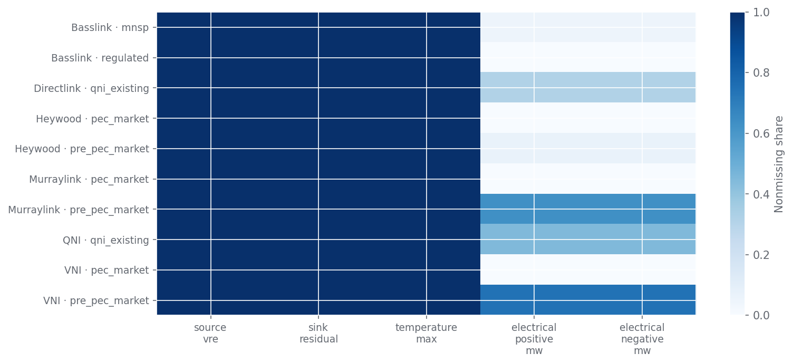

# The grid behind the range

Measured conditions and a twelve-month event review. Historical limit observations through 2026-10-25 00:00:00 NEM time.

## 1. Why the earlier tables can miss the day

The earlier low/normal/high tables condition on one driver at a time. A broad normal bucket can contain a corridor outage, an intact circuit with high local renewable output, and a low-renewable evening with different available generators. Their median may describe none of these well. This campaign keeps the diurnal reference, then asks which joint conditions change the distribution and whether enough independent history supports that distinction.

AEMO reported limits are outcomes of dispatch constraints and controllable dispatch choices. They are not equipment ratings or maximum secure transfer capability. Geographic generation and charging can change the feasible dispatch envelope without any change to regional total wind or demand. [AEMO constraint explanation](https://www.aemo.com.au/energy-systems/electricity/national-electricity-market-nem/system-operations/congestion-information-resource/constraint-faq).

## 2. What is actually measured

The data retain complete six-observation half-hours and signed directional values. Reverse capacity is minus raw IMPORTLIMIT. The primary target is the average; the minimum is retained to reveal restrictions hidden within that average. Missing data are never zero-filled. Calendar quarters use the delivery timestamp in fixed NEM time.

| condition                   | units   | source                                                       |   historical_coverage | availability                                                                        |
|:----------------------------|:--------|:-------------------------------------------------------------|----------------------:|:------------------------------------------------------------------------------------|
| temperature_max             | C       | Public weather; retained reanalysis and explicit issued runs |                  1    | Realised conditional history; dated inputs need separate issue and receipt evidence |
| source_temperature          | C       | Public weather; retained reanalysis and explicit issued runs |                  1    | Realised conditional history; dated inputs need separate issue and receipt evidence |
| sink_temperature            | C       | Public weather; retained reanalysis and explicit issued runs |                  1    | Realised conditional history; dated inputs need separate issue and receipt evidence |
| humidity_mean               | %       | Public weather; retained reanalysis and explicit issued runs |                  1    | Realised conditional history; dated inputs need separate issue and receipt evidence |
| source_vre                  | MW      | AEMO regional dispatch                                       |                  1    | Realised conditional history; dated inputs need separate issue and receipt evidence |
| sink_vre                    | MW      | AEMO regional dispatch                                       |                  1    | Realised conditional history; dated inputs need separate issue and receipt evidence |
| source_demand               | MW      | AEMO regional dispatch                                       |                  1    | Realised conditional history; dated inputs need separate issue and receipt evidence |
| sink_demand                 | MW      | AEMO regional dispatch                                       |                  1    | Realised conditional history; dated inputs need separate issue and receipt evidence |
| source_residual             | MW      | AEMO regional dispatch                                       |                  1    | Realised conditional history; dated inputs need separate issue and receipt evidence |
| sink_residual               | MW      | AEMO regional dispatch                                       |                  1    | Realised conditional history; dated inputs need separate issue and receipt evidence |
| vre_difference              | MW      | AEMO regional dispatch                                       |                  1    | Realised conditional history; dated inputs need separate issue and receipt evidence |
| residual_difference         | MW      | AEMO regional dispatch                                       |                  1    | Realised conditional history; dated inputs need separate issue and receipt evidence |
| source_vre_ramp_1h          | MW      | AEMO regional dispatch                                       |                  1    | Realised conditional history; dated inputs need separate issue and receipt evidence |
| sink_vre_ramp_1h            | MW      | AEMO regional dispatch                                       |                  1    | Realised conditional history; dated inputs need separate issue and receipt evidence |
| residual_difference_ramp_1h | MW      | AEMO regional dispatch                                       |                  1    | Realised conditional history; dated inputs need separate issue and receipt evidence |
| source_available_generation | MW      | AEMO regional dispatch                                       |                  1    | Realised conditional history; dated inputs need separate issue and receipt evidence |
| sink_available_generation   | MW      | AEMO regional dispatch                                       |                  1    | Realised conditional history; dated inputs need separate issue and receipt evidence |
| electrical_positive_mw      | MW      | AEMO equation factors and DUID dispatch                      |                  0.37 | Realised conditional history; dated inputs need separate issue and receipt evidence |
| electrical_negative_mw      | MW      | AEMO equation factors and DUID dispatch                      |                  0.37 | Realised conditional history; dated inputs need separate issue and receipt evidence |
| corridor_wind_ms            | m/s     | Public weather; retained reanalysis and explicit issued runs |                  1    | Realised conditional history; dated inputs need separate issue and receipt evidence |
| corridor_radiation_wm2      | W/m2    | Public weather; retained reanalysis and explicit issued runs |                  1    | Realised conditional history; dated inputs need separate issue and receipt evidence |
| corridor_cloud_pct          | %       | Public weather; retained reanalysis and explicit issued runs |                  1    | Realised conditional history; dated inputs need separate issue and receipt evidence |

Electrical generation groups are constructed from eligible signed equation terms and effective-dated unit mappings at the first training boundary. They are not rankings chosen from evaluation outcomes. Missing unit dispatch makes the aggregate unavailable rather than silently zero. Their current coverage is limited; the data matrix below makes that visible.

## 3. Twelve-month event review

The review window is 25 October 2025–25 October 2026. The 20 registered cases include mechanism candidates, structural breaks, a negative control, forecast quality checks and a data-quality quarantine. Monthly and theme searches are recorded. Direct site downloads were blocked, so article review used the web research tool; cached research responses have separate hashes. This is a bounded public-source review, not a census of every incident. Several articles quote market notices; an original notice not independently retrieved remains a verification gap. Additional September–October examples were added for explanation without changing the frozen evaluated feature set.

### 2025-11-25 — NSW cloud ramps with changing corridor outages

Successive days involved different outages; do not encode a single high-demand derating. The measurable candidate conditions are specific corridor outage, sink residual demand, solar ramp, local generation. Classification: **mechanism candidate**. [WattClarity event source](https://wattclarity.com.au/articles/2025/11/unpacking-some-of-the-drivers-of-volatility-in-nsw-today-on-wednesday-26th-nov-2025/). [AEMO corroboration/context](https://www.aemo.com.au/-/media/files/major-publications/qed/2025/qed-q4-2025.pdf).

Publication date: 2025-11-26. Later commentary supplies research labels and never masquerades as information known before the event.

| connector   | direction   |   rows |   median_mw |   p10_mw | minimum_mw   |   forced_share |   unknown_invocation_share |
|:------------|:------------|-------:|------------:|---------:|:-------------|---------------:|---------------------------:|
| VNI         | forward     |     96 |      299.16 |  -500.34 | -1,700.42    |           0.36 |                          0 |
| VNI         | reverse     |     96 |      783.54 |    88.28 | -362.89      |           0.02 |                          0 |

### 2026-01-09 — VNI corridor trips and SIPS operation

Protection service status requires independent public verification; generic battery output is not proof of armed support. The measurable candidate conditions are circuit status, support scheme status, battery capability. Classification: **mechanism candidate**. [WattClarity event source](https://wattclarity.com.au/articles/2026/01/09jan-vbb-sips-operated/). Original quoted notice reconciliation remains explicit in the evidence register.

Publication date: 2026-01-10. Later commentary supplies research labels and never masquerades as information known before the event.

| connector   | direction   |   rows |   median_mw |   p10_mw |   minimum_mw |   forced_share |   unknown_invocation_share |
|:------------|:------------|-------:|------------:|---------:|-------------:|---------------:|---------------------------:|
| VNI         | forward     |     48 |      339.3  |    46.08 |        -8.7  |           0.02 |                          0 |
| VNI         | reverse     |     48 |      223.82 |  -317.9  |      -412.08 |           0.27 |                          0 |

### 2026-01-09 — Lightning reclassification negative control

The discussed reclassification was not itself demonstrated as an interconnector setter. Weather alone must not trigger a limit adjustment. The measurable candidate conditions are contingency reclassification, affected circuit, synchronous unit configuration. Classification: **negative control**. [WattClarity event source](https://wattclarity.com.au/articles/2026/01/09jan-at-15-35-victoria/). Original quoted notice reconciliation remains explicit in the evidence register.

Publication date: 2026-01-09. Later commentary supplies research labels and never masquerades as information known before the event.

| connector   | direction   |   rows |   median_mw |   p10_mw |   minimum_mw |   forced_share |   unknown_invocation_share |
|:------------|:------------|-------:|------------:|---------:|-------------:|---------------:|---------------------------:|
| VNI         | forward     |     48 |      339.3  |    46.08 |        -8.7  |           0.02 |                          0 |
| VNI         | reverse     |     48 |      223.82 |  -317.9  |      -412.08 |           0.27 |                          0 |
| Heywood     | forward     |     48 |      501.27 |    22.62 |        20    |           0    |                          0 |
| Heywood     | reverse     |     48 |      -26.01 |  -561.17 |      -630.65 |           0.67 |                          0 |

### 2026-01-12 — Basslink zero transfers and FCAS context

Historical MNSP-era operation is not automatically comparable to regulated-era capacity. The measurable candidate conditions are DC direction transition, bid availability, FCAS context. Classification: **mechanism candidate**. [WattClarity event source](https://wattclarity.com.au/articles/2026/01/tas-energy-and-fcas-prices-spike-on-monday-afternoon-12th-january-2026/). Original quoted notice reconciliation remains explicit in the evidence register.

Publication date: 2026-01-12. Later commentary supplies research labels and never masquerades as information known before the event.

| connector   | direction   |   rows |   median_mw |   p10_mw |   minimum_mw |   forced_share |   unknown_invocation_share |
|:------------|:------------|-------:|------------:|---------:|-------------:|---------------:|---------------------------:|
| Basslink    | forward     |     48 |     -153.93 |  -177.1  |      -179.75 |            0.9 |                          0 |
| Basslink    | reverse     |     48 |      302.72 |    99.58 |         0    |            0   |                          0 |

### 2026-01-26 — Persistent SA evening heat

The article documents stress but does not establish a heat-caused transfer-limit derating. The measurable candidate conditions are temperature, evening residual demand, availability. Classification: **background stress**. [WattClarity event source](https://wattclarity.com.au/articles/2026/01/sa-sees-a-long-period-of-sustained-high-prices-near-the-mpc-amid-40c-heat-on-the-evening-of-australia-day-2026/). Original quoted notice reconciliation remains explicit in the evidence register.

Publication date: 2026-01-26. Later commentary supplies research labels and never masquerades as information known before the event.

| connector   | direction   |   rows |   median_mw |   p10_mw |   minimum_mw |   forced_share |   unknown_invocation_share |
|:------------|:------------|-------:|------------:|---------:|-------------:|---------------:|---------------------------:|
| Heywood     | forward     |     48 |      493.31 |   351.39 |       169.25 |           0    |                          0 |
| Heywood     | reverse     |     48 |      144.94 |  -177.58 |      -233.85 |           0.4  |                          0 |
| Murraylink  | forward     |     48 |       -2.68 |   -41.27 |       -97.84 |           0.69 |                          0 |
| Murraylink  | reverse     |     48 |        3.92 |    -0.72 |       -34.4  |           0.1  |                          0 |

### 2026-02-05 — Avon–Marulan outage with afternoon solar decline

An outage-specific state interacting with time of day and regional balance; effects require dispatch reconciliation. The measurable candidate conditions are specific corridor outage, solar ramp, sink demand. Classification: **mechanism candidate**. [WattClarity event source](https://wattclarity.com.au/articles/2026/02/05feb-nsw-volatility-continues/). Original quoted notice reconciliation remains explicit in the evidence register.

Publication date: 2026-02-05. Later commentary supplies research labels and never masquerades as information known before the event.

| connector   | direction   |   rows |   median_mw |   p10_mw | minimum_mw   |   forced_share |   unknown_invocation_share |
|:------------|:------------|-------:|------------:|---------:|:-------------|---------------:|---------------------------:|
| VNI         | forward     |     48 |      350.14 |  -167.55 | -1,086.10    |           0.4  |                          0 |
| VNI         | reverse     |     48 |      122.81 |   -77.61 | -161.47      |           0.25 |                          0 |

### 2026-06-20 — X3 derating, generation geography and limited flexibility

Joint configuration and generator leverage matter. Storage-energy explanations are distinct from measured charging/discharging. The measurable candidate conditions are equipment derating, geographic generation, battery charging/discharging availability, low wind. Classification: **mechanism candidate**. [WattClarity event source](https://wattclarity.com.au/articles/2026/06/still-air-empty-tanks-and-a-hot-joint/). [AEMO corroboration/context](https://www.aemo.com.au/energy-systems/electricity/national-electricity-market-nem/system-operations/congestion-information-resource/statistical-reporting-streams).

Publication date: 2026-06-29. Later commentary supplies research labels and never masquerades as information known before the event.

| connector   | direction   |   rows |   median_mw |   p10_mw |   minimum_mw |   forced_share |   unknown_invocation_share |
|:------------|:------------|-------:|------------:|---------:|-------------:|---------------:|---------------------------:|
| Heywood     | forward     |    240 |      330.44 |   132.25 |       -80.96 |           0.02 |                          0 |
| Heywood     | reverse     |    240 |       79.47 |  -214.1  |      -288.62 |           0.25 |                          0 |
| Murraylink  | forward     |    240 |        3.4  |  -150.65 |      -244.56 |           0.47 |                          0 |
| Murraylink  | reverse     |    240 |       77    |   -19.62 |       -96.33 |           0.12 |                          0 |

### 2026-07-01 — Basslink regulated transition

Separate regulated and MNSP operating eras before analogy matching. The measurable candidate conditions are market era, capacity-source semantics. Classification: **structural break**. [WattClarity event source](https://wattclarity.com.au/articles/2026/06/basslink-on-track-to-operate-as-regulated-interconnector-from-1-july-2026/). [AEMO corroboration/context](https://www.aemo.com.au/initiatives/major-programs/nem-reform-program/nem-reform-program-initiatives/basslink-determination-participant-support-arrangements).

Publication date: 2026-06-23. Later commentary supplies research labels and never masquerades as information known before the event.

| connector   | direction   |   rows |   median_mw |   p10_mw |   minimum_mw |   forced_share |   unknown_invocation_share |
|:------------|:------------|-------:|------------:|---------:|-------------:|---------------:|---------------------------:|
| Basslink    | forward     |     48 |           0 |        0 |            0 |              0 |                          0 |
| Basslink    | reverse     |     48 |           0 |        0 |            0 |              0 |                          0 |

### 2026-07-05 — Riverina battery disconnection direction

The direction is not by itself evidence of an interconnector-limit effect. The measurable candidate conditions are local inverter availability, system strength intervention. Classification: **unproven limit hypothesis**. [WattClarity event source](https://wattclarity.com.au/articles/2026/07/05july-aemo-directs-battery-disconnection/). Original quoted notice reconciliation remains explicit in the evidence register.

Publication date: 2026-07-05. Later commentary supplies research labels and never masquerades as information known before the event.

| connector   | direction   |   rows |   median_mw |   p10_mw |   minimum_mw |   forced_share |   unknown_invocation_share |
|:------------|:------------|-------:|------------:|---------:|-------------:|---------------:|---------------------------:|
| VNI         | forward     |     48 |      564.7  |  -401.07 |      -449.56 |           0.27 |                          0 |
| VNI         | reverse     |     48 |      415.68 |   184.15 |       150.19 |           0    |                          0 |
| Murraylink  | forward     |     48 |      127.75 |   101.85 |        25.48 |           0    |                          0 |
| Murraylink  | reverse     |     48 |       32.25 |  -130.79 |      -156.4  |           0.42 |                          0 |

### 2026-07-13 — Portland bus outage and FCAS-related set

Large-load and FCAS conditions can affect a DC link even without an outage of the cable itself. The measurable candidate conditions are large load contingency, specific outage, FCAS coupling. Classification: **mechanism candidate**. [WattClarity event source](https://wattclarity.com.au/articles/2026/07/13july-vic-demand-changes/). Original quoted notice reconciliation remains explicit in the evidence register.

Publication date: 2026-07-13. Later commentary supplies research labels and never masquerades as information known before the event.

| connector   | direction   |   rows |   median_mw |   p10_mw |   minimum_mw |   forced_share |   unknown_invocation_share |
|:------------|:------------|-------:|------------:|---------:|-------------:|---------------:|---------------------------:|
| Basslink    | forward     |     48 |     -122.05 |  -186.51 |      -280.28 |           0.62 |                          0 |
| Basslink    | reverse     |     48 |      251.94 |  -346.47 |      -394.71 |           0.31 |                          0 |

### 2026-08-05 — Apparent metered-flow and demand anomaly

A source-data anomaly is not a physical operating regime; compare results with this day excluded. The measurable candidate conditions are metering consistency, demand anomaly. Classification: **data quality quarantine**. [WattClarity event source](https://wattclarity.com.au/articles/2026/08/05aug-nsw-marketdemand-gyration/). Original quoted notice reconciliation remains explicit in the evidence register.

Publication date: 2026-08-05. Later commentary supplies research labels and never masquerades as information known before the event.

### 2026-08-15 — Simultaneous DC control unavailability

Control unavailability deserves its own regime; no common cause is assumed from timing alone. The measurable candidate conditions are control availability, simultaneous set invocation. Classification: **mechanism candidate**. [WattClarity event source](https://wattclarity.com.au/articles/2026/08/15aug-dc-interconnectors/). Original quoted notice reconciliation remains explicit in the evidence register.

Publication date: 2026-08-15. Later commentary supplies research labels and never masquerades as information known before the event.

| connector   | direction   |   rows |   median_mw |   p10_mw |   minimum_mw |   forced_share |   unknown_invocation_share |
|:------------|:------------|-------:|------------:|---------:|-------------:|---------------:|---------------------------:|
| Directlink  | forward     |     48 |       50.74 |     3.46 |       -33.62 |           0.1  |                          0 |
| Directlink  | reverse     |     48 |      104.18 |   -39.37 |       -84    |           0.19 |                          0 |
| Murraylink  | forward     |     48 |      139    |    77.67 |        59    |           0    |                          0 |
| Murraylink  | reverse     |     48 |        9.92 |  -149.23 |      -161.03 |           0.48 |                          0 |

### 2026-10-01 — PEC market representation change

Market registration, physical energisation and testing caps are different conditions. The measurable candidate conditions are market era, loop coupling. Classification: **structural break**. [WattClarity event source](https://wattclarity.com.au/articles/2026/10/01oct-pec-golive/). [AEMO corroboration/context](https://www.aemo.com.au/initiatives/major-programs/nem-reform-program/nem-reform-program-initiatives/project-energyconnect-market-integration-project/frequently-asked-questions).

Publication date: 2026-10-01. Later commentary supplies research labels and never masquerades as information known before the event.

| connector   | direction   |   rows |   median_mw |   p10_mw |   minimum_mw |   forced_share |   unknown_invocation_share |
|:------------|:------------|-------:|------------:|---------:|-------------:|---------------:|---------------------------:|
| VNI         | forward     |     48 |      720.94 |   235.14 |       -35.2  |           0.04 |                       0.98 |
| VNI         | reverse     |     48 |      305.05 |   224.53 |       160.18 |           0    |                       0.98 |
| Heywood     | forward     |     48 |      600    |   580.43 |       377.18 |           0    |                       0.98 |
| Heywood     | reverse     |     48 |      538.25 |   453.41 |       395.39 |           0    |                       0.98 |
| Murraylink  | forward     |     48 |      120.75 |    82.85 |        61.33 |           0    |                       0.98 |
| Murraylink  | reverse     |     48 |       36.92 |   -18.92 |      -117.19 |           0.15 |                       0.98 |

### 2026-10-04 — Southern congestion, SA restriction and AC coupling

A binding loop equation couples dispatch; do not automatically label it as the reported limit setter. The measurable candidate conditions are southern NSW congestion, SA import security, geographic VRE, loop coupling. Classification: **mechanism candidate**. [WattClarity event source](https://wattclarity.com.au/articles/2026/10/loopy-or-not/). [AEMO corroboration/context](https://www.aemo.com.au/initiatives/major-programs/nem-reform-program/nem-reform-program-initiatives/project-energyconnect-market-integration-project/frequently-asked-questions).

Publication date: 2026-10-06. Later commentary supplies research labels and never masquerades as information known before the event.

| connector   | direction   |   rows |   median_mw |   p10_mw |   minimum_mw |   forced_share |   unknown_invocation_share |
|:------------|:------------|-------:|------------:|---------:|-------------:|---------------:|---------------------------:|
| VNI         | forward     |     48 |      317.02 |  -290.27 |      -348.92 |           0.27 |                          1 |
| VNI         | reverse     |     48 |      536.6  |   293.4  |       265.91 |           0    |                          1 |
| Heywood     | forward     |     48 |      544.57 |   248.43 |       209.39 |           0    |                          1 |
| Heywood     | reverse     |     48 |      559.93 |   360.42 |       337.14 |           0    |                          1 |
| Murraylink  | forward     |     48 |      135.87 |   119.39 |       113.5  |           0    |                          1 |
| Murraylink  | reverse     |     48 |       10.25 |  -139.75 |      -150.42 |           0.46 |                          1 |

### 2026-10-12 — Explicit QNI southward restriction

The reported cap is an event-specific condition, not a universal new QNI reference. The measurable candidate conditions are explicit cap, outage, FCAS coupling. Classification: **mechanism candidate**. [WattClarity event source](https://wattclarity.com.au/articles/2026/10/12oct-qni-500mw-reduction/). Original quoted notice reconciliation remains explicit in the evidence register.

Publication date: 2026-10-18. Later commentary supplies research labels and never masquerades as information known before the event.

| connector   | direction   |   rows | median_mw   |   p10_mw |   minimum_mw |   forced_share |   unknown_invocation_share |
|:------------|:------------|-------:|:------------|---------:|-------------:|---------------:|---------------------------:|
| QNI         | forward     |     48 | 363.83      |    57.78 |       -47.19 |           0.04 |                          1 |
| QNI         | reverse     |     48 | 1,063.40    |   456.75 |       354.83 |           0    |                          1 |

### 2026-09-09 — Waratah protection-service testing and paired flexibility

Testing demonstrates why service configuration can matter; battery output alone does not establish armed service or a numerical interconnector-limit effect. The measurable candidate conditions are support-service availability, paired generator flexibility, transformer status. Classification: **unproven limit hypothesis**. [WattClarity event source](https://wattclarity.com.au/articles/2026/09/waratah-bess-tests-its-full-sips-capacity-on-wednesday-morning-9th-september-2026/). Original quoted notice reconciliation remains explicit in the evidence register.

Publication date: 2026-09-10. Later commentary supplies research labels and never masquerades as information known before the event.

| connector   | direction   |   rows | median_mw   |   p10_mw |   minimum_mw |   forced_share |   unknown_invocation_share |
|:------------|:------------|-------:|:------------|---------:|-------------:|---------------:|---------------------------:|
| VNI         | forward     |     48 | 581.70      |   521.97 |       252.83 |           0    |                          0 |
| VNI         | reverse     |     48 | 280.09      |   110.99 |      -113.97 |           0.02 |                          0 |
| QNI         | forward     |     48 | 644.48      |   540.11 |       421.07 |           0    |                          0 |
| QNI         | reverse     |     48 | 1,078.00    |   478.66 |       409.67 |           0    |                          0 |

### 2026-09-30 — PEC appears in predispatch before dispatch go-live

Product and delivery-time mappings can change before the observed dispatch representation. Never join solely on the forecast origin's era. The measurable candidate conditions are forecast product, delivery-time market era, run vintage. Classification: **forecast representation change**. [WattClarity event source](https://wattclarity.com.au/articles/2026/09/30sept-pec-in-predispatch/). Original quoted notice reconciliation remains explicit in the evidence register.

Publication date: 2026-09-30. Later commentary supplies research labels and never masquerades as information known before the event.

| connector   | direction   |   rows |   median_mw |   p10_mw |   minimum_mw |   forced_share |   unknown_invocation_share |
|:------------|:------------|-------:|------------:|---------:|-------------:|---------------:|---------------------------:|
| VNI         | forward     |     48 |      547.41 |  -228.81 |      -281.12 |           0.31 |                          0 |
| VNI         | reverse     |     48 |      450.98 |   227.08 |       181.21 |           0    |                          0 |
| Heywood     | forward     |     48 |      554.13 |   401.43 |        81.33 |           0    |                          0 |
| Heywood     | reverse     |     48 |      468.08 |  -126.24 |      -322.41 |           0.19 |                          0 |
| Murraylink  | forward     |     48 |      164.33 |   118    |        26.24 |           0    |                          0 |
| Murraylink  | reverse     |     48 |      -85.47 |  -178.83 |      -185.12 |           0.81 |                          0 |

### 2026-10-02 — Heywood test hold-point release

A test hold point is a separately dated operating condition. Its announced value is not a universal limit for the quarter. The measurable candidate conditions are capacity-release testing stage, explicit constraint-set notice, direction. Classification: **mechanism candidate**. [WattClarity event source](https://wattclarity.com.au/articles/2026/10/02oct-heywood/). Original quoted notice reconciliation remains explicit in the evidence register.

Publication date: 2026-10-02. Later commentary supplies research labels and never masquerades as information known before the event.

| connector   | direction   |   rows |   median_mw |   p10_mw |   minimum_mw |   forced_share |   unknown_invocation_share |
|:------------|:------------|-------:|------------:|---------:|-------------:|---------------:|---------------------------:|
| Heywood     | forward     |     48 |      451.23 |  -510.4  |      -547.43 |           0.33 |                          1 |
| Heywood     | reverse     |     48 |      548.66 |   487.08 |       454.65 |           0    |                          1 |

### 2026-10-09 — A PEC predispatch violation changes between runs

A forecast target outside its reported limit is a quality-control state, not evidence of an increased physical capability. The measurable candidate conditions are run coherence, forecast violation, loop representation. Classification: **forecast quality control**. [WattClarity event source](https://wattclarity.com.au/articles/2026/10/forecast-pec2-targets-temporarily-violate-in-predispatch-runs-on-9th-october-2026/). Original quoted notice reconciliation remains explicit in the evidence register.

Publication date: 2026-10-09. Later commentary supplies research labels and never masquerades as information known before the event.

| connector   | direction   |   rows |   median_mw |   p10_mw |   minimum_mw |   forced_share |   unknown_invocation_share |
|:------------|:------------|-------:|------------:|---------:|-------------:|---------------:|---------------------------:|
| VNI         | forward     |     48 |      565.42 |  -195.64 |      -334.73 |           0.33 |                          1 |
| VNI         | reverse     |     48 |      803.52 |   562.79 |       466.23 |           0    |                          1 |
| Heywood     | forward     |     48 |      449.94 |   193.99 |      -167.95 |           0.04 |                          1 |
| Heywood     | reverse     |     48 |      588.27 |   511.56 |       326.52 |           0    |                          1 |
| Murraylink  | forward     |     48 |      167.4  |   123.51 |        60.62 |           0    |                          1 |
| Murraylink  | reverse     |     48 |      -90.17 |  -177.8  |      -183.13 |           0.9  |                          1 |

### 2026-10-19 — Murraylink unplanned outage with explicit zero-transfer set

A confirmed cable outage differs from reduced regional transfer leverage. Unrelated industrial-action wording in the notice does not establish the outage's cause. The measurable candidate conditions are DC equipment outage, zero-transfer invocation, notice timing. Classification: **mechanism candidate**. [WattClarity event source](https://wattclarity.com.au/articles/2026/10/19oct-murraylink-out/). Original quoted notice reconciliation remains explicit in the evidence register.

Publication date: 2026-10-19. Later commentary supplies research labels and never masquerades as information known before the event.

| connector   | direction   |   rows |   median_mw |   p10_mw |   minimum_mw |   forced_share |   unknown_invocation_share |
|:------------|:------------|-------:|------------:|---------:|-------------:|---------------:|---------------------------:|
| Murraylink  | forward     |     48 |      163.27 |    93.38 |         0    |           0    |                          1 |
| Murraylink  | reverse     |     48 |      -90.83 |  -167.38 |      -181.39 |           0.98 |                          1 |

## 4. Distinguish mechanisms from coincident stress

Low wind and high prices do not by themselves identify a transfer restriction. The June SA case motivates the combination of equipment status and electrically relevant flexibility. The January lightning case guards against coding weather as a confirmed reclassification. The August DC-control case motivates explicit control availability. The August metering anomaly is quarantined from the primary panel rather than learned as a recurring physical state.

The PEC market representation change and Basslink transition are compatibility boundaries. Market registration, physical commissioning and individual outage states remain distinct. A binding loop equation is coupling context and is not automatically the reported limit setter. [AEMO PEC FAQ](https://www.aemo.com.au/initiatives/major-programs/nem-reform-program/nem-reform-program-initiatives/project-energyconnect-market-integration-project/frequently-asked-questions).

## 5. Limits of automatic condition selection

The local collector can retrieve current observed AEMO regional conditions and an explicit coherent public weather run. Applying current dispatch to another delivery period is a scenario assumption. Historical source files retrieved now do not provide historical measured receipts. Battery stored energy, complete current-month invocation and unverified protection status remain unavailable. The historical as-of scorecard therefore contains zero eligible rows; it does not inherit accuracy from the conditional experiment.

## Evidence and reproduction

[Condition dictionary](downloads/condition_dictionary.csv) · [Feature coverage](downloads/feature_coverage.csv) · [Event register](downloads/event_review.json) · [Source manifest](downloads/source_manifest.json) · [Methodology](downloads/METHODOLOGY.md)