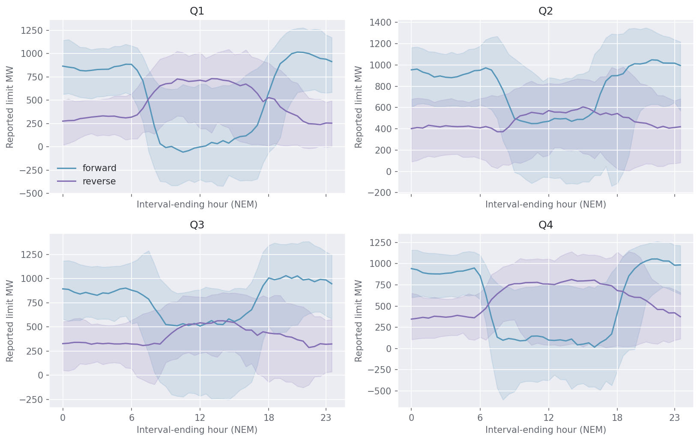
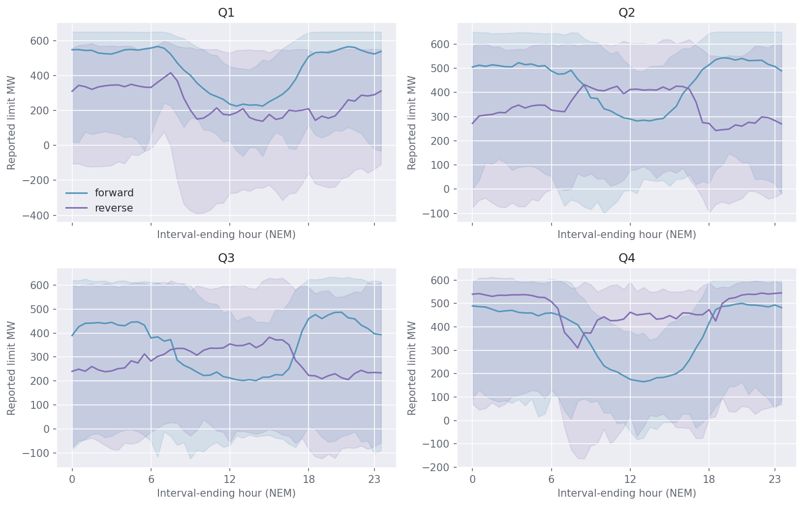
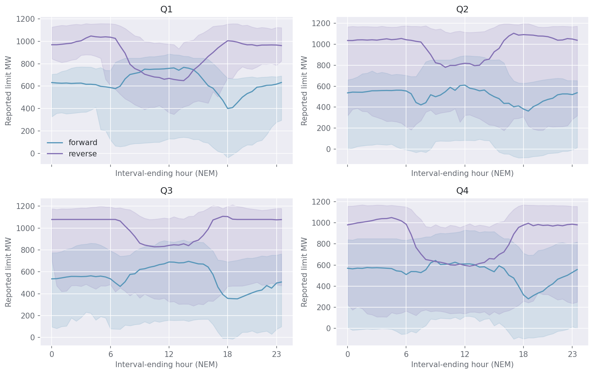
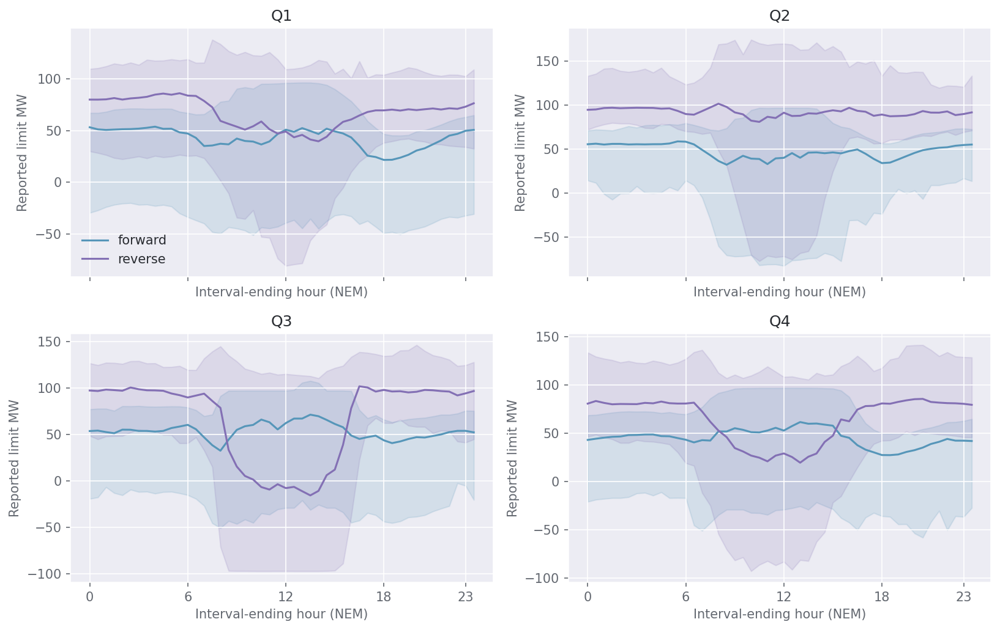
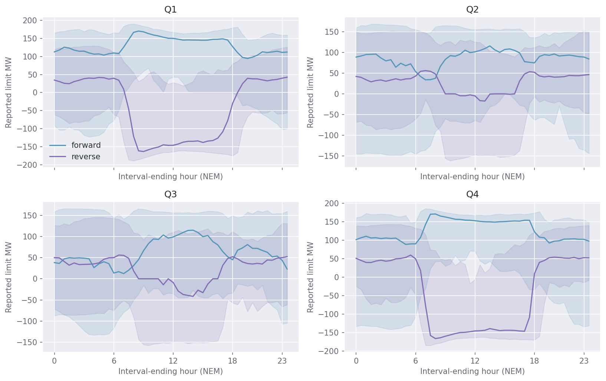
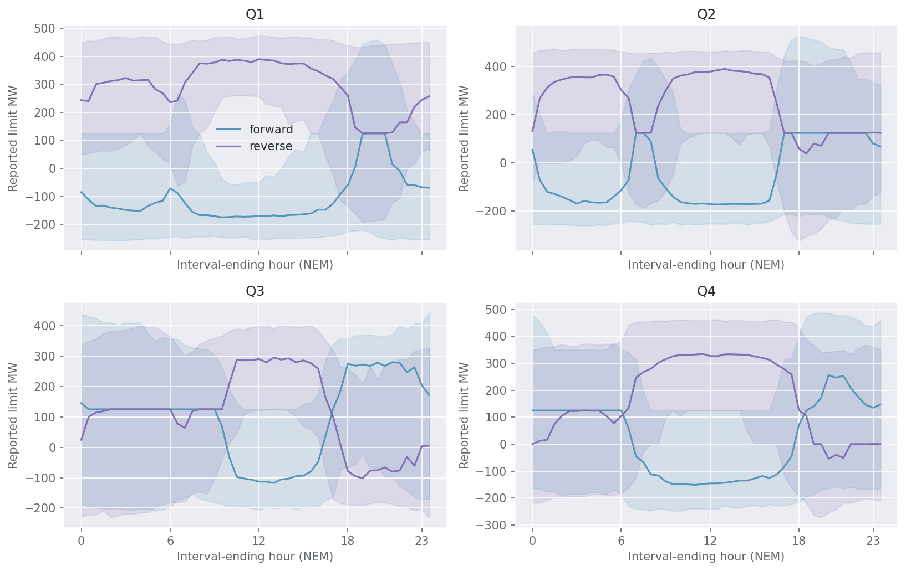

# Four quarters of conditional limits

Six interconnectors, both directions, with explicit support and configuration boundaries.

## 1. How to use these limits

Start with the quarter and delivery half-hour. Then specify the relevant network configuration and measurable conditions. The selector returns a conditional distribution, the historical examples behind it and any conditions relaxed for a broader reference. The P50 is one point in that distribution; the P10 and restrictive cases are essential when assessing downside transfer availability.

The catalogue is an overlapping set of interpretable conditions, not a claim that the grid occupies one mutually exclusive bucket. Thresholds in the final descriptive catalogue use its stated history. During evaluation every threshold was fitted afresh on eligible pre-evaluation history. Numeric user inputs remain numeric; named cases expose the threshold used. The serving evidence layer separately checks repetitions of each requested outage and collapses resubmission chains; unrelated background outage IDs cannot qualify that case as supported. This refines confidence labels without changing the evaluated point/quantile estimator.

## 2. Structural compatibility and sparse quarters

The current PEC-market history covers only part of Q4, and regulated Basslink has a short history. The selector does not borrow an incompatible old configuration as though it were the same grid. Asking for another quarter can return a broader within-era reference with quarter explicitly relaxed, or a separately labelled modelled extrapolation. A year of historical seasonal shape in an older configuration does not prove a new configuration has the same shape.

## VNI: quarterly and conditional profiles

The retained VNI panel contains 75,168 directional half-hours. Across that pooled history, 9.6% of directional observations are negative; this is a descriptive exposure frequency, not the probability of a future event. The figure keeps each direction separate and shows how the median can conceal a much wider lower tail. The longest era is **pre_pec_market**; the latest observed era is **pec_market**.

The following supported associations have the largest average median differences from the same quarter/half-hour reference. They reflect overlapping conditional samples and must not be added together as independent outage effects.

| direction   |   quarter | regime                            |   mean_median_difference_mw |   min_p10_mw |   median_days |   supported_half_hours |
|:------------|----------:|:----------------------------------|----------------------------:|-------------:|--------------:|-----------------------:|
| forward     |         3 | low_source_vre_high_sink_residual |                      277.6  |       657.32 |          39   |                     17 |
| reverse     |         1 | hot_high_sink_residual            |                     -214.59 |      -222.43 |          32.5 |                     10 |
| forward     |         2 | hot_high_sink_residual            |                     -196.54 |      -450.86 |          29   |                      3 |
| forward     |         1 | low_source_vre_high_sink_residual |                      178.41 |       612.24 |          26   |                     13 |
| forward     |         1 | outage_low_positive_group_output  |                     -160.38 |      -411.82 |          49   |                     11 |
| forward     |         3 | outage_high_negative_group_output |                      148.86 |       217.26 |          56.5 |                     24 |
| forward     |         2 | low_source_vre_high_sink_residual |                      140.5  |      -152.59 |          39   |                     12 |
| forward     |         4 | high_source_vre                   |                      139.53 |      -406.61 |          33   |                     47 |
| reverse     |         1 | high_sink_residual                |                     -125.74 |      -178.83 |          41   |                     29 |
| reverse     |         1 | outage_high_sink_residual         |                     -125.74 |      -178.83 |          41   |                     29 |

Current-era support is short and quarter coverage is incomplete. Its available reference cells are shown below rather than filling missing quarters from the earlier era.

| direction   |   quarter |   half_hours |   median_p50 |   lowest_p10 |   median_days |
|:------------|----------:|-------------:|-------------:|-------------:|--------------:|
| forward     |         4 |           48 |       594.58 |      -585.49 |            24 |
| reverse     |         4 |           48 |       612.73 |        23.53 |            24 |

## Heywood: quarterly and conditional profiles

The retained Heywood panel contains 75,264 directional half-hours. Across that pooled history, 11.7% of directional observations are negative; this is a descriptive exposure frequency, not the probability of a future event. The figure keeps each direction separate and shows how the median can conceal a much wider lower tail. The longest era is **pre_pec_market**; the latest observed era is **pec_market**.

The following supported associations have the largest average median differences from the same quarter/half-hour reference. They reflect overlapping conditional samples and must not be added together as independent outage effects.

| direction   |   quarter | regime                            |   mean_median_difference_mw |   min_p10_mw |   median_days |   supported_half_hours |
|:------------|----------:|:----------------------------------|----------------------------:|-------------:|--------------:|-----------------------:|
| reverse     |         1 | low_source_vre_high_sink_residual |                     -243.9  |      -282.7  |          25   |                      4 |
| forward     |         3 | set_S-TBSE                        |                     -236.06 |      -213.42 |          37   |                     48 |
| reverse     |         3 | set_S-TBSE                        |                     -170.97 |      -361.87 |          37   |                     48 |
| reverse     |         3 | joint_outage_configuration_1      |                     -162.58 |      -254.15 |          22.5 |                     18 |
| reverse     |         3 | set_S-TBTU                        |                     -153.85 |      -174.17 |          54   |                     20 |
| reverse     |         1 | high_source_vre                   |                      152.33 |      -192.82 |          45   |                     35 |
| forward     |         2 | high_source_vre                   |                     -151.27 |      -233.45 |          36   |                     48 |
| reverse     |         3 | no_mapped_outage                  |                      139.56 |      -330.06 |          37.5 |                     48 |
| reverse     |         3 | low_source_vre_high_sink_residual |                     -130.27 |      -155.69 |          37   |                     17 |
| forward     |         4 | low_source_vre_high_sink_residual |                      117.17 |       271.54 |          27   |                     21 |

Current-era support is short and quarter coverage is incomplete. Its available reference cells are shown below rather than filling missing quarters from the earlier era.

| direction   |   quarter |   half_hours |   median_p50 |   lowest_p10 |   median_days |
|:------------|----------:|-------------:|-------------:|-------------:|--------------:|
| forward     |         4 |           48 |       459.67 |      -121.9  |            24 |
| reverse     |         4 |           48 |       536.69 |       248.72 |            24 |

## QNI: quarterly and conditional profiles

The retained QNI panel contains 75,168 directional half-hours. Across that pooled history, 4.1% of directional observations are negative; this is a descriptive exposure frequency, not the probability of a future event. The figure keeps each direction separate and shows how the median can conceal a much wider lower tail. The longest era is **qni_existing**; the latest observed era is **qni_existing**.

The following supported associations have the largest average median differences from the same quarter/half-hour reference. They reflect overlapping conditional samples and must not be added together as independent outage effects.

| direction   |   quarter | regime                            |   mean_median_difference_mw |   min_p10_mw |   median_days |   supported_half_hours |
|:------------|----------:|:----------------------------------|----------------------------:|-------------:|--------------:|-----------------------:|
| forward     |         2 | hot_high_sink_residual            |                      183.34 |       -56.73 |          35   |                      4 |
| forward     |         4 | set_N-KC_TX                       |                      178.45 |      -298.43 |          37   |                     17 |
| forward     |         4 | outage_high_negative_group_output |                     -162    |      -668.42 |          50.5 |                     20 |
| forward     |         3 | set_Q-HATR                        |                      136.07 |       -26.38 |          43   |                     48 |
| forward     |         2 | outage_high_negative_group_output |                     -115.98 |      -582.52 |          28   |                     27 |
| reverse     |         2 | high_source_vre                   |                     -115.61 |       159.21 |         102   |                     17 |
| forward     |         2 | outage_high_sink_residual         |                     -114.86 |      -395.83 |          55   |                     12 |
| reverse     |         4 | outage_low_positive_group_output  |                      -94.96 |        73.54 |          35   |                     25 |
| forward     |         1 | low_source_vre_high_sink_residual |                      -90.16 |      -247.03 |          46   |                      9 |
| forward     |         4 | high_source_vre                   |                       87.64 |        60.89 |          91   |                     23 |

## Directlink: quarterly and conditional profiles

The retained Directlink panel contains 75,264 directional half-hours. Across that pooled history, 15.4% of directional observations are negative; this is a descriptive exposure frequency, not the probability of a future event. The figure keeps each direction separate and shows how the median can conceal a much wider lower tail. The longest era is **qni_existing**; the latest observed era is **qni_existing**.

The following supported associations have the largest average median differences from the same quarter/half-hour reference. They reflect overlapping conditional samples and must not be added together as independent outage effects.

| direction   |   quarter | regime                            |   mean_median_difference_mw |   min_p10_mw |   median_days |   supported_half_hours |
|:------------|----------:|:----------------------------------|----------------------------:|-------------:|--------------:|-----------------------:|
| reverse     |         3 | set_Q-GBMU_835_836                |                       27.86 |      -107.81 |          57   |                      6 |
| forward     |         3 | outage_high_negative_group_output |                      -22.88 |       -80.58 |          47   |                     19 |
| forward     |         3 | set_Q-GBMU_835_836                |                      -19.43 |       -48.13 |          57   |                      6 |
| forward     |         4 | outage_high_negative_group_output |                      -15.71 |       -58.03 |          35.5 |                     12 |
| forward     |         1 | outage_high_sink_residual         |                      -13.51 |       -62.45 |          72   |                     14 |
| forward     |         3 | hot_high_sink_residual            |                       13.16 |        -6.25 |          42.5 |                      2 |
| forward     |         2 | set_Q-GBMU_835_836                |                      -12.74 |      -105.72 |          40   |                     48 |
| forward     |         4 | no_mapped_outage                  |                       12.23 |       -88.69 |          75   |                     48 |
| reverse     |         1 | set_Q-X_HATR_TWO                  |                       12.15 |       -12.92 |          20   |                      2 |
| reverse     |         4 | set_N-KC_TX                       |                      -11.75 |       -96.51 |          37   |                     17 |

## Murraylink: quarterly and conditional profiles

The retained Murraylink panel contains 75,264 directional half-hours. Across that pooled history, 30.1% of directional observations are negative; this is a descriptive exposure frequency, not the probability of a future event. The figure keeps each direction separate and shows how the median can conceal a much wider lower tail. The longest era is **pre_pec_market**; the latest observed era is **pec_market**.

The following supported associations have the largest average median differences from the same quarter/half-hour reference. They reflect overlapping conditional samples and must not be added together as independent outage effects.

| direction   |   quarter | regime                            |   mean_median_difference_mw |   min_p10_mw |   median_days |   supported_half_hours |
|:------------|----------:|:----------------------------------|----------------------------:|-------------:|--------------:|-----------------------:|
| forward     |         2 | high_source_vre                   |                      -99.03 |      -154.75 |          36   |                     48 |
| forward     |         4 | high_source_vre                   |                      -81.3  |      -153.18 |          33   |                     47 |
| reverse     |         4 | high_source_vre                   |                       77.51 |      -184.78 |          52   |                     33 |
| forward     |         2 | outage_low_positive_group_output  |                      -71.51 |      -156.89 |          44   |                     37 |
| forward     |         3 | high_sink_residual                |                       69.08 |        -8.73 |          52.5 |                     34 |
| forward     |         3 | outage_high_sink_residual         |                       68.57 |        -8.73 |          48.5 |                     34 |
| reverse     |         2 | high_source_vre                   |                       67.16 |      -159.91 |          39   |                     47 |
| reverse     |         1 | high_source_vre                   |                       61.38 |      -190.32 |          45   |                     35 |
| reverse     |         3 | high_source_vre                   |                       53    |      -164.53 |          50   |                     43 |
| forward     |         3 | low_source_vre_high_sink_residual |                       48.34 |        -4.08 |          35   |                     19 |

Current-era support is short and quarter coverage is incomplete. Its available reference cells are shown below rather than filling missing quarters from the earlier era.

| direction   |   quarter |   half_hours |   median_p50 |   lowest_p10 |   median_days |
|:------------|----------:|-------------:|-------------:|-------------:|--------------:|
| forward     |         4 |           48 |       135.75 |       -26.27 |            24 |
| reverse     |         4 |           48 |        15.57 |      -180.96 |            24 |

## Basslink: quarterly and conditional profiles

The retained Basslink panel contains 75,264 directional half-hours. Across that pooled history, 37.3% of directional observations are negative; this is a descriptive exposure frequency, not the probability of a future event. The figure keeps each direction separate and shows how the median can conceal a much wider lower tail. The longest era is **mnsp**; the latest observed era is **regulated**.

The following supported associations have the largest average median differences from the same quarter/half-hour reference. They reflect overlapping conditional samples and must not be added together as independent outage effects.

| direction   |   quarter | regime                            |   mean_median_difference_mw |   min_p10_mw |   median_days |   supported_half_hours |
|:------------|----------:|:----------------------------------|----------------------------:|-------------:|--------------:|-----------------------:|
| reverse     |         2 | low_source_vre_high_sink_residual |                     -276.84 |      -359.48 |          32   |                     15 |
| forward     |         4 | hot_high_sink_residual            |                      213.71 |      -178.32 |          29   |                      7 |
| forward     |         1 | outage_high_sink_residual         |                      212.62 |      -213.25 |          35.5 |                     16 |
| forward     |         2 | high_sink_residual                |                      210.01 |      -213.55 |          53.5 |                     26 |
| forward     |         2 | outage_high_sink_residual         |                      199.05 |      -222.36 |          33   |                     17 |
| reverse     |         1 | low_source_vre_high_sink_residual |                     -195.13 |      -344.18 |          25   |                      9 |
| forward     |         1 | hot_high_sink_residual            |                      191.52 |      -223.05 |          38   |                     11 |
| forward     |         2 | low_source_vre_high_sink_residual |                      187.44 |       -98.88 |          27   |                     13 |
| forward     |         1 | high_sink_residual                |                      183.09 |      -219.64 |          41   |                     29 |
| forward     |         4 | outage_high_sink_residual         |                      176.56 |      -178.37 |          37   |                     23 |

Current-era support is short and quarter coverage is incomplete. Its available reference cells are shown below rather than filling missing quarters from the earlier era.

| direction   |   quarter |   half_hours |   median_p50 |   lowest_p10 |   median_days |
|:------------|----------:|-------------:|-------------:|-------------:|--------------:|
| forward     |         3 |           48 |       363.7  |      -221.68 |            92 |
| forward     |         4 |           48 |      -144.14 |      -245.82 |            24 |
| reverse     |         3 |           48 |      -164.46 |      -318.21 |            92 |
| reverse     |         4 |           48 |       311.45 |      -205.27 |            24 |

## Stress examples and extrapolation

Each Python query returns nearby historical days and restrictive observations from its compatible candidate set. Those examples are not assigned occurrence probabilities. Sparse exact conditions can produce a broader analogue range with an explicit list of relaxed conditions. Additive and boosted estimates require explicit extrapolation selection; their missing inputs are training-imputed assumptions and their tail calibration is not established for an arbitrary new combination.

## Downloads and use

[Full conditional catalogue](downloads/quarterly_catalogue.csv) · [Example 48-half-hour profile](downloads/example_profile.csv) · [Evidence-rich example](downloads/example_profile.json) · [Versioned Python bundle](downloads/nemic_regimes_bundle_v1.zip) · [Selector and workbook runbook](downloads/RUNBOOK_SELECTOR.md)