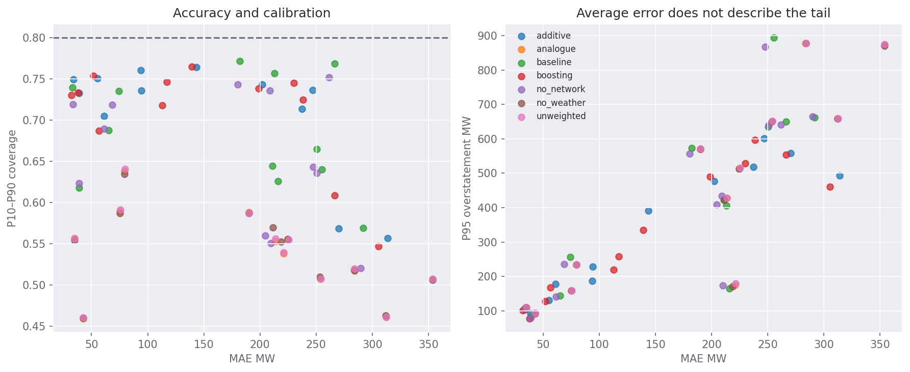
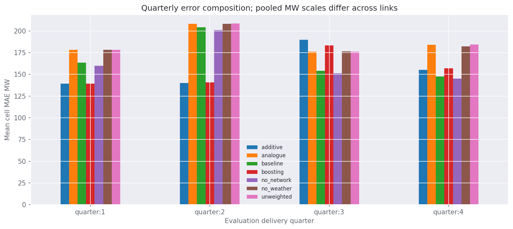

# Does conditioning improve the estimate?

Measured comparisons, calibration, availability and extreme-regime limitations.

## 1. What this evaluation can establish

The conditional experiment supplies known historical operating conditions to estimate the reported limit distribution. It answers whether the conditioner explains outcomes on later rows; it does not establish how well those future conditions can themselves be forecast. The event review informed feature development, so even chronological results are retrospective development evidence.

The separate as-of track has zero eligible historical rows because retained sources do not establish measured receipt for the complete six-link feature contract. No synthetic receipt times or realised future substitutions are used. Automatic collection now records actual receipts for future confirmation.

## 2. Chronology and comparisons

The expanding protocol starts with twelve months of training, eight weeks of selection, a four-week calibration/alert block and four-week evaluation blocks. The last two weeks of that pre-evaluation block are reserved for alert tuning, disjoint from quantile calibration. Earlier rows of boundary-crossing outage incidents are purged. Analogue neighbourhoods are tuned on a deterministic pre-evaluation sample; all 48 half-hours are eligible in evaluation. Source or method failures are reported separately, and comparisons use identical available rows.

The models are a piecewise additive regularised quantile regression and shallow quantile boosting. The former uses up to 1,800 deterministic training rows, L2 shrinkage and a convergence-checked smooth-pinball optimiser; boosting uses up to 6,000. The additive smoothing width is 0.005 of its training target IQR. Medians, scaling and imputation are training-fitted. Quantile ordering is repaired without clamping signed values.

| connector   | direction   | method     |     n |    mae |   pinball |   coverage80 |   width80 |   p95_overstatement |
|:------------|:------------|:-----------|------:|-------:|----------:|-------------:|----------:|--------------------:|
| Basslink    | forward     | additive   |  9333 |  93.66 |     29.86 |         0.76 |    296.16 |              187.33 |
| Basslink    | forward     | analogue   |  9333 | 221    |     72.63 |         0.54 |    334.16 |              175.52 |
| Basslink    | forward     | baseline   |  9333 | 215.92 |     69.75 |         0.63 |    403.61 |              164.42 |
| Basslink    | forward     | boosting   |  9333 | 112.72 |     33.59 |         0.72 |    298.17 |              219.85 |
| Basslink    | forward     | no_network |  9333 | 209.81 |     68.85 |         0.55 |    359.65 |              174.33 |
| Basslink    | forward     | no_weather |  9333 | 218.75 |     71.52 |         0.55 |    336.52 |              171.42 |
| Basslink    | forward     | unweighted |  9333 | 221.06 |     72.55 |         0.54 |    335.12 |              180.3  |
| Basslink    | reverse     | additive   |  9333 |  94.21 |     30.42 |         0.74 |    284.66 |              228.37 |
| Basslink    | reverse     | analogue   |  9333 | 213.62 |     69.41 |         0.55 |    342.32 |              427.74 |
| Basslink    | reverse     | baseline   |  9333 | 210.83 |     67.28 |         0.64 |    412.67 |              422.78 |
| Basslink    | reverse     | boosting   |  9333 | 117.2  |     34.61 |         0.75 |    305    |              257.6  |
| Basslink    | reverse     | no_network |  9333 | 204.49 |     67.28 |         0.56 |    364.52 |              408.92 |
| Basslink    | reverse     | no_weather |  9333 | 211.35 |     68.36 |         0.57 |    346.37 |              422.17 |
| Basslink    | reverse     | unweighted |  9333 | 213.6  |     69.48 |         0.56 |    343.32 |              427.75 |
| Directlink  | forward     | additive   | 11073 |  33.97 |     10.83 |         0.75 |     91.87 |              105.03 |
| Directlink  | forward     | analogue   | 11073 |  34.87 |     12.9  |         0.56 |     68.05 |              110.78 |
| Directlink  | forward     | baseline   | 11073 |  33.11 |     11.02 |         0.74 |     99.16 |              105.45 |
| Directlink  | forward     | boosting   | 11073 |  32.02 |     10.57 |         0.73 |     87.29 |              101.95 |
| Directlink  | forward     | no_network | 11073 |  33.56 |     11.13 |         0.72 |     95.05 |              106.79 |
| Directlink  | forward     | no_weather | 11073 |  34.79 |     12.92 |         0.55 |     67.82 |              110.9  |
| Directlink  | forward     | unweighted | 11073 |  34.87 |     12.89 |         0.56 |     68.03 |              110.63 |
| Directlink  | reverse     | additive   | 11073 |  38.87 |     12.63 |         0.73 |    118.32 |               92.4  |
| Directlink  | reverse     | analogue   | 11073 |  42.71 |     15.52 |         0.46 |     75.69 |               93.16 |
| Directlink  | reverse     | baseline   | 11073 |  38.92 |     13.17 |         0.62 |     95.35 |               83.6  |
| Directlink  | reverse     | boosting   | 11073 |  37.89 |     11.84 |         0.73 |    110.17 |               78.59 |
| Directlink  | reverse     | no_network | 11073 |  38.68 |     12.82 |         0.62 |     95.97 |               79.07 |
| Directlink  | reverse     | no_weather | 11073 |  42.7  |     15.52 |         0.46 |     75.68 |               93.11 |
| Directlink  | reverse     | unweighted | 11073 |  42.69 |     15.53 |         0.46 |     75.77 |               93.72 |
| Heywood     | forward     | additive   | 10416 | 143.4  |     44.6  |         0.76 |    432.56 |              391.45 |
| Heywood     | forward     | analogue   | 10416 | 189.97 |     68.22 |         0.59 |    348.4  |              570.7  |
| Heywood     | forward     | baseline   | 10416 | 182.04 |     59.02 |         0.77 |    516.37 |              573.36 |
| Heywood     | forward     | boosting   | 10416 | 139.2  |     42.69 |         0.76 |    416.73 |              334.69 |
| Heywood     | forward     | no_network | 10416 | 180.19 |     57.41 |         0.74 |    487.76 |              557.29 |
| Heywood     | forward     | no_weather | 10416 | 189.99 |     68.25 |         0.59 |    347.56 |              570.35 |
| Heywood     | forward     | unweighted | 10416 | 190.05 |     68.27 |         0.59 |    349.02 |              571.45 |
| Heywood     | reverse     | additive   | 10416 | 237.33 |     70.22 |         0.71 |    610.21 |              518.14 |
| Heywood     | reverse     | analogue   | 10416 | 253.93 |     90.42 |         0.51 |    426.45 |              651.13 |
| Heywood     | reverse     | baseline   | 10416 | 250.53 |     76.97 |         0.66 |    569.31 |              635.96 |
| Heywood     | reverse     | boosting   | 10416 | 229.9  |     66.67 |         0.75 |    604.73 |              529.24 |
| Heywood     | reverse     | no_network | 10416 | 250.75 |     78.25 |         0.64 |    537.55 |              639.29 |
| Heywood     | reverse     | no_weather | 10416 | 253.44 |     90.28 |         0.51 |    427.78 |              650.47 |
| Heywood     | reverse     | unweighted | 10416 | 254.15 |     90.41 |         0.51 |    427.79 |              651.05 |
| Murraylink  | forward     | additive   |  9137 |  61    |     19.15 |         0.7  |    164.98 |              178.52 |
| Murraylink  | forward     | analogue   |  9137 |  79.41 |     26.13 |         0.64 |    181.66 |              234.76 |
| Murraylink  | forward     | baseline   |  9137 |  74.26 |     22.41 |         0.74 |    200.62 |              256.42 |
| Murraylink  | forward     | boosting   |  9137 |  56.62 |     17.61 |         0.69 |    149.04 |              168.3  |
| Murraylink  | forward     | no_network |  9137 |  68.48 |     20.78 |         0.72 |    184.11 |              236.64 |
| Murraylink  | forward     | no_weather |  9137 |  79.51 |     26.23 |         0.63 |    180.88 |              235.2  |
| Murraylink  | forward     | unweighted |  9137 |  79.56 |     26.17 |         0.64 |    182.1  |              235.08 |
| Murraylink  | reverse     | additive   |  9137 |  55.18 |     17.14 |         0.75 |    171.64 |              130.79 |
| Murraylink  | reverse     | analogue   |  9137 |  75.21 |     24.78 |         0.59 |    168.1  |              158.93 |
| Murraylink  | reverse     | baseline   |  9137 |  65.18 |     20.3  |         0.69 |    196.59 |              144.76 |
| Murraylink  | reverse     | boosting   |  9137 |  51.73 |     15.66 |         0.75 |    163.51 |              127.74 |
| Murraylink  | reverse     | no_network |  9137 |  61.31 |     18.84 |         0.69 |    182.31 |              141.66 |
| Murraylink  | reverse     | no_weather |  9137 |  75.24 |     24.81 |         0.59 |    167.56 |              158.65 |
| Murraylink  | reverse     | unweighted |  9137 |  75.55 |     24.84 |         0.59 |    168.46 |              159.19 |
| QNI         | forward     | additive   | 11741 | 270.13 |     85.03 |         0.57 |    502.09 |              558.57 |
| QNI         | forward     | analogue   | 11741 | 312.19 |    115.05 |         0.46 |    456.84 |              659.23 |
| QNI         | forward     | baseline   | 11741 | 291.74 |     95.5  |         0.57 |    577.3  |              662.42 |
| QNI         | forward     | boosting   | 11741 | 266.4  |     84.94 |         0.61 |    522.62 |              554.07 |
| QNI         | forward     | no_network | 11741 | 289.83 |    101.73 |         0.52 |    516.81 |              664.83 |
| QNI         | forward     | no_weather | 11741 | 311.9  |    114.64 |         0.46 |    457.93 |              658.97 |
| QNI         | forward     | unweighted | 11741 | 312.38 |    114.9  |         0.46 |    458.93 |              658.88 |
| QNI         | reverse     | additive   | 11741 | 313.88 |     94.41 |         0.56 |    609.79 |              493.09 |
| QNI         | reverse     | analogue   | 11741 | 283.54 |    111.01 |         0.52 |    416.53 |              877.97 |
| QNI         | reverse     | baseline   | 11741 | 255.27 |    101.97 |         0.64 |    540.56 |              893.93 |
| QNI         | reverse     | boosting   | 11741 | 305.42 |     94.78 |         0.55 |    626.36 |              461.44 |
| QNI         | reverse     | no_network | 11741 | 247.46 |     98.83 |         0.64 |    507.57 |              867.85 |
| QNI         | reverse     | no_weather | 11741 | 284.14 |    111.18 |         0.52 |    415.7  |              877.6  |
| QNI         | reverse     | unweighted | 11741 | 284.06 |    110.97 |         0.52 |    419.62 |              877.72 |
| VNI         | forward     | additive   |  8691 | 246.83 |     77.82 |         0.74 |    692.92 |              601.47 |
| VNI         | forward     | analogue   |  8691 | 353.79 |    128.38 |         0.51 |    559.84 |              872.88 |
| VNI         | forward     | baseline   |  8691 | 266.44 |     84.6  |         0.77 |    835.08 |              649.57 |
| VNI         | forward     | boosting   |  8691 | 238.48 |     76.37 |         0.72 |    687.11 |              597.08 |
| VNI         | forward     | no_network |  8691 | 261.6  |     83.59 |         0.75 |    791.56 |              640.7  |
| VNI         | forward     | no_weather |  8691 | 353.88 |    128.41 |         0.51 |    559.34 |              871.08 |
| VNI         | forward     | unweighted |  8691 | 353.79 |    128.36 |         0.51 |    560.76 |              874.79 |
| VNI         | reverse     | additive   |  8691 | 202.08 |     64.59 |         0.74 |    603.56 |              476.98 |
| VNI         | reverse     | analogue   |  8691 | 224.45 |     79.78 |         0.56 |    466.89 |              514.33 |
| VNI         | reverse     | baseline   |  8691 | 213.04 |     67.73 |         0.76 |    667.47 |              405.76 |
| VNI         | reverse     | boosting   |  8691 | 198.61 |     62.19 |         0.74 |    572.67 |              489.93 |
| VNI         | reverse     | no_network |  8691 | 208.88 |     66.73 |         0.74 |    639.86 |              434.31 |
| VNI         | reverse     | no_weather |  8691 | 224.57 |     79.86 |         0.56 |    465.92 |              513.01 |
| VNI         | reverse     | unweighted |  8691 | 225.54 |     79.92 |         0.56 |    468.28 |              515.94 |

A separate [canonical incident audit](downloads/canonical_partition_audit.json) collapses outage resubmission chains and checks every pair of chronological partitions in all 132 connector-direction folds. No shared incident was found across partition boundaries. This establishes incident separation, not model accuracy.

## 3. Paired uncertainty and risk gates

Paired seven-day block resampling compares point errors on identical timestamps. The historical gates require a positive lower improvement bound, lower quantile loss, acceptable interval coverage, no material worsening in overstatement or restriction/forced-flow recall, and sufficient extreme-event support. Passing a historical gate is not production promotion. Where a method fails, the reason remains part of the deliverable.

| connector   | direction   | method     | control   | historical_gate_pass   | reasons                                                                                                                                                                                                                                                                | production_promotion   |
|:------------|:------------|:-----------|:----------|:-----------------------|:-----------------------------------------------------------------------------------------------------------------------------------------------------------------------------------------------------------------------------------------------------------------------|:-----------------------|
| Basslink    | forward     | additive   | analogue  | False                  | overstatement tail worsened; false alert rate worsened                                                                                                                                                                                                                 | False                  |
| Basslink    | forward     | analogue   | baseline  | False                  | paired point improvement not established; distributional loss not improved; 80% interval coverage outside 75–85% convention; overstatement tail worsened; forced_recall worsened; false alert rate worsened                                                            | False                  |
| Basslink    | forward     | boosting   | analogue  | False                  | 80% interval coverage outside 75–85% convention; overstatement tail worsened; false alert rate worsened                                                                                                                                                                | False                  |
| Basslink    | forward     | no_network | baseline  | False                  | 80% interval coverage outside 75–85% convention; overstatement tail worsened                                                                                                                                                                                           | False                  |
| Basslink    | forward     | no_weather | baseline  | False                  | paired point improvement not established; distributional loss not improved; 80% interval coverage outside 75–85% convention; forced_recall worsened; false alert rate worsened                                                                                         | False                  |
| Basslink    | forward     | unweighted | baseline  | False                  | paired point improvement not established; distributional loss not improved; 80% interval coverage outside 75–85% convention; overstatement tail worsened; false alert rate worsened                                                                                    | False                  |
| Basslink    | reverse     | additive   | analogue  | False                  | 80% interval coverage outside 75–85% convention; restriction_precision worsened; false alert rate worsened                                                                                                                                                             | False                  |
| Basslink    | reverse     | analogue   | baseline  | False                  | paired point improvement not established; distributional loss not improved; 80% interval coverage outside 75–85% convention; restriction_precision worsened; forced_recall worsened; false alert rate worsened                                                         | False                  |
| Basslink    | reverse     | boosting   | analogue  | False                  | 80% interval coverage outside 75–85% convention; restriction_precision worsened; false alert rate worsened                                                                                                                                                             | False                  |
| Basslink    | reverse     | no_network | baseline  | False                  | 80% interval coverage outside 75–85% convention                                                                                                                                                                                                                        | False                  |
| Basslink    | reverse     | no_weather | baseline  | False                  | paired point improvement not established; distributional loss not improved; 80% interval coverage outside 75–85% convention; restriction_precision worsened; forced_recall worsened; false alert rate worsened                                                         | False                  |
| Basslink    | reverse     | unweighted | baseline  | False                  | paired point improvement not established; distributional loss not improved; 80% interval coverage outside 75–85% convention; restriction_precision worsened; forced_recall worsened; false alert rate worsened                                                         | False                  |
| Directlink  | forward     | additive   | analogue  | False                  | paired point improvement not established; 80% interval coverage outside 75–85% convention; false alert rate worsened                                                                                                                                                   | False                  |
| Directlink  | forward     | analogue   | baseline  | False                  | paired point improvement not established; distributional loss not improved; 80% interval coverage outside 75–85% convention; restriction_precision worsened; forced_recall worsened; false alert rate worsened                                                         | False                  |
| Directlink  | forward     | boosting   | analogue  | False                  | 80% interval coverage outside 75–85% convention; false alert rate worsened                                                                                                                                                                                             | False                  |
| Directlink  | forward     | no_network | baseline  | False                  | paired point improvement not established; distributional loss not improved; 80% interval coverage outside 75–85% convention; restriction_precision worsened; false alert rate worsened                                                                                 | False                  |
| Directlink  | forward     | no_weather | baseline  | False                  | paired point improvement not established; distributional loss not improved; 80% interval coverage outside 75–85% convention; restriction_precision worsened; forced_recall worsened; false alert rate worsened                                                         | False                  |
| Directlink  | forward     | unweighted | baseline  | False                  | paired point improvement not established; distributional loss not improved; 80% interval coverage outside 75–85% convention; restriction_precision worsened; forced_recall worsened; false alert rate worsened                                                         | False                  |
| Directlink  | reverse     | additive   | analogue  | False                  | 80% interval coverage outside 75–85% convention; restriction_precision worsened; forced_precision worsened; false alert rate worsened                                                                                                                                  | False                  |
| Directlink  | reverse     | analogue   | baseline  | False                  | paired point improvement not established; distributional loss not improved; 80% interval coverage outside 75–85% convention; overstatement tail worsened; restriction_precision worsened; forced_recall worsened; false alert rate worsened                            | False                  |
| Directlink  | reverse     | boosting   | analogue  | False                  | 80% interval coverage outside 75–85% convention; restriction_precision worsened; false alert rate worsened                                                                                                                                                             | False                  |
| Directlink  | reverse     | no_network | baseline  | False                  | paired point improvement not established; 80% interval coverage outside 75–85% convention; restriction_precision worsened                                                                                                                                              | False                  |
| Directlink  | reverse     | no_weather | baseline  | False                  | paired point improvement not established; distributional loss not improved; 80% interval coverage outside 75–85% convention; overstatement tail worsened; restriction_precision worsened; forced_recall worsened; false alert rate worsened                            | False                  |
| Directlink  | reverse     | unweighted | baseline  | False                  | paired point improvement not established; distributional loss not improved; 80% interval coverage outside 75–85% convention; overstatement tail worsened; restriction_precision worsened; forced_recall worsened; false alert rate worsened                            | False                  |
| Heywood     | forward     | additive   | analogue  | False                  | false alert rate worsened                                                                                                                                                                                                                                              | False                  |
| Heywood     | forward     | analogue   | baseline  | False                  | paired point improvement not established; distributional loss not improved; 80% interval coverage outside 75–85% convention; restriction_precision worsened; forced_recall worsened; false alert rate worsened                                                         | False                  |
| Heywood     | forward     | boosting   | analogue  | False                  | false alert rate worsened                                                                                                                                                                                                                                              | False                  |
| Heywood     | forward     | no_network | baseline  | False                  | paired point improvement not established; 80% interval coverage outside 75–85% convention; false alert rate worsened                                                                                                                                                   | False                  |
| Heywood     | forward     | no_weather | baseline  | False                  | paired point improvement not established; distributional loss not improved; 80% interval coverage outside 75–85% convention; restriction_precision worsened; forced_recall worsened; false alert rate worsened                                                         | False                  |
| Heywood     | forward     | unweighted | baseline  | False                  | paired point improvement not established; distributional loss not improved; 80% interval coverage outside 75–85% convention; restriction_precision worsened; forced_recall worsened; false alert rate worsened                                                         | False                  |
| Heywood     | reverse     | additive   | analogue  | False                  | paired point improvement not established; 80% interval coverage outside 75–85% convention; restriction_precision worsened; false alert rate worsened                                                                                                                   | False                  |
| Heywood     | reverse     | analogue   | baseline  | False                  | paired point improvement not established; distributional loss not improved; 80% interval coverage outside 75–85% convention; restriction_precision worsened; forced_recall worsened; false alert rate worsened                                                         | False                  |
| Heywood     | reverse     | boosting   | analogue  | False                  | 80% interval coverage outside 75–85% convention; restriction_precision worsened; false alert rate worsened                                                                                                                                                             | False                  |
| Heywood     | reverse     | no_network | baseline  | False                  | paired point improvement not established; distributional loss not improved; 80% interval coverage outside 75–85% convention                                                                                                                                            | False                  |
| Heywood     | reverse     | no_weather | baseline  | False                  | paired point improvement not established; distributional loss not improved; 80% interval coverage outside 75–85% convention; restriction_precision worsened; forced_recall worsened; false alert rate worsened                                                         | False                  |
| Heywood     | reverse     | unweighted | baseline  | False                  | paired point improvement not established; distributional loss not improved; 80% interval coverage outside 75–85% convention; restriction_precision worsened; forced_recall worsened; false alert rate worsened                                                         | False                  |
| Murraylink  | forward     | additive   | analogue  | False                  | 80% interval coverage outside 75–85% convention; false alert rate worsened                                                                                                                                                                                             | False                  |
| Murraylink  | forward     | analogue   | baseline  | False                  | paired point improvement not established; distributional loss not improved; 80% interval coverage outside 75–85% convention; restriction_precision worsened; forced_recall worsened; false alert rate worsened                                                         | False                  |
| Murraylink  | forward     | boosting   | analogue  | False                  | 80% interval coverage outside 75–85% convention; false alert rate worsened                                                                                                                                                                                             | False                  |
| Murraylink  | forward     | no_network | baseline  | False                  | 80% interval coverage outside 75–85% convention; false alert rate worsened                                                                                                                                                                                             | False                  |
| Murraylink  | forward     | no_weather | baseline  | False                  | paired point improvement not established; distributional loss not improved; 80% interval coverage outside 75–85% convention; restriction_precision worsened; forced_recall worsened; false alert rate worsened                                                         | False                  |
| Murraylink  | forward     | unweighted | baseline  | False                  | paired point improvement not established; distributional loss not improved; 80% interval coverage outside 75–85% convention; restriction_precision worsened; forced_recall worsened; false alert rate worsened                                                         | False                  |
| Murraylink  | reverse     | additive   | analogue  | False                  | restriction_precision worsened; false alert rate worsened                                                                                                                                                                                                              | False                  |
| Murraylink  | reverse     | analogue   | baseline  | False                  | paired point improvement not established; distributional loss not improved; 80% interval coverage outside 75–85% convention; overstatement tail worsened; restriction_precision worsened; forced_recall worsened; false alert rate worsened                            | False                  |
| Murraylink  | reverse     | boosting   | analogue  | False                  | restriction_precision worsened; false alert rate worsened                                                                                                                                                                                                              | False                  |
| Murraylink  | reverse     | no_network | baseline  | False                  | 80% interval coverage outside 75–85% convention; restriction_precision worsened; false alert rate worsened                                                                                                                                                             | False                  |
| Murraylink  | reverse     | no_weather | baseline  | False                  | paired point improvement not established; distributional loss not improved; 80% interval coverage outside 75–85% convention; overstatement tail worsened; restriction_precision worsened; forced_recall worsened; false alert rate worsened                            | False                  |
| Murraylink  | reverse     | unweighted | baseline  | False                  | paired point improvement not established; distributional loss not improved; 80% interval coverage outside 75–85% convention; overstatement tail worsened; restriction_precision worsened; forced_recall worsened; false alert rate worsened                            | False                  |
| QNI         | forward     | additive   | analogue  | False                  | paired point improvement not established; 80% interval coverage outside 75–85% convention; false alert rate worsened                                                                                                                                                   | False                  |
| QNI         | forward     | analogue   | baseline  | False                  | paired point improvement not established; distributional loss not improved; 80% interval coverage outside 75–85% convention; forced_recall worsened; false alert rate worsened                                                                                         | False                  |
| QNI         | forward     | boosting   | analogue  | False                  | paired point improvement not established; 80% interval coverage outside 75–85% convention; false alert rate worsened                                                                                                                                                   | False                  |
| QNI         | forward     | no_network | baseline  | False                  | paired point improvement not established; distributional loss not improved; 80% interval coverage outside 75–85% convention; forced_recall worsened; forced_precision worsened; false alert rate worsened                                                              | False                  |
| QNI         | forward     | no_weather | baseline  | False                  | paired point improvement not established; distributional loss not improved; 80% interval coverage outside 75–85% convention; forced_recall worsened; false alert rate worsened                                                                                         | False                  |
| QNI         | forward     | unweighted | baseline  | False                  | paired point improvement not established; distributional loss not improved; 80% interval coverage outside 75–85% convention; forced_recall worsened; false alert rate worsened                                                                                         | False                  |
| QNI         | reverse     | additive   | analogue  | False                  | paired point improvement not established; 80% interval coverage outside 75–85% convention; false alert rate worsened                                                                                                                                                   | False                  |
| QNI         | reverse     | analogue   | baseline  | False                  | paired point improvement not established; distributional loss not improved; 80% interval coverage outside 75–85% convention; false alert rate worsened                                                                                                                 | False                  |
| QNI         | reverse     | boosting   | analogue  | False                  | paired point improvement not established; 80% interval coverage outside 75–85% convention; false alert rate worsened                                                                                                                                                   | False                  |
| QNI         | reverse     | no_network | baseline  | False                  | 80% interval coverage outside 75–85% convention                                                                                                                                                                                                                        | False                  |
| QNI         | reverse     | no_weather | baseline  | False                  | paired point improvement not established; distributional loss not improved; 80% interval coverage outside 75–85% convention; false alert rate worsened                                                                                                                 | False                  |
| QNI         | reverse     | unweighted | baseline  | False                  | paired point improvement not established; distributional loss not improved; 80% interval coverage outside 75–85% convention; false alert rate worsened                                                                                                                 | False                  |
| VNI         | forward     | additive   | analogue  | False                  | 80% interval coverage outside 75–85% convention; false alert rate worsened                                                                                                                                                                                             | False                  |
| VNI         | forward     | analogue   | baseline  | False                  | paired point improvement not established; distributional loss not improved; 80% interval coverage outside 75–85% convention; overstatement tail worsened; restriction_precision worsened; forced_recall worsened; forced_precision worsened; false alert rate worsened | False                  |
| VNI         | forward     | boosting   | analogue  | False                  | 80% interval coverage outside 75–85% convention; false alert rate worsened                                                                                                                                                                                             | False                  |
| VNI         | forward     | no_network | baseline  | False                  | paired point improvement not established                                                                                                                                                                                                                               | False                  |
| VNI         | forward     | no_weather | baseline  | False                  | paired point improvement not established; distributional loss not improved; 80% interval coverage outside 75–85% convention; overstatement tail worsened; restriction_precision worsened; forced_recall worsened; forced_precision worsened; false alert rate worsened | False                  |
| VNI         | forward     | unweighted | baseline  | False                  | paired point improvement not established; distributional loss not improved; 80% interval coverage outside 75–85% convention; overstatement tail worsened; restriction_precision worsened; forced_recall worsened; forced_precision worsened; false alert rate worsened | False                  |
| VNI         | reverse     | additive   | analogue  | False                  | 80% interval coverage outside 75–85% convention; restriction_precision worsened; false alert rate worsened                                                                                                                                                             | False                  |
| VNI         | reverse     | analogue   | baseline  | False                  | paired point improvement not established; distributional loss not improved; 80% interval coverage outside 75–85% convention; overstatement tail worsened; false alert rate worsened                                                                                    | False                  |
| VNI         | reverse     | boosting   | analogue  | False                  | 80% interval coverage outside 75–85% convention; false alert rate worsened                                                                                                                                                                                             | False                  |
| VNI         | reverse     | no_network | baseline  | False                  | paired point improvement not established; 80% interval coverage outside 75–85% convention; overstatement tail worsened                                                                                                                                                 | False                  |
| VNI         | reverse     | no_weather | baseline  | False                  | paired point improvement not established; distributional loss not improved; 80% interval coverage outside 75–85% convention; overstatement tail worsened; false alert rate worsened                                                                                    | False                  |
| VNI         | reverse     | unweighted | baseline  | False                  | paired point improvement not established; distributional loss not improved; 80% interval coverage outside 75–85% convention; overstatement tail worsened; false alert rate worsened                                                                                    | False                  |

| connector   | direction   | method     | control   |   improvement_mw |   ci_lo |   ci_hi |   blocks |
|:------------|:------------|:-----------|:----------|-----------------:|--------:|--------:|---------:|
| Basslink    | forward     | additive   | baseline  |           122.25 |   94.67 |  152.04 |       32 |
| Basslink    | forward     | additive   | analogue  |           127.34 |  107.28 |  147.24 |       32 |
| Basslink    | forward     | analogue   | baseline  |            -5.08 |  -18.1  |   10.89 |       32 |
| Basslink    | forward     | boosting   | baseline  |           103.2  |   82.84 |  125.78 |       32 |
| Basslink    | forward     | boosting   | analogue  |           108.28 |   92.68 |  123.3  |       32 |
| Basslink    | forward     | no_network | baseline  |             6.11 |    1.47 |   11.3  |       32 |
| Basslink    | forward     | no_weather | baseline  |            -2.83 |  -15.02 |   12.29 |       32 |
| Basslink    | forward     | unweighted | baseline  |            -5.15 |  -18.22 |   10.8  |       32 |
| Basslink    | reverse     | additive   | baseline  |           116.63 |   91.67 |  142.21 |       32 |
| Basslink    | reverse     | additive   | analogue  |           119.41 |  102.19 |  138.32 |       32 |
| Basslink    | reverse     | analogue   | baseline  |            -2.78 |  -15.53 |   12.57 |       32 |
| Basslink    | reverse     | boosting   | baseline  |            93.63 |   73.35 |  116.25 |       32 |
| Basslink    | reverse     | boosting   | analogue  |            96.41 |   80.96 |  112.48 |       32 |
| Basslink    | reverse     | no_network | baseline  |             6.34 |    1.02 |   12    |       32 |
| Basslink    | reverse     | no_weather | baseline  |            -0.52 |  -12.27 |   14.62 |       32 |
| Basslink    | reverse     | unweighted | baseline  |            -2.77 |  -15.47 |   12.55 |       32 |
| Directlink  | forward     | additive   | baseline  |            -0.86 |   -4.03 |    2.48 |       43 |
| Directlink  | forward     | additive   | analogue  |             0.91 |   -1.84 |    3.62 |       43 |
| Directlink  | forward     | analogue   | baseline  |            -1.76 |   -4.29 |    0.3  |       43 |
| Directlink  | forward     | boosting   | baseline  |             1.09 |   -2.47 |    4.12 |       43 |
| Directlink  | forward     | boosting   | analogue  |             2.86 |    0.45 |    5.16 |       43 |
| Directlink  | forward     | no_network | baseline  |            -0.45 |   -1.16 |    0.45 |       43 |
| Directlink  | forward     | no_weather | baseline  |            -1.68 |   -4.07 |    0.36 |       43 |
| Directlink  | forward     | unweighted | baseline  |            -1.76 |   -4.26 |    0.29 |       43 |
| Directlink  | reverse     | additive   | baseline  |             0.04 |   -1.97 |    2.02 |       43 |
| Directlink  | reverse     | additive   | analogue  |             3.83 |    1.35 |    6.65 |       43 |
| Directlink  | reverse     | analogue   | baseline  |            -3.79 |   -6.16 |   -1.91 |       43 |
| Directlink  | reverse     | boosting   | baseline  |             1.03 |   -0.64 |    2.6  |       43 |
| Directlink  | reverse     | boosting   | analogue  |             4.82 |    2.48 |    7.32 |       43 |
| Directlink  | reverse     | no_network | baseline  |             0.24 |   -0.42 |    0.94 |       43 |
| Directlink  | reverse     | no_weather | baseline  |            -3.78 |   -6.18 |   -1.86 |       43 |
| Directlink  | reverse     | unweighted | baseline  |            -3.77 |   -6.14 |   -1.9  |       43 |
| Heywood     | forward     | additive   | baseline  |            38.64 |   27.47 |   50.21 |       44 |
| Heywood     | forward     | additive   | analogue  |            46.56 |   32.12 |   59.55 |       44 |
| Heywood     | forward     | analogue   | baseline  |            -7.92 |  -24.29 |    6.82 |       44 |
| Heywood     | forward     | boosting   | baseline  |            42.84 |   26.17 |   60.07 |       44 |
| Heywood     | forward     | boosting   | analogue  |            50.77 |   35.47 |   64.51 |       44 |
| Heywood     | forward     | no_network | baseline  |             1.85 |   -2.02 |    5.29 |       44 |
| Heywood     | forward     | no_weather | baseline  |            -7.95 |  -24.48 |    6.93 |       44 |
| Heywood     | forward     | unweighted | baseline  |            -8.01 |  -24.03 |    6.62 |       44 |
| Heywood     | reverse     | additive   | baseline  |            13.2  |   -7.5  |   36.93 |       44 |
| Heywood     | reverse     | additive   | analogue  |            16.6  |   -8.5  |   39.51 |       44 |
| Heywood     | reverse     | analogue   | baseline  |            -3.39 |  -18.2  |    9.48 |       44 |
| Heywood     | reverse     | boosting   | baseline  |            20.63 |    0.7  |   42.22 |       44 |
| Heywood     | reverse     | boosting   | analogue  |            24.03 |    1.22 |   45.37 |       44 |
| Heywood     | reverse     | no_network | baseline  |            -0.21 |   -3.93 |    4.21 |       44 |
| Heywood     | reverse     | no_weather | baseline  |            -2.9  |  -17.73 |   10.1  |       44 |
| Heywood     | reverse     | unweighted | baseline  |            -3.61 |  -18.24 |    9.12 |       44 |
| Murraylink  | forward     | additive   | baseline  |            13.26 |    6.82 |   18.12 |       43 |
| Murraylink  | forward     | additive   | analogue  |            18.41 |   12.05 |   23.88 |       43 |
| Murraylink  | forward     | analogue   | baseline  |            -5.15 |  -11.54 |    1.01 |       43 |
| Murraylink  | forward     | boosting   | baseline  |            17.64 |   10.21 |   22.75 |       43 |
| Murraylink  | forward     | boosting   | analogue  |            22.8  |   16.64 |   28.06 |       43 |
| Murraylink  | forward     | no_network | baseline  |             5.78 |    2.05 |    8.77 |       43 |
| Murraylink  | forward     | no_weather | baseline  |            -5.25 |  -11.62 |    0.97 |       43 |
| Murraylink  | forward     | unweighted | baseline  |            -5.3  |  -11.7  |    0.84 |       43 |
| Murraylink  | reverse     | additive   | baseline  |            10    |    4.88 |   15.39 |       43 |
| Murraylink  | reverse     | additive   | analogue  |            20.03 |   16.58 |   24.71 |       43 |
| Murraylink  | reverse     | analogue   | baseline  |           -10.03 |  -16.29 |   -3.26 |       43 |
| Murraylink  | reverse     | boosting   | baseline  |            13.45 |    8.12 |   18.01 |       43 |
| Murraylink  | reverse     | boosting   | analogue  |            23.48 |   19.71 |   28.22 |       43 |
| Murraylink  | reverse     | no_network | baseline  |             3.87 |    2.39 |    5.34 |       43 |
| Murraylink  | reverse     | no_weather | baseline  |           -10.06 |  -16.37 |   -3.3  |       43 |
| Murraylink  | reverse     | unweighted | baseline  |           -10.37 |  -16.65 |   -3.56 |       43 |
| QNI         | forward     | additive   | baseline  |            21.61 |  -64.67 |   87.58 |       43 |
| QNI         | forward     | additive   | analogue  |            42.06 |  -37.42 |  102.93 |       43 |
| QNI         | forward     | analogue   | baseline  |           -20.45 |  -41.89 |    1.52 |       43 |
| QNI         | forward     | boosting   | baseline  |            25.35 |  -57.77 |   93.39 |       43 |
| QNI         | forward     | boosting   | analogue  |            45.8  |  -30.48 |  105.9  |       43 |
| QNI         | forward     | no_network | baseline  |             1.91 |   -2.22 |    6.54 |       43 |
| QNI         | forward     | no_weather | baseline  |           -20.15 |  -41.57 |    1.89 |       43 |
| QNI         | forward     | unweighted | baseline  |           -20.63 |  -42.04 |    1.55 |       43 |
| QNI         | reverse     | additive   | baseline  |           -58.61 | -155.92 |   18.56 |       43 |
| QNI         | reverse     | additive   | analogue  |           -30.34 | -117.89 |   45.37 |       43 |
| QNI         | reverse     | analogue   | baseline  |           -28.27 |  -53.79 |   -9.29 |       43 |
| QNI         | reverse     | boosting   | baseline  |           -50.15 | -149.04 |   27.84 |       43 |
| QNI         | reverse     | boosting   | analogue  |           -21.88 | -107.94 |   54.36 |       43 |
| QNI         | reverse     | no_network | baseline  |             7.81 |    3.15 |   12.68 |       43 |
| QNI         | reverse     | no_weather | baseline  |           -28.87 |  -54.18 |   -9.94 |       43 |
| QNI         | reverse     | unweighted | baseline  |           -28.79 |  -54.21 |   -9.83 |       43 |

## 4. Restrictive regimes and forced flow

Restriction thresholds are fitted from positive pre-evaluation directional limits, while zero and negative observations remain outcomes. An alert is judged with recall, precision and false alerts per half-hour exposure day. Forced flow is evaluated separately. Low incident counts can prevent a risk conclusion even when average errors are favourable.

| connector   | direction   | method     |   restriction_events |   restriction_recall | restriction_precision   |   false_alerts_per_day |   forced_events |   forced_recall |
|:------------|:------------|:-----------|---------------------:|---------------------:|:------------------------|-----------------------:|----------------:|----------------:|
| Basslink    | forward     | additive   |                 8558 |                 1    | 0.92                    |                   3.98 |            4049 |            1    |
| Basslink    | forward     | analogue   |                 8558 |                 0.94 | 0.93                    |                   3.35 |            4049 |            0.98 |
| Basslink    | forward     | baseline   |                 8558 |                 0.9  | 0.93                    |                   2.89 |            4049 |            1    |
| Basslink    | forward     | boosting   |                 8558 |                 1    | 0.92                    |                   3.98 |            4049 |            1    |
| Basslink    | forward     | no_network |                 8558 |                 0.92 | 0.94                    |                   2.8  |            4049 |            1    |
| Basslink    | forward     | no_weather |                 8558 |                 0.94 | 0.93                    |                   3.31 |            4049 |            0.98 |
| Basslink    | forward     | unweighted |                 8558 |                 0.94 | 0.93                    |                   3.36 |            4049 |            0.98 |
| Basslink    | reverse     | additive   |                 5652 |                 0.96 | 0.72                    |                  10.84 |             738 |            0.89 |
| Basslink    | reverse     | analogue   |                 5652 |                 0.27 | 0.85                    |                   1.38 |             738 |            0.62 |
| Basslink    | reverse     | baseline   |                 5652 |                 0.15 | 0.90                    |                   0.48 |             738 |            0.71 |
| Basslink    | reverse     | boosting   |                 5652 |                 0.96 | 0.73                    |                  10.27 |             738 |            0.87 |
| Basslink    | reverse     | no_network |                 5652 |                 0.25 | 0.96                    |                   0.33 |             738 |            0.78 |
| Basslink    | reverse     | no_weather |                 5652 |                 0.27 | 0.86                    |                   1.33 |             738 |            0.64 |
| Basslink    | reverse     | unweighted |                 5652 |                 0.27 | 0.85                    |                   1.38 |             738 |            0.62 |
| Directlink  | forward     | additive   |                 3016 |                 0.88 | 0.29                    |                  28.19 |            1854 |            0.69 |
| Directlink  | forward     | analogue   |                 3016 |                 0.15 | 0.28                    |                   4.92 |            1854 |            0.5  |
| Directlink  | forward     | baseline   |                 3016 |                 0.08 | 0.39                    |                   1.56 |            1854 |            0.76 |
| Directlink  | forward     | boosting   |                 3016 |                 0.83 | 0.28                    |                  27.85 |            1854 |            0.66 |
| Directlink  | forward     | no_network |                 3016 |                 0.13 | 0.34                    |                   3.29 |            1854 |            0.77 |
| Directlink  | forward     | no_weather |                 3016 |                 0.15 | 0.28                    |                   4.92 |            1854 |            0.51 |
| Directlink  | forward     | unweighted |                 3016 |                 0.15 | 0.28                    |                   4.92 |            1854 |            0.51 |
| Directlink  | reverse     | additive   |                 2103 |                 0.78 | 0.24                    |                  22.06 |            1017 |            0.94 |
| Directlink  | reverse     | analogue   |                 2103 |                 0.37 | 0.53                    |                   2.99 |            1017 |            0.8  |
| Directlink  | reverse     | baseline   |                 2103 |                 0.08 | 0.77                    |                   0.23 |            1017 |            0.9  |
| Directlink  | reverse     | boosting   |                 2103 |                 0.76 | 0.29                    |                  16.61 |            1017 |            0.93 |
| Directlink  | reverse     | no_network |                 2103 |                 0.2  | 0.66                    |                   0.92 |            1017 |            0.91 |
| Directlink  | reverse     | no_weather |                 2103 |                 0.38 | 0.52                    |                   3.26 |            1017 |            0.8  |
| Directlink  | reverse     | unweighted |                 2103 |                 0.36 | 0.52                    |                   3.03 |            1017 |            0.79 |
| Heywood     | forward     | additive   |                 2931 |                 0.96 | 0.40                    |                  19.83 |             869 |            0.82 |
| Heywood     | forward     | analogue   |                 2931 |                 0.23 | 0.41                    |                   4.59 |             869 |            0.15 |
| Heywood     | forward     | baseline   |                 2931 |                 0.07 | 0.50                    |                   0.88 |             869 |            0.35 |
| Heywood     | forward     | boosting   |                 2931 |                 0.97 | 0.41                    |                  18.76 |             869 |            0.84 |
| Heywood     | forward     | no_network |                 2931 |                 0.08 | 0.50                    |                   1.03 |             869 |            0.4  |
| Heywood     | forward     | no_weather |                 2931 |                 0.22 | 0.43                    |                   4.05 |             869 |            0.15 |
| Heywood     | forward     | unweighted |                 2931 |                 0.24 | 0.41                    |                   4.53 |             869 |            0.14 |
| Heywood     | reverse     | additive   |                 4952 |                 0.96 | 0.50                    |                  21.65 |            2424 |            0.79 |
| Heywood     | reverse     | analogue   |                 4952 |                 0.19 | 0.65                    |                   2.29 |            2424 |            0.4  |
| Heywood     | reverse     | baseline   |                 4952 |                 0.01 | 0.74                    |                   0.05 |            2424 |            0.47 |
| Heywood     | reverse     | boosting   |                 4952 |                 0.99 | 0.52                    |                  21.32 |            2424 |            0.83 |
| Heywood     | reverse     | no_network |                 4952 |                 0.05 | 0.78                    |                   0.35 |            2424 |            0.46 |
| Heywood     | reverse     | no_weather |                 4952 |                 0.19 | 0.65                    |                   2.29 |            2424 |            0.4  |
| Heywood     | reverse     | unweighted |                 4952 |                 0.19 | 0.65                    |                   2.34 |            2424 |            0.41 |
| Murraylink  | forward     | additive   |                 3273 |                 0.96 | 0.41                    |                  24.1  |            1823 |            0.95 |
| Murraylink  | forward     | analogue   |                 3273 |                 0.18 | 0.40                    |                   4.69 |            1823 |            0.72 |
| Murraylink  | forward     | baseline   |                 3273 |                 0.05 | 0.55                    |                   0.64 |            1823 |            0.78 |
| Murraylink  | forward     | boosting   |                 3273 |                 0.95 | 0.41                    |                  23.73 |            1823 |            0.91 |
| Murraylink  | forward     | no_network |                 3273 |                 0.19 | 0.68                    |                   1.52 |            1823 |            0.8  |
| Murraylink  | forward     | no_weather |                 3273 |                 0.18 | 0.40                    |                   4.72 |            1823 |            0.7  |
| Murraylink  | forward     | unweighted |                 3273 |                 0.19 | 0.40                    |                   4.76 |            1823 |            0.72 |
| Murraylink  | reverse     | additive   |                 5047 |                 0.99 | 0.56                    |                  20.96 |            3806 |            1    |
| Murraylink  | reverse     | analogue   |                 5047 |                 0.63 | 0.69                    |                   7.54 |            3806 |            0.91 |
| Murraylink  | reverse     | baseline   |                 5047 |                 0.35 | 0.81                    |                   2.12 |            3806 |            1    |
| Murraylink  | reverse     | boosting   |                 5047 |                 1    | 0.56                    |                  21.07 |            3806 |            1    |
| Murraylink  | reverse     | no_network |                 5047 |                 0.59 | 0.70                    |                   6.61 |            3806 |            0.99 |
| Murraylink  | reverse     | no_weather |                 5047 |                 0.63 | 0.69                    |                   7.6  |            3806 |            0.91 |
| Murraylink  | reverse     | unweighted |                 5047 |                 0.63 | 0.68                    |                   7.65 |            3806 |            0.91 |
| QNI         | forward     | additive   |                 3904 |                 0.8  | 0.49                    |                  13.41 |             926 |            0.59 |
| QNI         | forward     | analogue   |                 3904 |                 0.08 | 0.26                    |                   3.42 |             926 |            0.22 |
| QNI         | forward     | baseline   |                 3904 |                 0    | 0.07                    |                   0.75 |             926 |            0.26 |
| QNI         | forward     | boosting   |                 3904 |                 0.77 | 0.44                    |                  15.29 |             926 |            0.64 |
| QNI         | forward     | no_network |                 3904 |                 0.05 | 0.39                    |                   1.1  |             926 |            0.12 |
| QNI         | forward     | no_weather |                 3904 |                 0.08 | 0.27                    |                   3.36 |             926 |            0.22 |
| QNI         | forward     | unweighted |                 3904 |                 0.07 | 0.27                    |                   3.09 |             926 |            0.22 |
| QNI         | reverse     | additive   |                 2324 |                 0.8  | 0.29                    |                  18.85 |              36 |            0.31 |
| QNI         | reverse     | analogue   |                 2324 |                 0.04 | 0.14                    |                   2.25 |              36 |            0.08 |
| QNI         | reverse     | baseline   |                 2324 |                 0    | 0.02                    |                   1.03 |              36 |            0    |
| QNI         | reverse     | boosting   |                 2324 |                 0.78 | 0.29                    |                  18.56 |              36 |            0.11 |
| QNI         | reverse     | no_network |                 2324 |                 0.03 | 0.39                    |                   0.49 |              36 |            0    |
| QNI         | reverse     | no_weather |                 2324 |                 0.04 | 0.14                    |                   2.29 |              36 |            0.08 |
| QNI         | reverse     | unweighted |                 2324 |                 0.04 | 0.14                    |                   2.29 |              36 |            0.08 |
| VNI         | forward     | additive   |                 2519 |                 0.96 | 0.63                    |                   7.85 |            1501 |            0.81 |
| VNI         | forward     | analogue   |                 2519 |                 0.31 | 0.61                    |                   2.71 |            1501 |            0.28 |
| VNI         | forward     | baseline   |                 2519 |                 0.3  | 0.86                    |                   0.67 |            1501 |            0.77 |
| VNI         | forward     | boosting   |                 2519 |                 0.95 | 0.63                    |                   7.76 |            1501 |            0.82 |
| VNI         | forward     | no_network |                 2519 |                 0.37 | 0.85                    |                   0.87 |            1501 |            0.83 |
| VNI         | forward     | no_weather |                 2519 |                 0.31 | 0.61                    |                   2.7  |            1501 |            0.28 |
| VNI         | forward     | unweighted |                 2519 |                 0.31 | 0.61                    |                   2.72 |            1501 |            0.28 |
| VNI         | reverse     | additive   |                 1333 |                 0.69 | 0.18                    |                  23.73 |             283 |            0.35 |
| VNI         | reverse     | analogue   |                 1333 |                 0.05 | 0.22                    |                   1.43 |             283 |            0.13 |
| VNI         | reverse     | baseline   |                 1333 |                 0    | —                       |                   0    |             283 |            0.07 |
| VNI         | reverse     | boosting   |                 1333 |                 0.77 | 0.20                    |                  23.44 |             283 |            0.31 |
| VNI         | reverse     | no_network |                 1333 |                 0.02 | 0.46                    |                   0.22 |             283 |            0.29 |
| VNI         | reverse     | no_weather |                 1333 |                 0.05 | 0.21                    |                   1.45 |             283 |            0.13 |
| VNI         | reverse     | unweighted |                 1333 |                 0.06 | 0.21                    |                   1.75 |             283 |            0.13 |

## 5. Availability, failure modes and interpretation

Exact network combinations are often scarce after incident purging. The matched score table excludes rows where any required comparator is unavailable; the availability download shows the resulting selection. It must not be read as an all-conditions success rate. New market eras can lack a trained comparator even when descriptive dispatch observations exist. Current PEC-era history is especially short.

Electrical group coverage is incomplete because missing or transitioned DUIDs are not converted to zero. The latest month lacks a verified complete invocation feed. Reanalysis and final-state outage histories support conditional explanations, while retrospective revisions and later article descriptions prevent a live-forecast claim. The quarantined August anomaly is documented separately and is not treated as a physical regime.

Final bundle models are fitted for inference and are not scored on their own training rows. Their arbitrary-query extrapolation intervals remain unverified. Retain the empirical range and stress evidence when choosing assumptions; a better average score does not override failed calibration or risk gates.

## Reproduce and inspect

[Full slice scorecard](downloads/scores.csv) · [Method availability](downloads/evaluation_availability.csv) · [Paired comparisons](downloads/paired_comparisons.csv) · [Method gates](downloads/method_gates.csv) · [As-of eligibility](downloads/asof_scorecard.json) · [Research runbook](downloads/RUNBOOK_RESEARCH.md)