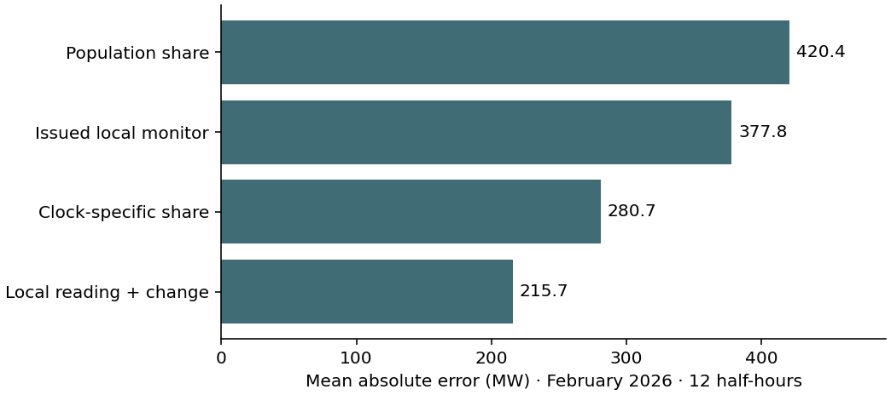

# Which inputs support a forward constraint calculation?

- In a second February 2026 sample, broad Sydney day-ahead error was 420.4 MW for population and 280.7 MW for a clock-specific electrical share.
- At Bango a 5 MW error budget allows about 4.2 MVA of rating error with other terms fixed.
- The previous-afternoon QNI forecast missed seven economic binds across 72 dispatch intervals.

A regional demand forecast determines one part of the future dispatch state. The same NSW demand can coexist with different pump schedules, local solar output, interconnector transfers and switch positions. A useful forward estimate starts with the terms that can materially change the limit and assigns each an observable baseline or a stated scenario.

On 23, 25 and 28 February, starting from measured Sydney-area load and applying its historical share of the regional demand change reduced previous-afternoon error to 215.7 MW. The issued monitor recorded 377.8 MW on those dates but beat the electrical share in the earlier morning cohort. Delivery hour and forecast origin matter. For statewide rooftop solar, the issued previous-afternoon forecast recorded 217.8 MW error against 443.1 MW for a historical clock mean.

Plant behaviour depends on the asset. For the active battery in the sample, a historical clock profile recorded 52.6 MW previous-afternoon error against 105.7 MW for idle dispatch. The other battery remained close to idle. When offers or stored energy are unavailable, propagate feasible charge, idle and discharge paths through the equation.

Start with the effective equation version and recent public RHS. Replace an input when its plausible error can change the decision. Score the complete expression on coherent forecast vintages against persistence and the published RHS. A binding call also requires invocation and a forecast of weighted injections. The evaluations used AEMO regional runs as a substitute for the user's forecasts. They leave seasonal accuracy, longer horizons and actual client receipt times open.

## Choosing an input by operating condition

| Input | First source | Regional fallback |
|---|---|---|
| Constants and shared equations | Resolve dated coefficients and recursively expand the applicable RHS | Use the exact definition |
| Local load | Decode the matching issued monitor and verify its definition | Fit local/region shares by delivery clock or regress on regional demand and rooftop PV using historical electrical labels |
| Regional demand | Reconcile regional demand and eligible scheduled loads against historical case inputs | Forecast eligible pumps separately or specify off and running schedules |
| Initial interconnector flow | Latest public metered flow or preceding target from the same forecast vintage | Use a signed clock/day-type baseline by link and scenario-test flow changes |
| Wind and solar trader MW | Latest signed SCADA or previously issued plant path where accessible | Use plant share of issued regional cleared generation or anchor plus regional change |
| Scheduled plant and pumping | Last observed unit state with public dated availability and outage schedule where available | Use unit clock/start/stop scenarios with ramp and capacity bounds |
| Storage | Latest unit MW and available state of charge with issue-time availability | Clock by unit plus idle/charge/discharge scenarios within power and energy limits |
| Rooftop solar | Use issued AEMO regional rooftop PV mean | Fit a local PV response or use installed-PV shares as an untested scenario |
| Thermal rating | Match the public standing rating and class to the equipment and confirm whether it is dynamic | Compare last rating and seasonal/clock rating and apply a weather scenario |
| Branch loading | Earlier terminal measurements or electrically matched state estimate | Fit a local relationship to regional dispatch and flows with topology fixed |
| Voltage and reactive power | Earlier point or published monitor with the same definition | Use local clock/regime baselines and high/low reactive and voltage scenarios |
| Inertia and system strength | Use the last published aggregate or sum eligible committed units with documented constants | Scenario-test likely unit combinations and synchronous condensers |
| Statuses and protection timers | Apply known switch logic with the latest public state and announced changes | Run discrete topology and timer scenarios |
| Entered settings and overrides | Use dated public entered forecast or a verified matching monitor | Carry last valid entry within its effective window and stress plausible alternatives |
| Basslink directional offers and mode | Use previously public directional offers and an issued flow direction as a switch proxy | Model outages and operating direction as joint scenarios |
| Previous-period references | Seed from earlier public result and recursively roll a consistent forecast path | Carry or clock benchmark and stress the first forecast step |
| Invocation and economic binding | Use issue-time set or outage information and matched public constraint solution | Run active and inactive scenarios plus a joint LHS/RHS range |

## Sources and evidence

- [February 2026 research record, method and supporting tables](../../local_exports/rhs_approximation_study/report.md)
- [ABS population release](https://www.abs.gov.au/statistics/people/population/regional-population/2023-24)
- [Transgrid data portal](https://tapr.transgrid.com.au/)
- [Western Sydney supply diagram](https://www.transgrid.com.au/media/wwpo0dlu/transgrid-pacr_macarthur.pdf)
- [AEMO predispatch](https://www.aemo.com.au/energy-systems/electricity/national-electricity-market-nem/data-nem/market-management-system-mms-data/pre-dispatch)
