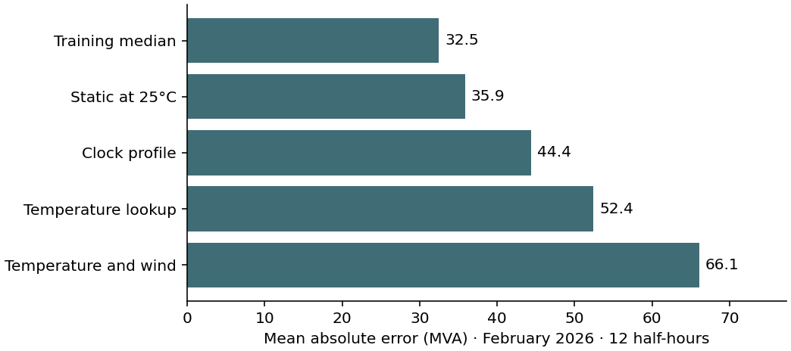

# Terminal loading and the Bango thermal limit

- Six dispatch inputs reproduced 240 Bango limits within 0.00000050 MW.
- Substituting the 146 MVA fallback for the applied 125 MVA rating raised the calculated RHS by 25.14 MW.
- Across twelve held-out half-hours, the issued previous-afternoon RHS recorded 6.95 MW mean absolute error.

Bango's equation takes the margin between the applicable rating and measured apparent power at the nominated terminal, deducts a fixed allowance, and adds four weighted trader injections. One additional MVA of rating lifts the limit by 1.197 MW with other terms fixed. One additional MVA of terminal loading lowers it by the same amount. A farm and its export line can move together, so their errors also need a joint test.

The public standing record identified the summer-day rating before the evaluation. At short leads, updating recent public observations with regional changes recorded 3.68 MW error against 4.00 MW for persistence. Using a forecast left-hand side, persistence nevertheless detected four of seven binding intervals with two false alerts. A small improvement in average RHS error need not improve the event decision.

For the dynamic Red Cliffs–Wemen rating, a training median recorded 32.45 MVA error against 52.42 MVA for a temperature-based static lookup and 66.10 MVA for a temperature and wind regression. The comparison covers three February mornings. The public fallback curve remains useful for testing an alternative operating assumption.

### Bango thermal limit, terminal loading and renewable units

| Forecast of Bango dispatch RHS | P5MIN half-hour MAE, MW | Previous-afternoon half-hour MAE, MW |
|---|---:|---:|
| Carry forward latest published Bango dispatch RHS | 4.00 | 36.79 |
| Move latest state by issued regional changes | 3.68 | 22.41 |
| Allocate issued NSW wind and solar by historical plant shares, model line loading | 10.85 | 14.26 |
| Historical average for matching half-hour | 11.03 | 11.03 |
| AEMO issued constraint RHS | 7.20 | 6.95 |

### Bango thermal limit, terminal loading and renewable units

| Input and unit | Recent state, short MAE | Regional generation shares, short MAE | Regional generation shares, previous-afternoon MAE | Matching clock, previous-afternoon MAE |
|---|---:|---:|---:|---:|
| Bango terminal apparent power, MVA | 6.09 | 20.51 | 25.04 | 37.00 |
| BANGOWF1 wind initial MW | 4.39 | 13.90 | 19.89 | 36.37 |
| GOONSF1 solar initial MW | 4.13 | 13.65 | 12.75 | 11.10 |
| JEMALNG1 solar initial MW | 3.68 | 10.43 | 10.87 | 14.19 |
| PARSF1 solar initial MW | 3.10 | 10.18 | 9.51 | 8.26 |

### Equipment ratings that can and cannot be fixed in advance

| Dynamic Red Cliffs rating estimate | MAE, MVA across 12 held-out half-hours |
|---|---:|
| Median rating across 28 training half-hours, 384.25 MVA | 32.45 |
| Public 25°C static fallback, 374 MVA | 35.87 |
| Historical matching half-hour | 44.43 |
| Apply forecast air temperature to public static curve, round up to next 5°C | 52.42 |
| Fit rating to forecast temperature and wind speed on earlier dates | 66.10 |

## Sources and evidence

- [February 2026 research record, method and supporting tables](../../local_exports/rhs_approximation_study/thermal/report.md)
- [AEMO effective-dated equation table](https://www.nemweb.com.au/Data_Archive/Wholesale_Electricity/MMSDM/2025/MMSDM_2025_12/MMSDM_Historical_Data_SQLLoader/DATA/PUBLIC_ARCHIVE%23GENERICCONSTRAINTRHS%23FILE01%23202512010000.zip)
- [AEMO intermittent generation forecast access](https://markets-portal-help.docs.public.aemo.com.au/Content/IntermittentGen/Forecasts.htm)
- [Archived public network standing data](https://www.nemweb.com.au/Reports/ARCHIVE/Network/PUBLIC_NETWORK_20260213.zip)
- [AEMO seasonal and temperature application rules](https://www.aemo.com.au/energy-systems/electricity/national-electricity-market-nem/data-nem/network-data/transmission-equipment-ratings/alternative-value-application-ratings)
